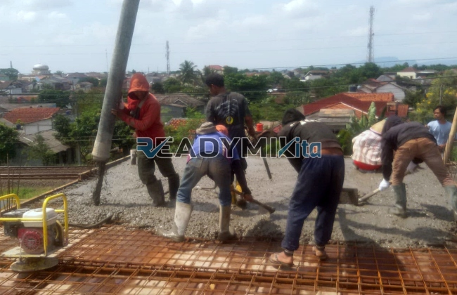

**Jasa Cor Readymix di Jatijajar Depok Murah** - Hai Mitra Readymix Kita! Sedang berencana membangun atau mengembangkan proyek di Jatijajar Depok? Mencari solusi pengecoran yang cepat, kuat, dan terpercaya? Nah, Anda sudah berada di tempat yang tepat! Kami dari Readymix Kita hadir sebagai penyedia beton cor readymix dan jasa sewa concrete pump terbaik di Jatijajar Depok Murah, siap mendukung kesuksesan proyek Anda.



## Mengapa Memilih Beton Readymix untuk Proyek Anda?

Beton readymix, atau beton cor siap pakai, adalah solusi modern dalam konstruksi. Diproduksi di pabrik dengan formulasi presisi dan kontrol kualitas ketat, beton ini kemudian diantarkan langsung ke lokasi proyek Anda. Apa saja keunggulannya? Mari kita lihat lebih detail:

1. **Efisiensi Waktu dan Biaya**

   Dibandingkan dengan mencampur beton secara manual, readymix menghemat waktu dan tenaga kerja secara signifikan. Ini berdampak langsung pada efisiensi biaya keseluruhan proyek Anda.

2. **Kualitas Terjamin Konsisten**

   Proses produksi terkontrol memastikan setiap batch beton readymix memiliki kualitas yang sama, meminimalkan risiko kegagalan struktur akibat ketidakseragaman campuran.

3. **Produksi Masif, Fleksibilitas Tinggi**

   Kapasitas produksi beton readymix sangat besar, memungkinkan kami memenuhi kebutuhan proyek skala kecil maupun besar dengan cepat dan responsif.

4. **Dukungan Ramah Lingkungan**

   Dengan sistem produksi yang terkelola, beton readymix meminimalkan pemborosan material dan dampak negatif terhadap lingkungan.

## Apa yang Membuat ReadymixKita Unggul di Jatijajar Depok?

Di antara banyaknya penyedia jasa di Jatijajar Depok Murah, **ReadymixKita** menawarkan nilai lebih yang akan membuat Anda puas. Kami bukan sekadar supplier beton, tapi mitra terpercaya dalam mewujudkan konstruksi impian Anda:

1. **Pengalaman dan Reputasi Teruji**

   Bertahun-tahun berkecimpung di industri konstruksi menjadikan kami memahami seluk-beluk proyek dan kebutuhan spesifik pelanggan di Jatijajar Depok.

2. **Pilihan Mutu Beton yang Lengkap**

   Kami menyediakan beragam kelas mutu beton, mulai dari K-225 hingga K-500, disesuaikan dengan kebutuhan proyek Anda. Kami bantu Anda memilih kelas yang paling tepat.

3. **Peralatan Mutakhir dan Terawat**

   Seluruh proses pengecoran didukung oleh peralatan modern, termasuk concrete pump yang handal, memastikan pengecoran cepat, presisi, dan merata.

4. **Tim Ahli yang Siap Membantu**

   Tim profesional kami siap memberikan konsultasi teknis, membantu perencanaan, dan mengawasi pelaksanaan pengecoran di lapangan.

## Layanan Kami yang Terjangkau di Jatijajar Depok

Sebagai penyedia lokal di Jatijajar Depok, kami memahami karakteristik wilayah ini dan menawarkan layanan yang disesuaikan:

1. **Pengiriman Tepat Waktu**

   Lokasi pabrik kami yang strategis memungkinkan pengiriman beton readymix yang cepat dan tepat waktu ke seluruh area Jatijajar Depok.

2. **Konsultasi Gratis dan Personal**

   Kami menawarkan layanan konsultasi gratis untuk membantu Anda menentukan jenis beton, metode pengecoran, dan perkiraan kebutuhan material yang akurat.

3. **Penawaran Istimewa untuk Pelanggan Lokal**

   Nikmati harga spesial dan diskon menarik bagi pelanggan proyek konstruksi di wilayah Jatijajar Depok Murah. Kami berkomitmen mendukung pembangunan lokal!

## Harga Terjangkau dan Promo Menarik

Kami percaya bahwa kualitas tidak harus mahal. **ReadymixKita** menawarkan:

1. **Harga Kompetitif dan Transparan**

   Kami berkomitmen memberikan harga yang bersaing tanpa mengorbankan kualitas. Informasi harga lengkap, termasuk biaya pengiriman dan sewa concrete pump, tersedia jelas.

2. **Promo dan Diskon Beragam**

   Dapatkan diskon menarik untuk pemesanan dalam jumlah besar atau proyek jangka panjang. Cek promo terbaru kami!

3. **Jaminan Kepuasan Pelanggan**

   Kami menjamin kepuasan Anda. Jika ada kendala, tim kami siap memberikan solusi cepat dan tepat.

## Daftar Harga Jasa Cor Readymix di Jatijajar Depok



Jangan tunda proyek Anda lagi! Percayakan pengecoran Anda pada ahlinya. Segera hubungi kami untuk konsultasi gratis dan penawaran terbaik di Jatijajar Depok Murah. [Jasa Cor Readymix di Abadijaya Depok Murah](/readymix/jasa-cor-readymix-di-abadijaya-depok-murah/) bisa jadi referensi proyek serupa yang sudah sukses kami tangani.

Kami siap memberikan layanan terbaik untuk memastikan proyek Anda berjalan lancar, efisien, dan menghasilkan konstruksi yang kokoh dan tahan lama. ReadymixKita – Mitra Terbaik Anda untuk Pengecoran Berkualitas di Jatijajar Depok! Bangun dengan keyakinan, bangun bersama kami!