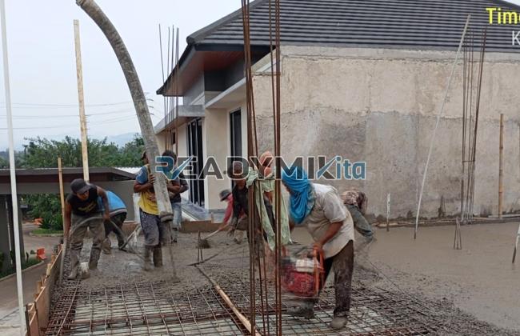

**Jasa Cor Readymix di Kampung Tengah Jakarta Murah** - Hai Mitra Readymix Kita! Punya rencana membangun di Kampung Tengah Jakarta? Nah, Anda sudah berada di tempat yang tepat! Kami dari Readymix Kita hadir sebagai solusi pengecoran readymix yang efisien, andal, dan berkualitas tinggi untuk setiap kebutuhan proyek Anda. Proyek kecil atau besar, kami siap membantu!



## Mengapa Memilih Pengecoran dengan Readymix?

Beton Cor Readymix: apa sih keunggulannya? Singkatnya, beton readymix adalah campuran beton yang diproduksi secara presisi di pabrik modern. Proses ini memastikan kualitas yang konsisten dan pengiriman yang cepat langsung ke lokasi proyek Anda. Yuk, simak keunggulan utamanya:

1. **Hemat Waktu & Tenaga Kerja**

   Lupakan proses pencampuran manual yang memakan waktu dan tenaga. Dengan readymix, waktu pengerjaan proyek Anda jadi lebih singkat karena beton sudah siap pakai saat tiba di lokasi.

2. **Kualitas Terjamin Konsisten**

   Akurasi takaran bahan baku dan penggunaan peralatan canggih memastikan mutu beton readymix selalu stabil dan sesuai standar. Risiko kegagalan konstruksi akibat campuran yang tidak tepat? Minimal!

3. **Fleksibilitas Kapasitas Produksi**

   Kebutuhan beton dalam jumlah besar untuk proyek besar? Atau hanya sedikit untuk perbaikan kecil? Readymix Kita siap memenuhi permintaan berapapun dengan cepat dan efisien.

4. **Dukungan Ramah Lingkungan**

   Proses produksi readymix yang lebih terkontrol meminimalkan limbah material di lokasi proyek, berkontribusi pada praktik konstruksi yang lebih berkelanjutan.

## Kenapa ReadymixKita adalah Pilihan Tepat di Kampung Tengah Jakarta?

Di Kampung Tengah Jakarta yang dinamis, Anda punya banyak pilihan penyedia jasa pengecoran. Tapi, **ReadymixKita** menawarkan lebih dari sekadar beton berkualitas. Inilah yang membedakan kami:

1. **Pengalaman dan Reputasi Terpercaya**

   Bertahun-tahun berkecimpung di industri konstruksi membuat kami memahami seluk-beluk proyek, mulai dari rumah tinggal hingga infrastruktur kompleks. Kami mengutamakan kepuasan pelanggan.

2. **Pilihan Mutu Beton yang Komprehensif**

   Kami menyediakan berbagai kelas mutu beton, mulai dari K-225 yang umum digunakan hingga K-500 yang sangat kuat untuk proyek berat. Pilihan yang tepat untuk setiap kebutuhan konstruksi Anda.

3. **Teknologi Pengecoran Modern**

   Kami menggunakan peralatan canggih seperti concrete pump untuk mempercepat proses pengecoran dan memastikan hasil yang rata dan sempurna.

4. **Tim Profesional yang Siap Membantu**

   Tim kami terdiri dari para ahli yang siap memberikan solusi terbaik untuk proyek Anda, mulai dari perencanaan hingga pelaksanaan di lapangan. Kami fleksibel dan menyesuaikan dengan jadwal Anda.

## Layanan Kami yang Disesuaikan untuk Kampung Tengah Jakarta

Sebagai penyedia lokal di Kampung Tengah Jakarta, kami memahami betul tantangan konstruksi di wilayah ini. Mulai dari kepadatan penduduk hingga variasi kondisi tanah dan medan, kami siap menghadapinya.

1. **Pengiriman Tepat Waktu**

   Kami menjamin pengiriman beton readymix tepat waktu, mengingat lokasi pabrik kami yang strategis di dekat Kampung Tengah Jakarta.

2. **Konsultasi Teknis Gratis**

   Butuh saran tentang jenis beton yang paling cocok untuk proyek Anda? Tim ahli kami siap memberikan konsultasi gratis dan rekomendasi terbaik.

3. **Penawaran Spesial untuk Proyek Lokal**

   Khusus untuk pelanggan di wilayah Kampung Tengah Jakarta, kami menawarkan harga spesial dan diskon menarik untuk proyek-proyek tertentu.

## Harga Terjangkau dan Promo Menarik di Kampung Tengah Jakarta

Kami percaya bahwa kualitas tidak harus mahal. **ReadymixKita** berkomitmen untuk memberikan harga yang kompetitif dan promo menarik tanpa mengorbankan mutu beton readymix kami.

1. **Harga yang Bersaing**

   Kami menawarkan harga yang wajar dan transparan, termasuk biaya pengiriman dan penggunaan concrete pump (jika diperlukan).

2. **Promo Menggiurkan**

   Dapatkan diskon khusus untuk pemesanan dalam jumlah besar atau proyek jangka panjang.

3. **Jaminan Kepuasan Pelanggan**

   Kami menjamin kualitas beton readymix dan layanan kami. Jika ada masalah, tim kami akan segera menyelesaikan hingga Anda puas.

## Daftar Harga Jasa Cor Readymix di Kampung Tengah Jakarta



Jangan tunda lagi! Dapatkan beton readymix berkualitas tinggi untuk proyek Anda di Kampung Tengah Jakarta. Hubungi kami sekarang untuk konsultasi gratis dan penawaran terbaik!

Kami juga siap membantu Anda dalam survei lokasi dan perencanaan proyek. Percayakan pengecoran Anda kepada ahlinya: ReadymixKita. Bersama kami, Anda bisa membangun masa depan dengan fondasi yang kuat dan kokoh di Kampung Tengah Jakarta! [Jasa Cor Readymix di Bale Kambang Jakarta Murah](/readymix/jasa-cor-readymix-di-bale-kambang-jakarta-murah/) dapat menjadi referensi tambahan mengenai layanan premium kami.