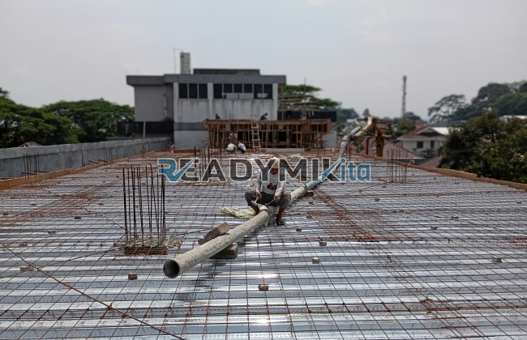

**Jasa Cor Readymix di Karet Semanggi Jakarta Murah** - Hai Mitra Readymix Kita! Punya proyek konstruksi di Karet Semanggi Jakarta dan butuh beton berkualitas tinggi? Atau mungkin Anda sedang mencari cara untuk mempercepat pengerjaan proyek tanpa mengorbankan mutu? Nah, Anda sudah berada di tempat yang tepat! Kami dari Readymix Kita hadir sebagai solusi pengecoran readymix yang andal dan efisien di Karet Semanggi Jakarta Murah.



## Mengapa Memilih Cor Readymix untuk Proyek Anda?

Beton Cor Readymix, atau sering disebut beton siap pakai, adalah material konstruksi yang dicampur secara presisi di pabrik modern. Dengan formula yang terukur dan bahan baku berkualitas tinggi, beton ini kemudian diangkut langsung ke lokasi proyek Anda menggunakan truk mixer. Daripada repot mencampur sendiri, yuk simak keunggulan yang ditawarkan beton Cor Readymix:

1. **Efisiensi Waktu dan Tenaga**

   Waktu adalah uang, kan? Dengan beton readymix, Anda menghemat waktu dan tenaga yang signifikan. Pencampuran sudah dilakukan di pabrik, jadi Anda bisa fokus pada tahapan konstruksi lainnya.

2. **Konsistensi Kualitas Terjamin**

   Kualitas beton yang tidak konsisten bisa berakibat fatal. Readymix memastikan kualitas yang seragam karena pencampuran dilakukan dengan takaran yang tepat dan peralatan modern.

3. **Kapasitas Produksi Fleksibel**

   Proyek kecil atau besar, readymix siap memenuhi kebutuhan Anda. Kami dapat menyediakan volume beton sesuai dengan skala proyek Anda.

4. **Solusi Lebih Ramah Lingkungan**

   Proses produksi readymix yang terkelola dengan baik membantu mengurangi limbah material dan dampak negatif terhadap lingkungan.

## ReadymixKita: Partner Pengecoran Terpercaya di Karet Semanggi Jakarta

Lantas, kenapa harus memilih **ReadymixKita** di antara sekian banyak penyedia jasa pengecoran di Karet Semanggi Jakarta? Tentu saja karena keunggulan yang kami tawarkan:

1. **Pengalaman dan Keahlian Teruji**

   Dengan pengalaman bertahun-tahun di industri ini, kami memahami seluk-beluk konstruksi dan kebutuhan spesifik proyek Anda – mulai dari perumahan, gedung komersial, hingga infrastruktur.

2. **Pilihan Mutu Beton Lengkap**

   Kami menyediakan berbagai kelas mutu beton, termasuk K-225, K-300, hingga K-500. Pastinya ada pilihan yang tepat untuk konstruksi Anda.

3. **Didukung Peralatan Mutakhir**

   Kami menggunakan peralatan modern seperti pompa beton (concrete pump) untuk memastikan pengecoran cepat, merata, dan efisien.

4. **Tim Profesional yang Siap Membantu**

   Tim kami terdiri dari tenaga ahli yang siap memberikan panduan ahli, mulai dari perencanaan hingga implementasi di lokasi proyek Anda. Layanan kami fleksibel dan bisa disesuaikan dengan jadwal proyek Anda.

## Layanan Kami di Karet Semanggi Jakarta dan Sekitarnya

Sebagai penyedia jasa lokal, kami sangat memahami karakteristik wilayah Karet Semanggi Jakarta dan sekitarnya. Baik itu kepadatan penduduk, aksesibilitas jalan, atau kondisi tanah, kami siap menghadapi tantangan. Kami menawarkan:

1. **Pengiriman Tepat Waktu**

   Lokasi pabrik kami yang strategis memungkinkan kami menjamin pengiriman beton tepat waktu, sehingga proyek Anda tidak tertunda.

2. **Konsultasi Gratis**

   Kami menyediakan layanan konsultasi gratis untuk membantu Anda menentukan jenis beton dan metode pengecoran yang paling sesuai dengan kebutuhan proyek Anda.

3. **Penawaran Khusus untuk Proyek Lokal**

   Untuk proyek-proyek di wilayah Karet Semanggi Jakarta, kami menawarkan harga spesial dan diskon menarik.

## Harga Terjangkau dan Promo Menarik

Kami mengerti bahwa anggaran adalah pertimbangan penting dalam setiap proyek konstruksi. Itulah sebabnya **ReadymixKita** menawarkan:

1. **Harga yang Kompetitif**

   Kami berkomitmen memberikan harga yang kompetitif tanpa mengorbankan kualitas beton. Untuk informasi harga lengkap, termasuk biaya pengiriman dan alat tambahan seperti concrete pump, lihat tabel di atas.

2. **Promo dan Diskon**

   Nikmati berbagai promo menarik untuk pemesanan dalam jumlah besar atau proyek jangka panjang.

3. **Kepuasan Pelanggan sebagai Prioritas**

   Kepuasan Anda adalah prioritas kami. Jika ada kendala dalam proses pengecoran, tim kami akan berusaha semaksimal mungkin untuk memberikan solusi.

## Daftar Harga Jasa Cor Readymix di Karet Semanggi Jakarta



Yuk, jangan tunda lagi! Pastikan proyek Anda berjalan lancar dan menghasilkan konstruksi yang kuat dan tahan lama dengan menggunakan jasa Pengecoran dg Cor Readymix dari ReadymixKita di Karet Semanggi Jakarta Murah.

Kami siap membantu Anda dengan layanan survei lokasi dan konsultasi gratis. Segera pesan sekarang dan rasakan perbedaan kualitas dan pelayanan dari ReadymixKita. Jangan sampai mutu konstruksi Anda terkompromi – percayakan pada ahlinya! Bersama ReadymixKita, proyek Anda kuat dan awet! [Jasa Cor Readymix di Abadijaya Depok Murah](/readymix/jasa-cor-readymix-di-abadijaya-depok-murah/) menawarkan solusi serupa untuk kebutuhan konstruksi Anda di Depok.