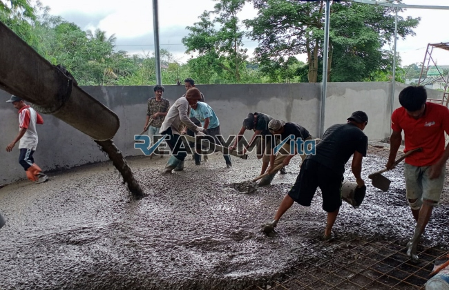

**Jasa Cor Readymix di Kebonsirih Jakarta Murah** - Hai Mitra Readymix Kita! Ada proyek konstruksi di Kebonsirih Jakarta? Kami hadir sebagai solusi pengecoran readymix yang andal dan efisien. Kecepatan, kualitas, dan harga bersaing – itulah komitmen kami untuk kesuksesan proyek Anda.



## Mengapa Memilih Beton Readymix untuk Proyek Anda?

Beton Cor Readymix adalah campuran beton yang diproduksi di pabrik dengan presisi tinggi, menggunakan material pilihan terbaik. Selanjutnya, material ini diangkut langsung ke lokasi proyek menggunakan truk mixer. Lantas, apa saja keunggulan memilih beton ready mix dibandingkan metode tradisional?

1. **Waktu dan Biaya Lebih Efisien**

   Proses pengecoran konvensional seringkali lama dan membutuhkan banyak tenaga. Dengan readymix, waktu pengerjaan proyek berkurang signifikan karena beton sudah siap pakai.

2. **Kualitas Terjamin Konsisten**

   Pencampuran beton readymix menggunakan takaran yang akurat dan teknologi modern, menghasilkan kualitas beton yang stabil dan terpercaya. Ini meminimalkan risiko kegagalan struktur akibat kesalahan takaran.

3. **Fleksibilitas Kapasitas**

   Kapasitas produksi beton readymix sangat fleksibel, mampu memenuhi kebutuhan proyek kecil, menengah, hingga skala besar dalam waktu singkat.

4. **Dampak Lingkungan Lebih Rendah**

   Proses produksi yang terkelola dengan baik di pabrik readymix membantu mengurangi limbah material konstruksi secara keseluruhan.

## Keunggulan Jasa ReadymixKita di Kebonsirih Jakarta

Di antara sekian banyak penyedia, **ReadymixKita** menawarkan nilai lebih yang menjadikan kami pilihan utama di Kebonsirih Jakarta:

1. **Pengalaman dan Keandalan**

   Berbekal pengalaman bertahun-tahun di industri konstruksi, kami memahami tantangan dan kebutuhan berbagai proyek – mulai dari pembangunan residensial, komersial, hingga infrastruktur publik.

2. **Pilihan Mutu Beton yang Lengkap**

   Kami menyediakan beragam kelas mutu beton, mulai dari K-225 yang ideal untuk pekerjaan standar hingga K-500 untuk proyek konstruksi dengan beban berat. Pilihan mutu beton kami disesuaikan dengan karakteristik proyek Anda.

3. **Peralatan Pengecoran Modern**

   Kami dilengkapi dengan peralatan pengecoran canggih, termasuk pompa beton (concrete pump) yang memastikan pengecoran cepat, merata, dan efisien.

4. **Tim Ahli yang Profesional**

   Tim kami terdiri dari tenaga ahli konstruksi yang siap memberikan konsultasi dan panduan, mulai dari perencanaan hingga pelaksanaan pengecoran di lapangan. Kami juga menawarkan layanan yang fleksibel, menyesuaikan dengan jadwal proyek Anda.

## Layanan Kami di Kebonsirih Jakarta dan Sekitarnya

Sebagai penyedia jasa lokal, kami memahami seluk-beluk konstruksi di Kebonsirih Jakarta. Variasi kondisi lahan dan lingkungan di wilayah ini menjadi perhatian utama kami. **ReadymixKita** menawarkan layanan khusus untuk mengatasi tantangan tersebut:

1. **Pengiriman Tepat Waktu**

   Kami memastikan pengiriman beton readymix tepat waktu ke lokasi proyek Anda di Kebonsirih Jakarta dan sekitarnya, didukung oleh lokasi pabrik strategis dan armada transportasi yang handal.

2. **Konsultasi Teknis Gratis**

   Kami menyediakan layanan konsultasi gratis untuk membantu Anda menentukan jenis beton yang paling sesuai dengan kebutuhan proyek, serta metode pengecoran yang optimal.

3. **Penawaran Spesial untuk Proyek Lokal**

   Pelanggan yang berlokasi di Kebonsirih Jakarta berhak mendapatkan harga khusus dan diskon menarik untuk proyek-proyek konstruksi yang sedang berjalan.

## Harga Terjangkau dan Penawaran Menarik di Kebonsirih Jakarta

Kami memahami pentingnya anggaran dalam setiap proyek. **ReadymixKita** hadir dengan solusi:

1. **Harga yang Bersaing**

   Kami menawarkan harga beton readymix yang kompetitif tanpa mengorbankan kualitas material dan layanan. Kami selalu transparan dalam memberikan informasi harga, termasuk biaya pengiriman dan penggunaan concrete pump.

2. **Promo dan Diskon**

   Manfaatkan promo menarik dan diskon khusus untuk pemesanan dalam jumlah besar atau proyek pembangunan jangka panjang.

3. **Jaminan Kepuasan**

   Kami berkomitmen untuk memberikan solusi konstruksi terbaik. Jika ada kendala selama proses pengecoran, tim kami siap membantu hingga proyek Anda selesai dengan sempurna.

## Informasi Harga Jasa Cor Readymix di Kebonsirih Jakarta



Jangan biarkan kualitas material menjadi penghalang kesuksesan proyek Anda. Hubungi **ReadymixKita** sekarang dan dapatkan solusi pengecoran terbaik di Kebonsirih Jakarta!

Kami juga menyediakan layanan survei lokasi gratis untuk membantu Anda menentukan kebutuhan beton yang tepat. Segera pesan dan rasakan manfaat konstruksi yang kuat, tahan lama, serta efisien. [Jasa Cor Readymix di Balaraja Tangerang Murah](/readymix/jasa-cor-readymix-di-balaraja-tangerang-murah/) bisa menjadi referensi tambahan dalam perencanaan proyek Anda.

ReadymixKita berkomitmen untuk menjadi mitra terpercaya dalam setiap langkah konstruksi Anda. Dengan pengalaman, kualitas produk, dan layanan yang responsif, kami yakin dapat membantu Anda mewujudkan proyek impian Anda. Hubungi kami sekarang juga untuk merasakan perbedaannya! Bangun masa depan Anda dengan pondasi yang kokoh bersama ReadymixKita.