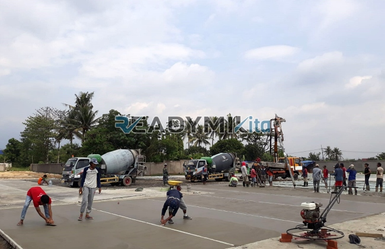

**Jasa Cor Readymix di Kelapa Dua Tangerang Murah** - Hai Mitra Readymix Kita! Apakah Anda sedang merencanakan pembangunan di Kelapa Dua Tangerang? Mencari solusi pengecoran yang cepat, berkualitas, dan yang paling penting, terjangkau? Nah, Anda sudah berada di tempat yang tepat! Kami dari Readymix Kita hadir sebagai solusi beton readymix terbaik untuk proyek Anda di Kelapa Dua Tangerang Murah. Dengan pengalaman bertahun-tahun, kami siap mendukung kesuksesan konstruksi Anda.



## Mengapa Memilih Layanan Readymix untuk Proyek Anda?

Sebagai penyedia beton cor readymix terkemuka, kami paham betul betapa pentingnya fondasi yang kuat untuk setiap bangunan. Beton Cor Readymix adalah campuran beton yang diproduksi secara presisi di pabrik modern, menggunakan bahan baku berkualitas prima. Lalu, campuran ini diantarkan langsung ke lokasi proyek menggunakan truk mixer khusus. Apa saja kelebihan menggunakan readymix dibandingkan metode tradisional? Yuk, kita simak:

1. **Hemat Waktu dan Tenaga**

   Proses pencampuran beton di lokasi proyek memakan waktu dan sumber daya yang besar. Dengan readymix, Anda langsung mendapatkan beton siap pakai, mempercepat penyelesaian proyek Anda secara signifikan.

2. **Kualitas Terjamin Konsisten**

   Dengan takaran yang tepat dan kontrol kualitas ketat di pabrik, beton readymix memastikan konsistensi mutu di setiap pengiriman. Ini meminimalkan risiko kegagalan struktur akibat campuran yang tidak tepat.

3. **Skalabilitas Produksi**

   Beton Cor Readymix mampu memenuhi kebutuhan volume besar dengan cepat, ideal untuk proyek skala kecil maupun besar.

4. **Dukungan Ramah Lingkungan**

   Proses produksi readymix yang terkontrol menghasilkan lebih sedikit limbah material di lokasi konstruksi, berkontribusi pada praktik pembangunan berkelanjutan.

## Keunggulan ReadymixKita di Kelapa Dua Tangerang Murah

Di antara banyaknya pilihan penyedia jasa pengecoran di Kelapa Dua Tangerang, ReadymixKita menawarkan nilai tambah yang tak tertandingi:

1. **Pengalaman dan Kepercayaan Pelanggan**

   Kami telah lama berkecimpung di industri konstruksi, menghadirkan solusi pengecoran yang teruji untuk berbagai jenis proyek, mulai dari bangunan residensial hingga infrastruktur kompleks.

2. **Pilihan Mutu Beton yang Lengkap**

   Kami menyediakan beragam kelas mutu beton, mulai dari K-225 yang ideal untuk pekerjaan standar hingga K-500 untuk konstruksi berat. Setiap kelas mutu dirancang untuk memenuhi kebutuhan spesifik proyek Anda.

3. **Teknologi Pengecoran Modern**

   Kami dilengkapi dengan peralatan pengecoran mutakhir, termasuk pompa beton (concrete pump), yang menjamin pengecoran cepat, efisien, dan merata, bahkan di area yang sulit dijangkau.

4. **Tim Ahli yang Siap Membantu**

   Tim kami terdiri dari para profesional berpengalaman yang siap memberikan konsultasi, panduan, dan dukungan teknis sepanjang proyek Anda berlangsung. Kami selalu beradaptasi dengan jadwal dan kebutuhan Anda.

## Solusi Pengecoran yang Disesuaikan untuk Kelapa Dua Tangerang

Kami memahami karakteristik unik Kelapa Dua Tangerang dan sekitarnya. Kondisi geografis yang beragam, dari area padat penduduk hingga lahan berbukit, memerlukan pendekatan pengecoran yang tepat. Berikut layanan khusus yang kami tawarkan:

1. **Pengiriman Tepat Waktu**

   Dengan lokasi yang strategis di Kelapa Dua Tangerang, kami menjamin pengiriman beton readymix yang tepat waktu, meminimalkan keterlambatan proyek Anda.

2. **Konsultasi Teknis Gratis**

   Tim ahli kami siap memberikan konsultasi gratis untuk membantu Anda memilih jenis beton dan metode pengecoran yang paling sesuai dengan kebutuhan proyek Anda.

3. **Penawaran Khusus untuk Proyek Lokal**

   Kami menghargai kepercayaan Anda. Klien di Kelapa Dua Tangerang berhak mendapatkan penawaran khusus dan diskon menarik untuk proyek-proyek besar.

## Harga Bersaing dan Promo Menarik di Kelapa Dua Tangerang

Kami percaya bahwa kualitas tidak harus mahal. ReadymixKita berkomitmen untuk memberikan harga yang kompetitif tanpa mengorbankan mutu beton. Kami menawarkan:

1. **Harga Transparan dan Kompetitif**

   Kami memberikan informasi harga yang jelas dan terperinci, termasuk biaya pengiriman dan biaya tambahan untuk peralatan seperti pompa beton.

2. **Promo dan Diskon Spesial**

   Nikmati diskon menarik untuk pemesanan dalam jumlah besar atau proyek yang berlangsung dalam jangka waktu tertentu.

3. **Jaminan Kepuasan Pelanggan**

   Kami berkomitmen untuk memberikan layanan terbaik. Jika Anda mengalami kendala dalam proses pengecoran, tim kami siap membantu hingga proyek Anda selesai dengan memuaskan.

## Informasi Harga Jasa Cor Readymix di Kelapa Dua Tangerang



Jangan tunda lagi! Dapatkan solusi pengecoran yang andal dan terjangkau di Kelapa Dua Tangerang Murah. Hubungi kami sekarang untuk konsultasi gratis dan penawaran terbaik!

Kami juga menawarkan layanan survei lokasi untuk memastikan kebutuhan beton Anda dapat terpenuhi secara optimal. Segera pesan beton readymix dari ReadymixKita dan rasakan perbedaan kualitas dan pelayanan profesional. Bersama kami, bangun masa depan yang kokoh! [Jasa Cor Readymix di Balaraja Tangerang Murah](/readymix/jasa-cor-readymix-di-balaraja-tangerang-murah/) — untuk referensi, begini kami melayani tetangga Kelapa Dua!