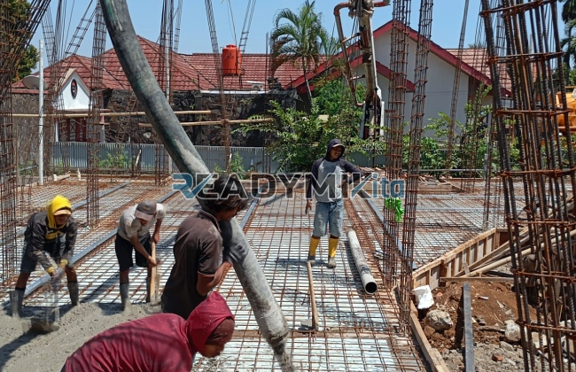

**Jasa Cor Readymix di Kemiri Muka Depok Murah** - Hai Mitra Readymix Kita! Punya rencana membangun di Kemiri Muka Depok? Mencari beton readymix berkualitas dengan harga bersaing? Nah, Anda berada di tempat yang tepat! Kami dari Readymix Kita hadir sebagai solusi pengecoran yang andal dan efisien untuk berbagai proyek konstruksi Anda. Mau tahu apa saja yang membuat kami berbeda? Yuk, simak terus artikel ini!



## Mengapa Pengecoran dengan Readymix adalah Pilihan Tepat?

Beton readymix, atau beton siap pakai, telah menjadi pilihan utama dalam dunia konstruksi modern. Lantas, apa sih yang membuat beton Cor Readymix begitu unggul? Prosesnya sendiri melibatkan pencampuran material di pabrik dengan presisi tinggi, kemudian diangkut langsung ke lokasi proyek menggunakan truk mixer. Keunggulan-keunggulan ini menjadikannya solusi ideal untuk kebutuhan konstruksi Anda:

1. **Hemat Waktu dan Tenaga:**
   Dengan beton readymix, Anda tak perlu lagi repot mencampur material di lokasi proyek. Proses ini memangkas waktu pengerjaan dan mengurangi kebutuhan tenaga kerja.

2. **Kualitas yang Terjamin Konsisten:**
   Pencampuran beton readymix dilakukan dengan takaran yang akurat dan menggunakan teknologi canggih, sehingga menghasilkan kualitas yang konsisten dan minim risiko kegagalan struktur.

3. **Kemampuan Produksi Skala Besar:**
   Butuh beton dalam jumlah besar? Beton Cor Readymix mampu memenuhi kebutuhan proyek dari skala kecil hingga besar dengan cepat dan efisien.

4. **Berkontribusi pada Lingkungan yang Lebih Baik:**
   Proses produksi beton Cor Readymix yang teratur membantu mengurangi limbah material di lokasi konstruksi, mendukung praktik konstruksi yang lebih ramah lingkungan.

## Keunggulan ReadymixKita di Kemiri Muka Depok

Di antara banyaknya penyedia jasa pengecoran di Kemiri Muka Depok, **ReadymixKita** menawarkan sejumlah keunggulan yang membedakan kami. Apa sajakah itu?

1. **Pengalaman dan Kepercayaan:**
   Kami telah lama berkecimpung di industri konstruksi dan memiliki pemahaman mendalam tentang kebutuhan setiap proyek, mulai dari pembangunan rumah tinggal hingga infrastruktur berskala besar.

2. **Pilihan Mutu Beton yang Beragam:**
   Kami menyediakan berbagai kelas mutu beton, termasuk K-225, K-300, hingga K-500, memastikan Anda mendapatkan material yang tepat untuk proyek Anda.

3. **Peralatan Canggih untuk Hasil Optimal:**
   Kami menggunakan peralatan modern seperti pompa beton (concrete pump) untuk memastikan pengecoran berlangsung cepat, merata, dan efisien.

4. **Tim Profesional yang Siap Membantu:**
   Tim ahli kami siap memberikan pendampingan dari tahap perencanaan hingga eksekusi di lapangan, dengan pelayanan yang fleksibel dan disesuaikan dengan jadwal proyek Anda.

## Layanan Kami yang Disesuaikan untuk Kemiri Muka Depok

Layanan kami tak hanya berkualitas, tapi juga disesuaikan dengan karakteristik unik Kemiri Muka Depok. Kami memahami tantangan konstruksi di wilayah ini, mulai dari kondisi jalan hingga kontur tanah.

1. **Pengiriman Tepat Waktu:**
   Lokasi pabrik kami yang strategis di Kemiri Muka Depok dan sekitarnya memungkinkan kami menjamin pengiriman beton yang tepat waktu ke lokasi proyek Anda.

2. **Konsultasi Gratis:**
   Kami menyediakan layanan konsultasi gratis untuk membantu Anda memilih jenis beton dan metode pengecoran yang paling sesuai dengan kebutuhan proyek Anda.

3. **Penawaran Khusus:**
   Khusus untuk pelanggan di Kemiri Muka Depok, kami menawarkan tarif spesial dan diskon menarik untuk proyek-proyek besar.

## Harga Kompetitif dan Penawaran Menarik

Kami percaya bahwa kualitas tidak harus selalu mahal. **ReadymixKita** berkomitmen untuk memberikan harga yang kompetitif tanpa mengorbankan mutu beton readymix.

1. **Harga Terjangkau dan Transparan:**
   Kami menawarkan harga yang bersaing dan transparan, dengan rincian biaya pengiriman dan peralatan tambahan seperti concrete pump tercantum dengan jelas.

2. **Promo dan Diskon:**
   Manfaatkan promo menarik untuk pemesanan dalam jumlah besar atau proyek jangka panjang.

3. **Jaminan Kepuasan:**
   Kepuasan Anda adalah prioritas kami. Jika ada masalah selama proses pengecoran, tim kami siap membantu hingga proyek Anda selesai dengan sempurna.

## Daftar Harga Jasa Cor Readymix di Kemiri Muka Depok



Jadi, tunggu apa lagi? Jangan biarkan proyek konstruksi Anda terhambat karena kualitas material yang meragukan. Segera hubungi kami untuk mendapatkan solusi pengecoran terbaik di Kemiri Muka Depok!

Nikmati kemudahan survei lokasi dan konsultasi gratis untuk memastikan kebutuhan Anda terpenuhi dengan tepat. Pesan sekarang juga dan rasakan ketenangan pikiran dengan fondasi yang kokoh dan bangunan yang tahan lama. [Jasa Cor Readymix di Abadijaya Depok Murah](/readymix/jasa-cor-readymix-di-abadijaya-depok-murah/) bisa jadi referensi lain untuk solusi kor berkualitas. Di ReadymixKita, kami berdedikasi untuk memberikan layanan terbaik bagi setiap pelanggan. Percayakan proyek Anda kepada kami dan lihat perbedaannya! Hubungi kami sekarang dan wujudkan impian konstruksi Anda bersama **ReadymixKita** – mitra terpercaya Anda di Kemiri Muka Depok. Bangun kokoh, bangun bersama kami!