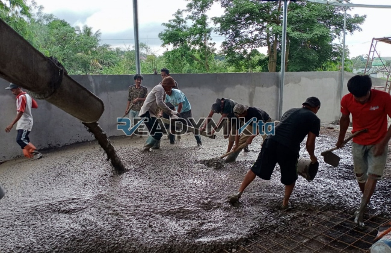

**Jasa Cor Readymix di Kosambi Tangerang Murah** - Hai Mitra Readymix Kita! Apakah Anda sedang merencanakan pembangunan di Kosambi Tangerang? Mencari solusi material konstruksi yang praktis, berkualitas, dan terpercaya? Nah, Anda sudah berada di tempat yang tepat! Kami dari Readymix Kita hadir untuk memberikan solusi pengecoran readymix terbaik di Kosambi Tangerang Murah dan sekitarnya. Kualitas terjamin, harga bersaing, dan layanan yang memuaskan – itu janji kami!



## Beton Readymix: Pilihan Cerdas untuk Konstruksi Modern

Mitra, tahukah Anda apa itu beton readymix? Sederhananya, beton readymix adalah campuran beton yang diproduksi secara sentral di pabrik kami dengan formulasi yang presisi dan menggunakan bahan baku pilihan. Kemudian, beton ini diantarkan langsung ke lokasi proyek menggunakan truk molen yang terus mengaduk agar konsistensinya tetap terjaga. Dibandingkan dengan metode konvensional, beton readymix punya segudang keunggulan, antara lain:

1. **Hemat Waktu dan Tenaga**

   Pencampuran beton di lokasi proyek pasti memakan waktu dan tenaga yang tidak sedikit. Dengan readymix, Anda langsung mendapatkan campuran siap pakai – fokus pada pembangunan, bukan lagi pada pembuatan beton!

2. **Kualitas Terjamin Konsisten**

   Di pabrik kami, setiap batch beton readymix melalui kontrol kualitas yang ketat dan menggunakan takaran yang presisi. Ini berarti, Anda mendapatkan mutu beton yang konsisten dari awal sampai akhir proyek.

3. **Skalabilitas Produksi**

   Kebutuhan beton untuk proyek besar? Tak masalah! Readymix Kita memiliki kapasitas produksi yang mumpuni untuk memenuhi permintaan dalam jumlah besar, tanpa mengorbankan kualitas.

4. **Dukungan Ramah Lingkungan**

   Proses produksi yang terpusat dan terkontrol menghasilkan lebih sedikit limbah material di lokasi proyek, sebuah langkah kecil untuk lingkungan yang lebih baik.

## Mengapa Memilih ReadymixKita di Kosambi Tangerang?

Antusiasme dukungan Anda adalah semangat kami! Di Kosambi Tangerang Murah, ada banyak penyedia jasa pengecoran. Lalu, kenapa harus memilih ReadymixKita? Ini alasannya:

1. **Pengalaman dan Kepercayaan**

   Bertahun-tahun di industri konstruksi menjadikan kami ahli dalam memahami setiap kebutuhan proyek, mulai dari pembangunan rumah tinggal, ruko, gedung komersial, hingga infrastruktur yang lebih kompleks.

2. **Pilihan Mutu Beton yang Lengkap**

   Kami menyediakan beragam grade beton readymix, mulai dari K-225 (untuk kebutuhan standar) hingga K-500 (untuk konstruksi yang membutuhkan kekuatan ekstra). Konsultasikan kebutuhan Anda, dan kami akan merekomendasikan solusi terbaik!

3. **Didukung Peralatan Canggih**

   Kami mengoperasikan armada pompa beton modern (concrete pump) yang memungkinkan pengecoran lebih cepat, efisien, dan merata, bahkan di area yang sulit dijangkau.

4. **Tim Solid dan Profesional**

   Tim ReadymixKita terdiri dari para ahli yang siap memberikan panduan teknis, mulai dari perencanaan awal hingga pelaksanaan di lapangan. Kami fleksibel dan akan menyesuaikan dengan jadwal proyek Anda.

## Layanan Kami yang Dirancang untuk Kosambi Tangerang

Sebagai bagian dari komunitas Kosambi Tangerang, kami memahami betul tantangan dan kebutuhan konstruksi di wilayah ini. Kondisi geografis yang beragam, mulai dari area padat hingga area perbukitan, memerlukan solusi yang tepat. Berikut layanan khusus yang kami tawarkan:

1. **Pengiriman Tepat Waktu**

   Kami menjamin pengiriman beton readymix yang tepat waktu ke lokasi proyek Anda di Kosambi Tangerang dan sekitarnya. Lokasi pabrik kami yang strategis mendukung efisiensi pengiriman.

2. **Konsultasi Proyek Gratis**

   Bingung memilih jenis beton yang tepat? Jangan khawatir! Kami menyediakan layanan konsultasi gratis untuk membantu Anda menentukan solusi terbaik sesuai kebutuhan proyek Anda.

3. **Penawaran Spesial untuk Proyek Lokal**

   Khusus untuk proyek-proyek di Kosambi Tangerang, kami menawarkan harga spesial dan diskon menarik, terutama untuk proyek skala besar.

## Harga Beton Readymix yang Bersahabat di Kosambi Tangerang

Kami percaya bahwa kualitas tidak harus mahal. **ReadymixKita** berkomitmen untuk memberikan harga yang kompetitif dan transparan tanpa mengorbankan kualitas.

1. **Harga Terjangkau**

   Kami menawarkan harga yang bersaing di pasar, tanpa biaya tersembunyi. Informasi harga, termasuk biaya pengiriman dan sewa concrete pump, akan kami sampaikan secara jelas dan transparan.

2. **Promo Menarik**

   Dapatkan berbagai promo menarik, seperti diskon pemesanan volume besar atau penawaran khusus untuk proyek jangka panjang.

3. **Kepuasan Pelanggan adalah Prioritas**

   Kami berkomitmen untuk memberikan layanan terbaik dan memastikan kepuasan Anda. Jika ada kendala, tim kami akan segera memberikan solusi terbaik.

## Daftar Harga Jasa Cor Readymix di Kosambi Tangerang



Jangan tunda lagi! Segera hubungi tim ReadymixKita untuk mendapatkan penawaran terbaik dan konsultasi gratis. Kami siap membantu mewujudkan proyek konstruksi impian Anda di Kosambi Tangerang dan sekitarnya.

Kami juga menyediakan layanan survei lokasi untuk memastikan kesesuaian kebutuhan beton dengan kondisi lapangan. Pesan sekarang dan rasakan sendiri kemudahan serta kualitas unggulan dari ReadymixKita! [Baca juga tentang pentingnya memilih supplier readymix yang tepat di sini.](/[Jasa Cor Readymix di Abadijaya Depok Murah](/readymix/jasa-cor-readymix-di-abadijaya-depok-murah/)) Bersama ReadymixKita, bangunan Anda akan berdiri kokoh dan awet!