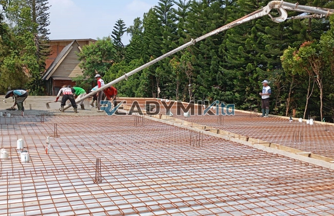

**Jasa Cor Readymix di Lebak Bulus Jakarta Murah** - Hai Mitra Readymix Kita! Mau bangun rumah, kantor, atau infrastruktur lain di Lebak Bulus Jakarta? Kami punya solusi pengecoran yang cepat, praktis, dan terpercaya. Readymix Kita hadir sebagai mitra konstruksi Anda, siap menyediakan beton cor readymix berkualitas tinggi dengan harga yang bersahabat. Yuk, simak keunggulan memilih layanan kami!



## Mengapa Memilih Pengecoran dengan Readymix?

Apa sih beton Cor Readymix itu? Singkatnya, ini adalah campuran beton yang sudah jadi, diproduksi dengan presisi di pabrik modern menggunakan bahan-bahan terbaik. Prosesnya? Tinggal pesan, lalu kami kirim langsung ke lokasi proyek Anda dengan truk mixer khusus. Nah, dibanding cara konvensional, ada banyak banget kelebihannya:

1. **Hemat Waktu & Tenaga:**

   Nggak perlu repot lagi bikin campuran beton sendiri di lokasi proyek. Dengan readymix, waktu pengerjaan jadi lebih singkat karena semua proses pencampuran sudah dilakukan di pabrik.

2. **Kualitas Terjamin:**

   Beton Cor Readymix dibuat dengan takaran yang akurat dan teknologi modern, jadi kualitasnya selalu konsisten dan bisa diandalkan. Ini penting banget buat kekuatan dan keamanan bangunan Anda.

3. **Skala Produksi Fleksibel:**

   Butuh beton dalam jumlah besar atau kecil? Nggak masalah! Readymix bisa mengakomodasi kebutuhan proyek Anda, mulai dari pembangunan rumah sederhana sampai gedung bertingkat.

4. **Lebih Ramah Lingkungan:**

   Proses produksi readymix lebih terkontrol, sehingga meminimalkan limbah material dan dampaknya terhadap lingkungan.

## Apa yang Membuat ReadymixKita Unggul di Lebak Bulus Jakarta?

Di Lebak Bulus Jakarta, banyak penyedia jasa cor readymix. Tapi, kenapa harus pilih **ReadymixKita**? Ini dia alasannya:

1. **Pengalaman & Kepercayaan:**

   Kami sudah lama berkecimpung di dunia konstruksi dan punya banyak pengalaman menangani berbagai jenis proyek, dari perumahan hingga infrastruktur besar. Kepercayaan pelanggan adalah prioritas kami.

2. **Pilihan Mutu Beton Lengkap:**

   Kami menyediakan beragam kelas mutu beton, mulai dari K-225 (standar) sampai K-500 (untuk konstruksi berat). Konsultasikan kebutuhan proyek Anda, dan kami akan bantu memilih mutu yang tepat.

3. **Teknologi Pengecoran Modern:**

   Kami menggunakan peralatan canggih, seperti *concrete pump*, untuk memastikan proses pengecoran cepat, merata, dan efisien.

4. **Tim Ahli yang Profesional:**

   Tim kami siap memberikan panduan, mulai dari perencanaan hingga pelaksanaan di lapangan. Kami juga fleksibel dan bisa menyesuaikan dengan jadwal proyek Anda.

## Layanan Khusus untuk Proyek di Lebak Bulus Jakarta

Sebagai penyedia lokal, kami paham betul tantangan konstruksi di Lebak Bulus Jakarta. Mulai dari kondisi tanah yang beragam, sampai akses jalan yang mungkin terbatas. Untuk itu, kami menawarkan:

1. **Pengiriman Tepat Waktu:**

   Lokasi pabrik kami yang strategis di Lebak Bulus Jakarta memungkinkan kami mengirimkan beton tepat waktu, sesuai jadwal proyek Anda.

2. **Konsultasi Teknis Gratis:**

   Bingung memilih jenis beton yang sesuai? Jangan khawatir! Kami menyediakan layanan konsultasi gratis untuk membantu Anda menentukan solusi terbaik.

3. **Penawaran Spesial untuk Pelanggan Lokal:**

   Khusus untuk proyek di Lebak Bulus Jakarta, kami menawarkan harga spesial dan diskon menarik.

## Harga Terjangkau & Promo Menarik di Lebak Bulus Jakarta

Kami mengerti bahwa anggaran adalah hal penting dalam setiap proyek. **ReadymixKita** berkomitmen untuk memberikan:

1. **Harga Bersaing:**

   Kami menawarkan harga yang kompetitif tanpa mengorbankan kualitas beton. Kami juga memberikan informasi harga yang transparan, termasuk biaya pengiriman dan penggunaan alat seperti concrete pump.

2. **Promo & Diskon:**

   Dapatkan diskon menarik untuk pemesanan volume besar atau proyek jangka panjang.

3. **Kepuasan Pelanggan Terjamin:**

   Kami memberikan garansi kepuasan! Jika ada masalah selama proses pengecoran, tim kami akan membantu sampai proyek Anda selesai sempurna.

## Daftar Harga Jasa Cor Readymix di Lebak Bulus Jakarta



Jangan biarkan kualitas bangunan Anda kompromi karena material yang kurang baik. Percayakan pengecoran Anda pada ahlinya! Segera hubungi kami untuk mendapatkan solusi terbaik di Lebak Bulus Jakarta.

Kami juga menyediakan layanan survei lokasi dan konsultasi gratis. Pesan sekarang dan rasakan sendiri hasil konstruksi yang berkualitas, kokoh, dan tahan lama.

Mau bangun kuat dan awet? Pilihlah jasa Pengecoran dengan Cor Readymix dari ReadymixKita! Langsung hubungi tim kami untuk penawaran terbaik di Lebak Bulus Jakarta. Bersama ReadymixKita, bangunan impian Anda terwujud! [Jasa Cor Readymix di Bale Kambang Jakarta Murah](/readymix/jasa-cor-readymix-di-bale-kambang-jakarta-murah/) — temukan layanan serupa untuk area lain di Jakarta.