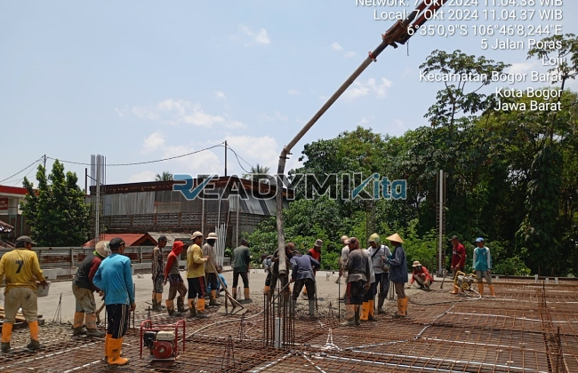

**Jasa Cor Readymix di Mangga Dua Jakarta Murah** - Hai Mitra Readymix Kita! Apakah Anda sedang merencanakan pembangunan di Mangga Dua Jakarta? Mencari solusi pengecoran yang cepat, praktis, dan berkualitas? Nah, Anda sudah berada di tempat yang tepat! Kami dari Readymix Kita siap menjadi mitra terpercaya Anda dalam menghadirkan fondasi yang kuat dan tahan lama untuk proyek Anda di Mangga Dua Jakarta Murah. Pengecoran dengan readymix bukan sekadar pilihan, tapi investasi cerdas untuk efisiensi dan kualitas bangunan Anda.



## Mengapa Memilih Pengecoran Dengan Readymix?

Beton readymix, atau beton cor siap pakai, adalah solusi modern dalam dunia konstruksi. Dibuat di pabrik dengan kontrol kualitas ketat dan dikirim langsung ke lokasi proyek dengan truk mixer, readymix menawarkan banyak keuntungan dibandingkan metode tradisional. Apa saja kelebihannya?

1. **Hemat Waktu dan Biaya Tenaga**

   Pembuatan beton di lokasi membutuhkan waktu dan tenaga kerja yang signifikan. Dengan readymix, proses ini sudah dilakukan di pabrik, mempercepat penyelesaian proyek Anda secara keseluruhan.

2. **Kualitas Terjamin dan Konsisten**

   Readymix diproduksi dengan takaran yang presisi dan bahan baku berkualitas, menjamin mutu beton yang konsisten. Ini meminimalkan risiko kesalahan pencampuran yang berpotensi merusak kekuatan struktur.

3. **Fleksibilitas Kapasitas Produksi**

   Baik untuk proyek kecil maupun besar, readymix dapat diproduksi dalam jumlah yang sesuai kebutuhan Anda, tanpa membuang-buang material.

4. **Kontribusi Positif Bagi Lingkungan**

   Proses produksi readymix yang terkontrol mengurangi limbah material di lokasi proyek, menjadikannya pilihan yang lebih ramah lingkungan.

## Keunggulan Memilih ReadymixKita di Mangga Dua Jakarta?

Di antara banyaknya penyedia jasa pengecoran di Mangga Dua Jakarta Murah, **ReadymixKita** menawarkan nilai tambah yang signifikan. Apa yang membuat kami berbeda?

1. **Pengalaman dan Keahlian Teruji**

   Bertahun-tahun pengalaman di industri konstruksi menjadikan kami paham betul akan kebutuhan dan tantangan berbagai proyek, mulai dari bangunan residensial hingga infrastruktur skala besar.

2. **Pilihan Mutu Beton yang Lengkap**

   Kami menyediakan beragam pilihan mutu beton, seperti K-225 untuk aplikasi standar, hingga K-500 untuk konstruksi yang membutuhkan kekuatan ekstra. Masing-masing dirancang untuk memenuhi spesifikasi proyek Anda.

3. **Peralatan Mutakhir untuk Efisiensi Maksimal**

   Kami menggunakan peralatan modern, termasuk pompa beton (concrete pump) canggih, untuk memastikan proses pengecoran berlangsung cepat, merata, dan efisien.

4. **Tim Profesional yang Siap Mendukung Anda**

   Tim ahli kami siap membantu Anda mulai dari tahap perencanaan, pemilihan mutu beton yang tepat, hingga pelaksanaan pengecoran di lokasi. Kami juga menawarkan fleksibilitas jadwal untuk menyesuaikan dengan kebutuhan proyek Anda di Mangga Dua Jakarta.

## Layanan Khusus Kami untuk Proyek di Mangga Dua Jakarta

Sebagai penyedia jasa lokal, kami memahami betul karakteristik proyek-proyek di Mangga Dua Jakarta. Baik itu kepadatan lalu lintas, kondisi tanah yang beragam, atau aksesibilitas lokasi, kami siap menghadapinya.

1. **Pengiriman Tepat Waktu, Tanpa Hambatan**

   Jaringan distribusi kami yang luas dan armada pengiriman yang andal menjamin beton readymix sampai di lokasi Anda tepat waktu, khususnya di kawasan Mangga Dua Jakarta Murah.

2. **Konsultasi Gratis dari Ahli Kami**

   Tim konsultan kami siap memberikan saran dan rekomendasi terbaik mengenai jenis beton, metode pengecoran, dan solusi konstruksi yang paling sesuai untuk proyek Anda.

3. **Penawaran Khusus untuk Pelanggan Lokal**

   Kami menawarkan harga spesial dan diskon menarik bagi pelanggan yang berlokasi di wilayah Mangga Dua Jakarta dan sekitarnya.

## Investasi Cerdas dengan Harga Terjangkau di Mangga Dua Jakarta

Kami percaya bahwa kualitas tidak harus mahal. **ReadymixKita** berkomitmen untuk menyediakan solusi pengecoran readymix yang terjangkau tanpa mengorbankan mutu dan layanan.

1. **Harga Kompetitif yang Transparan**

   Kami menawarkan harga yang bersaing dan transparan, tanpa biaya tersembunyi. Informasi harga lengkap, termasuk biaya pengiriman dan penggunaan pompa beton, tersedia untuk Anda.

2. **Promo Menarik untuk Pesanan Besar**

   Dapatkan diskon eksklusif untuk pemesanan dalam jumlah besar atau proyek konstruksi jangka panjang.

3. **Jaminan Kepuasan Pelanggan**

   Kami berkomitmen untuk memberikan layanan terbaik dan memastikan kepuasan Anda. Jika ada kendala, tim kami siap membantu hingga proyek Anda selesai dengan sempurna.

## Informasi Harga Jasa Cor Readymix di Mangga Dua Jakarta



Jangan biarkan kualitas material yang buruk mengganggu kelancaran dan kekuatan proyek Anda. Pilih **ReadymixKita** sebagai mitra terpercaya Anda untuk pengecoran readymix di Mangga Dua Jakarta Murah! Kami siap memberikan solusi terbaik dan hasil yang memuaskan.

Hubungi kami sekarang untuk mendapatkan penawaran khusus dan konsultasi gratis! Kami juga menawarkan layanan survei lokasi untuk memastikan Anda mendapatkan solusi pengecoran readymix yang paling tepat. Pesan sekarang dan rasakan kemudahan, efisiensi, dan kualitas terbaik dari ReadymixKita. Bangunlah masa depan yang kokoh bersama kami! [Jasa Cor Readymix di Balaraja Tangerang Murah](/readymix/jasa-cor-readymix-di-balaraja-tangerang-murah/) bisa menjadi inspirasi untuk konsep bangunan yang kuat dan tahan lama.