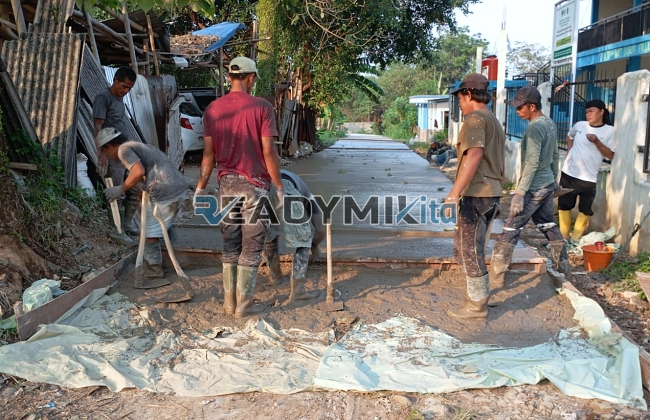

**Jasa Cor Readymix di Mekarsari Depok Murah** - Hai Mitra Readymix Kita! Punya proyek konstruksi di Mekarsari Depok dan butuh solusi pengecoran yang cepat, efisien, dan berkualitas? Nah, Anda sudah berada di tempat yang tepat! Kami dari Readymix Kita hadir sebagai penyedia jasa cor readymix terpercaya, siap mendukung kelancaran proyek Anda. Jangan biarkan kendala pencampuran beton atau keterlambatan pengiriman menghambat kemajuan pekerjaan Anda.



## Mengapa Memilih Cor Readymix untuk Proyek Anda?

Beton readymix adalah solusi modern untuk pengecoran, yang diproduksi secara presisi di pabrik kami menggunakan bahan baku terbaik. Proses ini memastikan kualitas yang konsisten dan meminimalkan risiko kesalahan yang sering terjadi pada pencampuran manual. Alih-alih berurusan dengan proses yang rumit di lokasi proyek, beton siap pakai ini langsung diantar ke lokasi Anda dengan truk mixer khusus. Apa saja keunggulannya?

1. **Hemat Waktu dan Sumber Daya**

   Pengerjaan pengecoran jadi lebih cepat karena tidak perlu lagi menyiapkan bahan baku dan mencampur sendiri. Ini memangkas waktu dan biaya tenaga kerja secara signifikan.

2. **Kualitas Terjamin Konsisten**

   Dengan formula yang tepat dan kontrol kualitas yang ketat, beton readymix menghasilkan mutu yang seragam. Investasi ini mengurangi risiko kerusakan struktur akibat beton yang tidak sempurna.

3. **Fleksibilitas Volume Pengecoran**

   Baik untuk proyek kecil maupun besar, kami mampu menyediakan beton dalam volume yang sesuai kebutuhan. Ini menghindarkan Anda dari pemborosan material.

4. **Dukungan Pembangunan Berkelanjutan**

   Proses produksi beton readymix yang terkontrol membantu mengurangi limbah dan dampak negatif terhadap lingkungan.

## Keunggulan Jasa Readymix Kita di Mekarsari Depok

Di Mekarsari Depok Murah, banyak sekali penyedia jasa cor readymix. Lantas, kenapa Anda harus memilih Readymix Kita? Berikut beberapa alasan yang akan meyakinkan Anda:

1. **Pengalaman dan Reputasi Teruji**

   Kami telah lama berkecimpung dalam industri ini dan memiliki pengalaman menangani berbagai jenis proyek konstruksi, mulai dari perumahan pribadi hingga proyek komersial besar.

2. **Pilihan Mutu Beton yang Lengkap**

   Kami menyediakan beragam kelas mutu beton, termasuk K-225, K-300, K-350, hingga K-500. Pilihan ini memungkinkan Anda memilih beton yang paling sesuai dengan spesifikasi proyek Anda.

3. **Didukung Peralatan Canggih**

   Kami dilengkapi dengan truk mixer modern dan pompa beton (concrete pump) yang handal. Peralatan ini memastikan pengiriman dan pengecoran beton berlangsung lancar dan efisien.

4. **Tim Profesional yang Siap Membantu**

   Tim kami terdiri dari tenaga ahli yang berpengalaman dan berkomitmen untuk memberikan layanan terbaik kepada Anda. Kami siap membantu Anda mulai dari perencanaan hingga penyelesaian proyek.

## Layanan Kami yang Dirancang Khusus untuk Mekarsari Depok

ReadymixKita memahami betul karakteristik wilayah Mekarsari Depok Murah. Kami telah mengamati dan menyesuaikan layanan kami agar dapat memberikan solusi terbaik bagi para pelanggan di daerah ini:

1. **Pengiriman Tepat Waktu dan Efisien**

   Kami berkomitmen untuk mengirimkan beton readymix tepat waktu, mengantisipasi potensi kemacetan dan kendala lalu lintas di Mekarsari Depok.

2. **Konsultasi Teknis Gratis**

   Kami menawarkan layanan konsultasi gratis untuk membantu Anda menentukan jenis beton yang paling sesuai dengan kebutuhan proyek Anda, serta memberikan saran teknis terkait metode pengecoran yang optimal.

3. **Penawaran Istimewa untuk Proyek Lokal**

   Sebagai bentuk apresiasi kepada pelanggan di Mekarsari Depok Murah, kami menawarkan promo khusus dan diskon menarik untuk proyek-proyek lokal.

## Harga Terjangkau dan Penawaran Menarik di Mekarsari Depok

Kami percaya bahwa kualitas tidak harus mahal. Oleh karena itu, Readymix Kita berkomitmen untuk memberikan harga yang kompetitif dan terjangkau bagi para pelanggan di Mekarsari Depok.

1. **Harga Transparan dan Bersaing**

   Kami memberikan informasi harga yang jelas dan rinci, termasuk biaya pengiriman dan biaya tambahan lainnya. Anda tidak perlu khawatir akan biaya tersembunyi.

2. **Promo dan Diskon Spesial**

   Nikmati berbagai promo menarik dan diskon spesial untuk pemesanan dalam jumlah besar atau proyek jangka panjang.

3. **Jaminan Kepuasan Pelanggan**

   Kami menjamin kepuasan Anda terhadap kualitas beton dan layanan yang kami berikan. Jika ada masalah, kami akan segera menyelesaikannya hingga Anda puas.

## Informasi Harga Jasa Cor Readymix di Mekarsari Depok



Jangan tunda lagi! Segera hubungi tim Readymix Kita untuk mendapatkan penawaran harga terbaik dan solusi pengecoran yang tepat untuk proyek Anda di Mekarsari Depok Murah.

Kami siap memberikan layanan survei lokasi gratis untuk membantu Anda menentukan kebutuhan beton yang tepat. Pesan sekarang dan rasakan kemudahan, efisiensi, dan kualitas yang hanya bisa Anda dapatkan dari Readymix Kita! [Jasa Cor Readymix di Abadijaya Depok Murah](/readymix/jasa-cor-readymix-di-abadijaya-depok-murah/) — cek juga layanan kami di area Abadijaya, Depok. Di ReadymixKita, kesuksesan proyek Anda adalah prioritas utama kami. Bangun masa depan yang kokoh bersama kami!