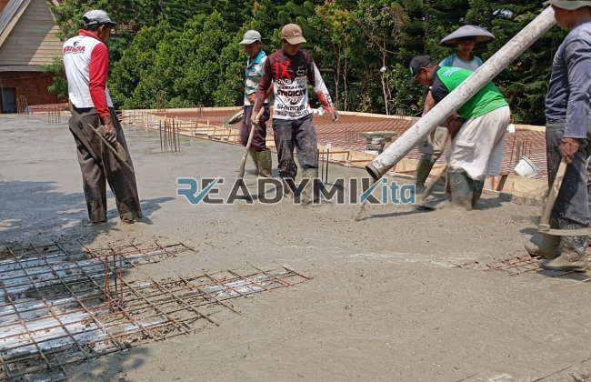

**Jasa Cor Readymix di Palmerah Jakarta Murah** - Hai Mitra Readymix Kita! Proyek konstruksi di Palmerah Jakarta sedang berjalan? Atau ada rencana membangun segera? Nah, Anda sudah berada di tempat yang tepat! Kami hadir sebagai solusi pengecoran readymix yang praktis, cepat, dan berkualitas tinggi untuk semua kebutuhan proyek Anda. Beton siap pakai ini akan menyelesaikan masalah pencampuran dan transportasi material di lokasi kerja Anda.



## Mengapa Memilih Pengecoran dengan Readymix?

Mungkin Anda bertanya-tanya, apa sih kelebihan beton *Cor Readymix* dibandingkan cara tradisional? Sederhananya, beton readymix adalah campuran beton yang dibuat di pabrik dengan formula presisi, lalu diantar langsung ke lokasi Anda menggunakan truk molen. Ini memberikan sejumlah keuntungan signifikan:

1. **Hemat Waktu & Biaya Tenaga**

   Proses pencampuran manual membutuhkan waktu dan tenaga kerja yang besar. Dengan readymix, waktu pengerjaan proyek Anda dipangkas drastis, sekaligus mengurangi biaya operasional.

2. **Kualitas Terjamin Konsisten**

   Formula beton readymix dibuat dengan takaran yang akurat menggunakan mesin modern. Hasilnya? Kualitas beton yang seragam dan dapat diandalkan untuk kekuatan struktur yang optimal.

3. **Fleksibilitas Kapasitas Produksi**

   Baik untuk proyek kecil seperti pembangunan rumah atau proyek besar seperti gedung bertingkat, readymix siap memenuhi kebutuhan volume beton Anda dengan cepat.

4. **Dukungan Ramah Lingkungan**

   Proses produksi readymix lebih terkontrol dan efisien, meminimalkan pemborosan material dan mengurangi dampak negatif terhadap lingkungan.

## Keunggulan Jasa Readymix Kita di Palmerah Jakarta

Di Palmerah Jakarta, banyak penyedia jasa readymix. Lalu, kenapa Anda harus memilih **ReadymixKita**? Ini dia alasannya:

1. **Pengalaman & Reputasi Teruji**

   Selama bertahun-tahun, kami telah melayani beragam proyek konstruksi, dari perumahan pribadi hingga proyek komersial skala besar. Kepercayaan pelanggan adalah prioritas utama kami. 

2. **Pilihan Kelas Mutu Beton Lengkap**

   Kami menyediakan berbagai kelas mutu beton, mulai dari K-225 (untuk pondasi sederhana) hingga K-500 (untuk struktur dengan beban berat). Pilihlah yang paling sesuai dengan kebutuhan proyek Anda.

3. **Didukung Peralatan Pengecoran Modern**

   Dengan armada truk mixer dan pompa beton (concrete pump) yang canggih, kami memastikan pengiriman dan pengecoran beton berlangsung cepat, presisi, dan merata.

4. **Tim Ahli Konstruksi yang Profesional**

   Kami memiliki tim yang terdiri dari tenaga ahli berpengalaman yang siap membantu Anda mulai dari perencanaan, pemilihan material, hingga proses pengecoran di lokasi proyek.

## Layanan Kami yang Disesuaikan untuk Palmerah Jakarta

Kami memahami betul karakteristik wilayah Palmerah Jakarta. Permukiman padat, jalanan sempit, dan kondisi tanah yang bervariasi menuntut solusi pengecoran yang tepat. Itulah mengapa kami menawarkan:

1. **Pengiriman Tepat Waktu**

   Dengan jaringan distribusi yang luas dan armada yang handal, kami menjamin pengiriman beton readymix tepat waktu ke lokasi proyek Anda di Palmerah Jakarta.

2. **Konsultasi Teknis Gratis**

   Tak yakin jenis beton apa yang paling cocok untuk proyek Anda? Jangan ragu untuk berkonsultasi dengan tim ahli kami. Kami akan membantu Anda membuat keputusan yang tepat.

3. **Penawaran Spesial untuk Pelanggan Lokal**

   Sebagai bentuk komitmen kepada masyarakat Palmerah Jakarta, kami menawarkan penawaran harga spesial dan diskon menarik untuk proyek-proyek lokal.

## Harga Beton Readymix di Palmerah Jakarta: Terjangkau & Kompetitif

Kami percaya bahwa kualitas tidak harus mahal. **ReadymixKita** berkomitmen untuk memberikan harga yang kompetitif dengan tetap mempertahankan standar kualitas tertinggi. 

1. **Harga Bersaing & Transparan**

   Kami menawarkan harga yang bersaing di pasar Palmerah Jakarta. Harga yang kami tawarkan juga transparan dan mudah dipahami.

2. **Promo Menarik & Diskon Volume**

   Dapatkan diskon khusus untuk pemesanan volume besar atau proyek dengan jangka waktu yang lama. Jangan lewatkan promo-promo menarik lainnya yang kami tawarkan!

3. **Jaminan Kepuasan Pelanggan**

   Kami berkomitmen untuk memberikan layanan terbaik kepada setiap pelanggan. Jika ada kendala dalam proses pengecoran, tim kami akan segera membantu untuk mencari solusi terbaik.

## Daftar Harga Terbaru Jasa Cor Readymix di Palmerah Jakarta



Jangan tunda lagi! Hubungi kami sekarang juga untuk mendapatkan penawaran harga terbaik dan solusi pengecoran readymix yang sesuai dengan kebutuhan proyek Anda di Palmerah Jakarta. 

Kami siap membantu Anda mewujudkan proyek konstruksi yang kuat, tahan lama, dan berkualitas tinggi. Pesan sekarang dan rasakan kemudahan serta efisiensi pengecoran dengan **ReadymixKita**! [Jasa Cor Readymix di Abadijaya Depok Murah](/readymix/jasa-cor-readymix-di-abadijaya-depok-murah/) bisa menjadi referensi tambahan, lho! Kami juga siap melakukan survei lokasi gratis untuk memastikan estimasi yang akurat.