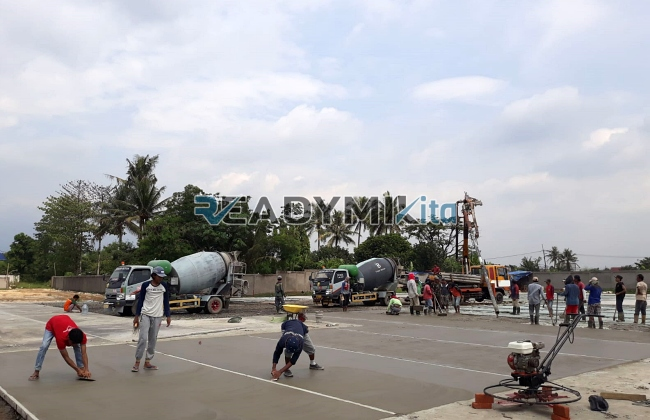

**Jasa Cor Readymix di Pangkalan Jati Depok Murah** - Hai Mitra Readymix Kita! Apakah Anda tengah merencanakan proyek pembangunan di Pangkalan Jati Depok? Mencari fondasi yang kuat dan solusi pengecoran praktis? Kami dari Readymix Kita hadir sebagai mitra terpercaya Anda. Kualitas terjamin, harga bersaing – yuk, simak bagaimana kami bisa mendukung kesuksesan proyek Anda!



## Keunggulan Memilih Beton Readymix untuk Proyek Anda

Beton Cor Readymix: solusi modern untuk konstruksi efisien. Apa sebenarnya beton readymix itu? Ini adalah campuran beton yang diproduksi secara presisi di pabrik, dengan kontrol kualitas ketat. Kemudian, campuran ini diantarkan langsung ke lokasi proyek menggunakan truk mixer khusus. Nah, apa saja keuntungannya dibandingkan metode tradisional?

1. **Hemat Waktu dan Biaya Operasional**

   Proses pencampuran di lokasi proyek seringkali memakan waktu dan sumber daya yang besar. Dengan readymix, Anda menghemat waktu pengerjaan secara signifikan karena beton sudah siap pakai saat tiba di lokasi.

2. **Kualitas Konsisten dan Terjamin**

   Kualitas beton adalah kunci kekuatan bangunan Anda. Readymix Kita menjamin konsistensi mutu karena menggunakan takaran yang tepat dan teknologi modern dalam pencampuran.

3. **Fleksibilitas Volume Produksi**

   Kebutuhan beton bisa bervariasi tergantung skala proyek. Readymix Kita mampu melayani proyek kecil maupun besar dengan kapasitas produksi yang fleksibel.

4. **Dukungan Ramah Lingkungan**

   Penggunaan readymix mengurangi limbah material di lokasi konstruksi, berkontribusi pada praktik pembangunan yang lebih berkelanjutan.

## Mengapa Readymix Kita adalah Pilihan Tepat di Pangkalan Jati Depok?

Di antara banyaknya penyedia jasa, **ReadymixKita** menawarkan keunggulan yang membedakan kami sebagai mitra ideal untuk proyek Anda di Pangkalan Jati Depok:

1. **Pengalaman dan Reputasi Terpercaya**

   Dengan pengalaman bertahun-tahun di industri ini, kami memahami seluk-beluk kebutuhan konstruksi, dari proyek perumahan hingga infrastruktur besar.

2. **Pilihan Mutu Beton yang Lengkap**

   Kami menyediakan berbagai kelas mutu beton, mulai dari K-225 untuk kebutuhan umum hingga K-500 untuk konstruksi berat. Setiap mutu dirancang untuk memenuhi kebutuhan spesifik proyek Anda.

3. **Didukung Peralatan Modern dan Canggih**

   Kami berinvestasi pada peralatan modern, termasuk *concrete pump*, untuk memastikan proses pengecoran berjalan cepat, merata, dan efisien.

4. **Tim Profesional Berdedikasi**

   Tim kami siap memberikan dukungan penuh, mulai dari konsultasi perencanaan hingga eksekusi di lapangan. Kami juga fleksibel dalam menyesuaikan jadwal dengan kebutuhan proyek Anda.

## Layanan Khusus Kami di Pangkalan Jati Depok dan Sekitarnya

Sebagai penyedia jasa lokal, **ReadymixKita** memahami betul karakteristik wilayah Pangkalan Jati Depok dan tantangan konstruksi yang mungkin dihadapi. Kami menawarkan solusi yang disesuaikan:

1. **Pengiriman Tepat Waktu dan Andal**

   Lokasi pabrik kami yang strategis memungkinkan kami menjamin pengiriman beton tepat waktu, menjaga kelancaran jadwal proyek Anda.

2. **Konsultasi Gratis untuk Kebutuhan Proyek Anda**

   Bingung memilih jenis beton yang tepat? Manfaatkan layanan konsultasi gratis kami! Kami bantu Anda menentukan solusi terbaik untuk proyek Anda.

3. **Penawaran Khusus untuk Proyek Lokal**

   Pelanggan di Pangkalan Jati Depok berhak mendapatkan penawaran khusus dan diskon menarik untuk proyek-proyek besar.

## Harga Terjangkau dan Promo Menarik di Pangkalan Jati Depok

Kami memahami bahwa biaya adalah pertimbangan penting dalam setiap proyek. **ReadymixKita** menawarkan:

1. **Harga Kompetitif dan Transparan**

   Kami memberikan harga yang bersaing tanpa mengorbankan kualitas. Informasi harga – termasuk biaya pengiriman dan *concrete pump* – disampaikan secara jelas dan terbuka.

2. **Promo Spesial untuk Volume Besar**

   Nikmati diskon menarik untuk pemesanan dalam jumlah besar atau proyek jangka panjang.

3. **Kepuasan Pelanggan adalah Prioritas Kami**

   Kami berkomitmen untuk memberikan layanan terbaik. Jika ada kendala selama proses pengecoran, tim kami siap membantu hingga proyek selesai dengan memuaskan.

## Informasi Harga Jasa Cor Readymix di Pangkalan Jati Depok



Jangan kompromikan kualitas bangunan Anda dengan material yang kurang terjamin. Segera hubungi kami untuk mendapatkan solusi pengecoran terbaik di Pangkalan Jati Depok! Kami juga menawarkan layanan survei lokasi gratis dan konsultasi mendalam untuk memastikan kebutuhan Anda terpenuhi secara optimal. Pesan readymix sekarang dan wujudkan konstruksi yang kuat, awet, dan sesuai harapan Anda. 

Kami juga hadir untuk membantu Anda menemukan solusi pengecoran terbaik yang sesuai dengan anggaran dan kebutuhan proyek Anda. Dengan Readymix Kita, Anda mendapatkan lebih dari sekadar beton: Anda mendapatkan kemitraan yang kokoh dan terpercaya untuk kesuksesan konstruksi Anda di Pangkalan Jati Depok dan sekitarnya. [Jasa Cor Readymix di Abadijaya Depok Murah](/readymix/jasa-cor-readymix-di-abadijaya-depok-murah/) bisa menjadi referensi tambahan untuk melihat solusi pengecoran di area Depok lainnya.