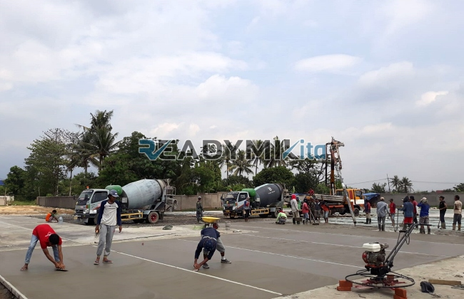

**Jasa Cor Readymix di Pegangsaan Jakarta Murah** - Hai Mitra Readymix Kita! Sedang merencanakan pembangunan di Pegangsaan Jakarta? Mencari material konstruksi yang andal dan efisien? Kami hadir sebagai solusi pengecoran readymix yang tepat untuk berbagai proyek Anda di ibukota. Kualitas terjamin, pengiriman cepat, dan harga bersaing – itulah komitmen kami!



## Mengapa Memilih Beton Readymix untuk Proyek Anda?

Apa itu beton readymix? Singkatnya, beton readymix adalah campuran beton siap pakai yang diproduksi secara presisi di pabrik kami, menggunakan bahan baku berkualitas tinggi. Proses ini memastikan kualitas yang konsisten dan optimal. Kemudian, beton siap tuang ini diantarkan langsung ke lokasi proyek Anda menggunakan truk molen. Berikut beberapa alasan kuat memilih beton readymix dibandingkan metode tradisional:

1. **Hemat Waktu dan Biaya Tenaga Kerja**

   Lupakan repotnya mencampur beton secara manual di lokasi proyek! Beton readymix datang siap pakai, memangkas waktu pengerjaan dan mengurangi kebutuhan tenaga kerja.

2. **Jaminan Kualitas yang Terukur**

   Dengan takaran material yang akurat dan proses produksi terkontrol, beton readymix kami menjamin mutu yang konsisten dan sesuai standar. Hal ini meminimalkan risiko kegagalan struktur akibat kesalahan pencampuran.

3. **Fleksibilitas untuk Skala Proyek Apapun**

   Baik proyek kecil rumahan maupun konstruksi besar seperti gedung bertingkat, kami mampu menyediakan beton readymix sesuai kebutuhan volume Anda.

4. **Dukungan Ramah Lingkungan**

   Proses produksi beton readymix yang efisien mengurangi limbah material di lokasi proyek, berkontribusi pada praktik konstruksi yang lebih berkelanjutan.

## Keunggulan ReadymixKita di Pegangsaan Jakarta

Di antara banyaknya penyedia beton readymix di Jakarta, **ReadymixKita** menawarkan keunggulan yang membedakan kami:

1. **Pengalaman dan Kepercayaan Pelanggan**

   Bertahun-tahun melayani proyek konstruksi di Pegangsaan Jakarta dan sekitarnya menjadikan kami ahli yang dapat Anda andalkan.

2. **Pilihan Mutu Beton yang Lengkap**

   Kami menyediakan berbagai kelas mutu beton, mulai dari K-225, K-300, hingga K-500, memastikan Anda mendapatkan campuran yang optimal untuk kebutuhan spesifik proyek Anda.

3. **Teknologi Pengecoran Modern**

   Kami dilengkapi dengan peralatan pengecoran modern, termasuk concrete pump yang handal, untuk memastikan pengecoran cepat, merata, dan efisien.

4. **Tim Ahli yang Siap Membantu**

   Tim profesional kami siap memberikan dukungan ahli, mulai dari konsultasi pemilihan material hingga pengawasan pelaksanaan di lapangan.

## Layanan Kami yang Disesuaikan untuk Pegangsaan Jakarta

Kami memahami betul karakteristik konstruksi di Pegangsaan Jakarta. Kondisi tanah dan akses lokasi yang beragam memerlukan solusi yang tepat. **ReadymixKita** menawarkan:

1. **Pengiriman Tepat Waktu**

   Jaringan logistik kami yang luas memastikan beton readymix tiba di lokasi proyek Anda tepat waktu, bahkan di tengah kemacetan Jakarta.

2. **Konsultasi Teknis Gratis**

   Dapatkan konsultasi gratis dari tim ahli kami untuk memilih jenis beton readymix yang paling sesuai dengan kebutuhan proyek Anda.

3. **Penawaran Spesial untuk Pelanggan Lokal**

   Nikmati harga spesial dan diskon menarik bagi pelanggan di wilayah Pegangsaan Jakarta untuk proyek-proyek besar.

## Harga Terjangkau dan Penawaran Menarik

Kami percaya kualitas tidak harus mahal. **ReadymixKita** berkomitmen untuk memberikan harga yang kompetitif tanpa mengorbankan mutu:

1. **Harga yang Transparan**

   Kami menawarkan harga yang jelas dan transparan, termasuk biaya pengiriman dan biaya sewa concrete pump (jika diperlukan).

2. **Promo dan Diskon**

   Dapatkan promo menarik untuk pemesanan dalam jumlah besar atau proyek dengan jangka waktu pengerjaan yang panjang.

3. **Jaminan Kepuasan Pelanggan**

   Kami berkomitmen untuk memberikan pengalaman terbaik bagi pelanggan kami. Jika Anda kurang puas dengan layanan kami, kami akan berupaya menyelesaikannya dengan sebaik mungkin.

## Informasi Harga Jasa Cor Readymix di Pegangsaan Jakarta



Jangan tunda lagi! Pastikan proyek Anda berjalan lancar dengan kualitas beton readymix terbaik dari **ReadymixKita** di Pegangsaan Jakarta. [Hubungi kami sekarang](URL) untuk konsultasi gratis dan penawaran harga spesial!

Kami juga membantu Anda merencanakan kebutuhan beton readymix yang tepat untuk proyek Anda, mulai dari perhitungan volume hingga pemilihan mutu beton yang sesuai. [Pesan sekarang](URL) dan rasakan kemudahan pengecoran dengan ReadymixKita!

Yuk, wujudkan proyek impian Anda bersama ReadymixKita – partner terpercaya dalam membangun Pegangsaan Jakarta yang lebih kuat dan berkelanjutan!