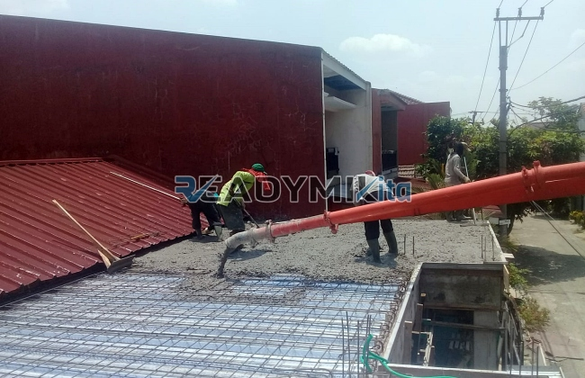

**Jasa Cor Readymix di Petamburan Jakarta Murah** - Hai Mitra Readymix Kita! Proyek konstruksi di Petamburan Jakarta sedang berjalan? Mencari fondasi yang kuat dan tahan lama? Nah, Anda sudah berada di tempat yang tepat! Kami hadir sebagai solusi pengecoran readymix terpercaya, memberikan kualitas terbaik dengan harga yang bersahabat. Yuk, simak bagaimana Readymix Kita bisa mendukung kesuksesan proyek Anda!



## Mengapa Memilih Beton Readymix untuk Proyek Anda?

Pernahkah Anda bertanya-tanya, apa sebenarnya beton readymix itu? Sederhananya, beton readymix adalah campuran beton yang diproduksi secara presisi di pabrik kami, menggunakan material pilihan. Kemudian, campuran ini diangkut langsung ke lokasi proyek Anda menggunakan truk mixer khusus. Ini berbeda dengan metode tradisional yang memerlukan pencampuran di lokasi. Berikut beberapa alasan kenapa readymix jadi pilihan cerdas:

1. **Efisiensi Waktu dan Tenaga Kerja**

   Pengerjaan beton manual memakan waktu dan tenaga yang tidak sedikit. Dengan readymix, Anda menghemat keduanya! Proses pencampuran sudah dilakukan di pabrik, mempercepat penyelesaian proyek Anda.

2. **Kualitas Terjamin Konsisten**

   Kualitas adalah prioritas utama kami. Setiap batch beton readymix diproduksi dengan takaran akurat dan teknologi modern, menjamin mutu yang konsisten dan meminimalkan risiko kegagalan struktur.

3. **Fleksibilitas Volume Produksi**

   Baik proyek kecil-kecilan maupun konstruksi berskala besar, kami siap memenuhi kebutuhan volume beton Anda dengan cepat dan efisien.

4. **Dukungan Ramah Lingkungan**

   Dengan proses produksi yang terkontrol, readymix menghasilkan lebih sedikit limbah material di lokasi proyek, berkontribusi pada praktik konstruksi yang lebih berkelanjutan.

## Mengapa ReadymixKita adalah Pilihan Terbaik di Petamburan Jakarta?

Di antara banyaknya penyedia jasa pengecoran readymix di Petamburan Jakarta, **ReadymixKita** menawarkan keunggulan yang membedakan kami:

1. **Pengalaman dan Kepercayaan Pelanggan**

   Selama bertahun-tahun, kami telah menjadi bagian dari berbagai proyek konstruksi, mulai dari rumah tinggal hingga infrastruktur publik. Pengalaman ini memungkinkan kami memahami seluk-beluk kebutuhan proyek Anda.

2. **Pilihan Mutu Beton yang Lengkap**

   Kami menyediakan berbagai jenis mutu beton, dari K-225 (untuk konstruksi umum) hingga K-500 (untuk aplikasi yang membutuhkan kekuatan ekstra). Kami bantu Anda memilih yang tepat sesuai kebutuhan.

3. **Teknologi Pengecoran Modern**

   Kami menggunakan peralatan canggih seperti pompa beton (concrete pump) untuk memastikan pengecoran cepat, merata, dan efisien.

4. **Tim Ahli yang Profesional**

   Tim kami terdiri dari para ahli yang siap memberikan konsultasi dan panduan, dari tahap perencanaan hingga pelaksanaan di lapangan. Kami fleksibel dan siap menyesuaikan dengan jadwal proyek Anda.

## Layanan Kami yang Dirancang untuk Kebutuhan Petamburan Jakarta

Sebagai penyedia jasa lokal di Petamburan Jakarta, kami memahami betul tantangan konstruksi di wilayah ini. Mulai dari kondisi jalan yang padat hingga terrain yang bervariasi, kami siap menghadapinya:

1. **Pengiriman Tepat Waktu**

   Kami berkomitmen untuk mengirimkan beton readymix tepat waktu, memanfaatkan lokasi pabrik kami yang strategis di Petamburan Jakarta dan rute pengiriman yang efisien.

2. **Konsultasi Bebas Biaya**

   Bingung memilih jenis beton yang tepat? Jangan ragu untuk berkonsultasi dengan tim ahli kami secara gratis! Kami bantu Anda menentukan solusi terbaik untuk proyek Anda.

3. **Penawaran Khusus Pelanggan Lokal**

   Khusus untuk pelanggan di wilayah Petamburan Jakarta, kami menawarkan harga spesial dan diskon menarik untuk proyek-proyek berukuran besar.

## Harga Terjangkau dan Promo Menarik di Petamburan Jakarta

Kami percaya bahwa kualitas tidak harus mahal. **ReadymixKita** menawarkan:

1. **Harga Bersaing**

   Kami menawarkan harga yang kompetitif tanpa mengorbankan kualitas beton readymix. Kami transparan dalam memberikan informasi harga, termasuk biaya pengiriman dan penggunaan alat bantu seperti concrete pump.

2. **Promo dan Diskon**

   Dapatkan diskon menarik untuk pemesanan dalam jumlah besar atau proyek jangka panjang. Jangan lewatkan penawaran spesial kami!

3. **Kepuasan Pelanggan Dijamin**

   Kami berkomitmen untuk memberikan layanan terbaik. Jika ada masalah dalam proses pengecoran, tim kami siap membantu sampai semuanya selesai dengan baik.

## Informasi Harga Jasa Cor Readymix di Petamburan Jakarta



Jangan tunda lagi! Pastikan proyek Anda berjalan lancar dengan beton readymix berkualitas dari **ReadymixKita** di Petamburan Jakarta.

Kami juga menyediakan layanan survei lokasi dan konsultasi gratis untuk membantu Anda merencanakan proyek Anda dengan tepat. Hubungi kami sekarang untuk mendapatkan penawaran terbaik dan rasakan pengalaman pengecoran yang profesional! [Jasa Cor Readymix di Balaraja Tangerang Murah](/readymix/jasa-cor-readymix-di-balaraja-tangerang-murah/) bisa menjadi referensi tambahan tentang layanan kami.

Dengan ReadymixKita, Anda mendapatkan lebih dari sekadar beton – Anda mendapatkan mitra terpercaya untuk membangun masa depan. Bangun impian Anda dengan kokoh bersama kami! Hubungi kami segera untuk mengetahui kualitas jasa Pengecoran dg Cor Readymix di Petamburan Jakarta dari ReadymixKita.