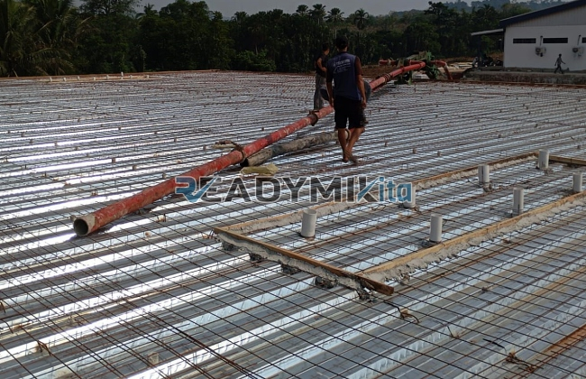

**Jasa Cor Readymix di Petojoselatan Jakarta Murah** - Hai Mitra Readymix Kita! Sukses dengan proyek konstruksi impian Anda di Petojoselatan Jakarta? Fondasi yang kokoh adalah kunci utama, dan kami punya solusinya! Readymix Kita hadir sebagai supplier beton cor readymix terpercaya, siap mendukung setiap tahapan pembangunan Anda. Yuk, simak bagaimana kami bisa jadi mitra terbaik dalam proyek Anda!



## Mengapa Memilih Beton Readymix untuk Proyek Anda?

Beton readymix adalah solusi cerdas untuk kebutuhan konstruksi modern. Diproduksi secara presisi di pabrik dengan kontrol kualitas ketat, beton ini kemudian diantar langsung ke lokasi proyek menggunakan truk mixer. Apa saja keunggulannya dibanding metode konvensional?

1. **Efisiensi Tak Tertandingi**

   Pengerjaan beton di lokasi proyek sering kali memakan waktu dan tenaga. Dengan beton readymix, Anda menghemat keduanya. Proses pencampuran sudah dilakukan sebelumnya, sehingga waktu pengerjaan di lokasi proyek bisa dipangkas drastis.

2. **Kualitas Konsisten Terjamin**

   Kualitas beton readymix sangat terjaga berkat takaran yang presisi dan teknologi modern dalam proses pencampuran. Minimalisir risiko kegagalan struktur karena kesalahan formulasi.

3. **Kapasitas Produksi Fleksibel**

   Baik untuk proyek kecil maupun besar, beton readymix mampu memenuhi kebutuhan volume yang beragam dalam waktu singkat.

4. **Komitmen Pada Lingkungan**

   Proses produksi beton readymix yang terkontrol meminimalkan limbah material di lokasi konstruksi, menjadikannya pilihan ramah lingkungan.

## Mengapa ReadymixKita Jadi Pilihan Terbaik di Petojoselatan Jakarta?

Di tengah banyaknya penyedia jasa, **ReadymixKita** menonjol dengan keunggulan yang dirancang khusus untuk kebutuhan proyek di Petojoselatan Jakarta:

1. **Pengalaman dan Keandalan**

   Dengan pengalaman bertahun-tahun di industri konstruksi di Petojoselatan Jakarta, kami memahami seluk-beluk proyek anda, mulai dari pembangunan rumah tinggal hingga infrastruktur skala besar.

2. **Pilihan Mutu Beton Lengkap**

   Kami menyediakan beragam kelas mutu beton, dari K-225 yang ideal untuk konstruksi standar hingga K-500 yang tangguh untuk proyek dengan beban berat. Tentukan mutu yang paling sesuai dengan kebutuhan proyek Anda.

3. **Peralatan Pendukung Mutakhir**

   Proses pengecoran kami dilancarkan dengan peralatan modern, termasuk pompa beton (concrete pump) yang memastikan pengecoran cepat, merata, dan efisien.

4. **Tim Ahli yang Siap Membantu**

   Tim profesional kami siap memberikan panduan komprehensif, mulai dari perencanaan hingga eksekusi di lokasi. Kami juga beradaptasi dengan jadwal proyek Anda.

## Layanan Khusus di Petojoselatan Jakarta: Kami Paham Kebutuhan Anda

Sebagai bagian dari komunitas Petojoselatan Jakarta, kami mengerti tantangan yang mungkin dihadapi dalam konstruksi. Kondisi medan yang bervariasi membutuhkan solusi yang tepat. Berikut layanan khusus kami:

1. **Pengiriman Tepat Waktu**

   Kami menjamin pengiriman tepat waktu berkat jaringan distribusi yang luas dan lokasi strategis pabrik kami di sekitar Petojoselatan Jakarta.

2. **Konsultasi Gratis**

   Dapatkan konsultasi gratis untuk membantu Anda memilih jenis beton dan metode pengecoran yang paling optimal untuk proyek Anda.

3. **Penawaran Istimewa Lokal**

   Klien di Petojoselatan Jakarta berkesempatan menikmati tarif spesial dan diskon menarik untuk proyek-proyek besar.

## Harga Terjangkau dan Promo Menarik di Petojoselatan Jakarta

Kami memahami bahwa anggaran adalah aspek penting dalam setiap proyek konstruksi. Inilah yang **ReadymixKita** tawarkan:

1. **Harga Bersaing**

   Kami memberikan harga yang kompetitif tanpa mengorbankan kualitas. Informasi harga yang transparan, termasuk biaya pengiriman dan penggunaan pompa beton, tersedia untuk Anda.

2. **Promo Eksklusif**

   Nikmati diskon menarik untuk pemesanan dalam jumlah besar atau proyek berkelanjutan.

3. **Kepuasan Pelanggan Terjamin**

   Kami memberikan garansi kepuasan. Jika ada kendala dalam proses pengecoran, tim kami siap memberikan solusi hingga proyek selesai dengan sempurna.

## Informasi Harga Jasa Cor Readymix di Petojoselatan Jakarta



Jangan biarkan kualitas material menjadi penghalang kesuksesan proyek Anda. Percayakan pengecoran Anda pada ahlinya! Hubungi kami sekarang untuk mendapatkan solusi beton readymix terbaik di Petojoselatan Jakarta.

Kami juga menyediakan layanan survei lokasi dan konsultasi gratis untuk memastikan kebutuhan Anda terpenuhi dengan tepat. Segera pesan dan nikmati hasil konstruksi yang solid, tahan lama, dan memuaskan.

Dengan **ReadymixKita**, Anda mendapatkan perpaduan istimewa antara kecepatan, kualitas, dan layanan profesional. Segera hubungi kami untuk solusi pengecoran terbaik di Petojoselatan Jakarta! Bersama ReadymixKita, proyek Anda akan berdiri kokoh dan bertahan lama!