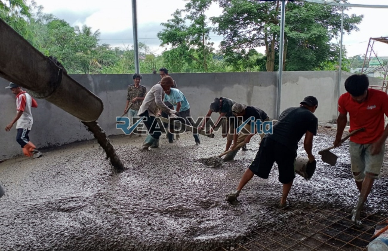

**Jasa Cor Readymix di Purabaya Sukabumi Murah** - Hai Mitra Readymix Kita! Punya rencana membangun di Purabaya Sukabumi? Mencari cara mempercepat pekerjaan tanpa mengorbankan kualitas? Nah, Anda sudah berada di tempat yang tepat! Kami dari Readymix Kita hadir sebagai solusi pengecoran readymix terpercaya dan terjangkau di Purabaya Sukabumi dan sekitarnya. Mitra, yuk simak bagaimana kami bisa mendukung kesuksesan proyek Anda!



## Mengapa Memilih Pengecoran dengan Readymix?

Apa sih kelebihan beton *ready mix* dibandingkan cara tradisional? Sederhananya, beton Cor Readymix adalah campuran beton yang dibuat secara presisi di pabrik kami, menggunakan bahan baku berkualitas tinggi. Kemudian diantar langsung ke lokasi proyek Anda menggunakan truk molen. Keunggulan utamanya? Mari kita telaah:

1. **Hemat Waktu & Tenaga Kerja**

   Lupakan repotnya mencampur semen, pasir, dan kerikil di lokasi proyek. Dengan readymix, waktu pengerjaan jadi lebih efisien karena beton sudah siap pakai saat tiba di lokasi.

2. **Kualitas Terjamin Konsisten**

   Proses pembuatan yang terkontrol memastikan kualitas beton selalu seragam. Ini meminimalkan risiko kerusakan struktur akibat kesalahan takaran campuran yang sering terjadi dalam metode manual.

3. **Fleksibilitas Kapasitas**

   Mau proyek kecil atau skala besar? Beton Cor Readymix mampu memenuhi kebutuhan volume beton apa pun, kapan pun Anda butuhkan.

4. **Dukungan Ramah Lingkungan**

   Dengan meminimalkan material terbuang di lokasi proyek, penggunaan readymix turut berkontribusi pada praktik konstruksi yang lebih berkelanjutan.

## Apa yang Membuat Kami Unggul di Purabaya Sukabumi?

Di antara banyaknya penyedia jasa pengecoran, **ReadymixKita** menonjol sebagai pilihan utama di Purabaya Sukabumi karena beberapa alasan krusial:

1. **Pengalaman & Reputasi Terpercaya**

   Berbekal pengalaman bertahun-tahun di industri konstruksi, kami memahami betul seluk-beluk kebutuhan proyek Anda, mulai dari perumahan, gedung komersial, hingga proyek infrastruktur besar.

2. **Pilihan Mutu Beton yang Lengkap**

   Kami menawarkan berbagai kelas mutu beton, termasuk K-225 (untuk konstruksi standar) hingga K-500 (untuk struktur yang memerlukan kekuatan ekstra). Mutu beton disesuaikan persis dengan spesifikasi proyek Anda.

3. **Didukung Peralatan Modern**

   Kami berinvestasi dalam teknologi mutakhir, seperti *concrete pump* (pompa beton), yang mempercepat proses pengecoran dan memastikan distribusi beton merata.

4. **Tim Ahli yang Profesional**

   Tim kami terdiri dari tenaga ahli yang siap memberikan panduan teknis, mulai dari perencanaan hingga implementasi di lapangan. Kami juga fleksibel menyesuaikan jadwal dengan kebutuhan proyek Anda.

## Layanan Kami yang Disesuaikan untuk Purabaya Sukabumi

Menyadari karakteristik unik Purabaya Sukabumi, termasuk variasi topografi dan kondisi tanah, **ReadymixKita** menyediakan layanan yang dirancang khusus untuk kebutuhan lokal:

1. **Pengiriman Tepat Waktu**

   Lokasi pabrik kami yang strategis di Purabaya Sukabumi memungkinkan kami menjamin pengiriman beton tepat waktu, sesuai jadwal proyek Anda.

2. **Konsultasi Teknis Gratis**

   Bingung memilih jenis beton yang tepat? Manfaatkan layanan konsultasi gratis kami untuk mendapatkan rekomendasi terbaik berdasarkan kebutuhan proyek Anda.

3. **Penawaran Istimewa untuk Proyek Lokal**

   Khusus untuk klien di Purabaya Sukabumi, kami memberikan penawaran harga spesial dan diskon menarik, terutama untuk proyek-proyek skala besar.

## Harga Terjangkau dan Promo Menarik di Purabaya Sukabumi

Kami memahami bahwa anggaran adalah aspek penting dalam setiap proyek konstruksi. Itulah mengapa **ReadymixKita** berkomitmen untuk memberikan:

1. **Harga Bersaing**

   Kami menawarkan harga yang kompetitif tanpa mengorbankan kualitas beton. Informasi lengkap mengenai biaya, termasuk ongkos kirim dan biaya penggunaan *concrete pump*, akan kami sampaikan secara transparan.

2. **Promo dan Diskon Spesial**

   Nikmati diskon eksklusif untuk pemesanan volume besar atau proyek-proyek yang berlangsung dalam jangka waktu tertentu.

3. **Kepuasan Pelanggan Terjamin**

   Kami menjamin kualitas layanan kami. Jika ada kendala dalam proses pengecoran, tim kami siap memberikan solusi hingga proyek Anda selesai dengan memuaskan.

## Informasi Harga Jasa Cor Readymix di Purabaya Sukabumi



Jangan biarkan kualitas proyek Anda terganggu karena material yang kurang memadai. Segera hubungi kami untuk mendapatkan penawaran terbaik untuk kebutuhan pengecoran di Purabaya Sukabumi!

Kami siap membantu Anda dalam survei lokasi dan memberikan konsultasi gratis. Pesan sekarang dan rasakan kemudahan pengecoran dengan beton readymix berkualitas dari ReadymixKita. [Hubungi kami melalui tombol Telepon/WhatsApp di halaman ini](URL) untuk informasi lebih lanjut!

Dengan ReadymixKita, proyek konstruksi Anda di Purabaya Sukabumi akan berjalan lancar, efisien, dan menghasilkan struktur yang kokoh dan tahan lama. Jangan tunda lagi, hubungi kami sekarang!