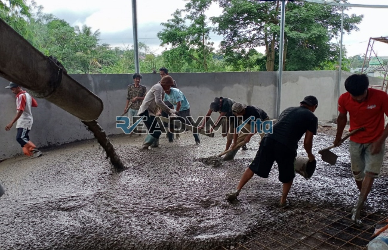

**Jasa Cor Readymix di Rajeg Tangerang Murah** - Hai Mitra Readymix Kita! Punya proyek konstruksi di Rajeg Tangerang dan butuh solusi cepat, efisien, dan berkualitas? Nah, Anda sudah berada di tempat yang tepat! Kami dari Readymix Kita hadir sebagai penyedia jasa cor readymix terpercaya, siap mendukung kelancaran proyek Anda dengan material terbaik dan layanan yang memuaskan. Kota Rajeg Tangerang yang dinamis ini butuh fondasi yang kuat – dan kami siap menyediakannya.



## Mengapa Memilih Pengecoran dengan Readymix?

Mungkin Anda bertanya-tanya, apa sih kelebihan menggunakan beton Cor Readymix dibandingkan cara tradisional? Sederhananya, beton readymix adalah campuran beton yang dibuat di pabrik dengan kontrol kualitas ketat, lalu dikirim langsung ke lokasi proyek menggunakan truk mixer. Ini menawarkan sejumlah keuntungan signifikan:

1. **Efisiensi Waktu dan Tenaga Kerja**

   Lupakan ribetnya mencampur beton di lokasi proyek! Beton readymix menghemat waktu dan tenaga, karena proses pencampuran sudah dilakukan secara presisi di pabrik.

2. **Kualitas Terjamin dan Konsisten**

   Dengan takaran material yang akurat dan teknologi modern, beton Cor Readymix menjamin kualitas yang konsisten, mengurangi risiko kegagalan struktur akibat campuran yang tidak tepat.

3. **Skalabilitas untuk Segala Ukuran Proyek**

   Apapun skala proyek Anda – dari pembangunan rumah sederhana hingga gedung bertingkat – beton readymix mampu memenuhi kebutuhan volume yang bervariasi dengan cepat dan efisien.

4. **Berkontribusi pada Lingkungan yang Lebih Baik**

   Proses produksi beton Cor Readymix lebih terkelola, meminimalkan limbah material di lokasi konstruksi dan mendukung praktik pembangunan berkelanjutan.

## Apa yang Membuat Kami Unggul di Rajeg Tangerang?

Di tengah banyaknya penyedia jasa pengecoran, **ReadymixKita** menonjol dengan komitmen kami terhadap kualitas, layanan, dan kepuasan pelanggan di Rajeg Tangerang. Kenapa harus memilih kami?

1. **Pengalaman dan Reputasi Terpercaya**

   Dengan pengalaman bertahun-tahun di industri ini, kami memahami seluk-beluk konstruksi dan siap memberikan solusi yang tepat untuk setiap kebutuhan proyek.

2. **Pilihan Mutu Beton yang Lengkap**

   Kami menawarkan beragam kelas mutu beton, mulai dari K-225 untuk aplikasi ringan hingga K-500 untuk struktur berat. Dapatkan beton yang *pas* untuk pekerjaan Anda!

3. **Didukung Peralatan Canggih**

   Kami dilengkapi dengan pompa beton (concrete pump) modern untuk memastikan pengecoran cepat, merata, dan efisien, bahkan di area yang sulit dijangkau.

4. **Tim Ahli yang Siap Membantu**

   Tim profesional kami siap mendampingi Anda dari tahap perencanaan hingga penyelesaian proyek, memberikan solusi adaptif sesuai jadwal dan kebutuhan Anda.

## Layanan Kami yang Disesuaikan untuk Rajeg Tangerang

Kami menyadari bahwa proyek di Rajeg Tangerang memiliki tantangan unik, mulai dari kondisi tanah hingga aksesibilitas lokasi. **ReadymixKita** menawarkan layanan yang dirancang khusus untuk mengatasi hal tersebut:

1. **Pengiriman Tepat Waktu**

   Kami berkomitmen untuk mengirimkan beton readymix tepat waktu, memanfaatkan lokasi strategis pabrik kami di Rajeg Tangerang dan jaringan distribusi yang optimal.

2. **Konsultasi Gratis dan Solusi Terbaik**

   Butuh saran mengenai jenis beton yang tepat? Tim ahli kami siap memberikan konsultasi gratis untuk membantu Anda memilih solusi terbaik untuk proyek Anda.

3. **Penawaran Spesial untuk Pelanggan Lokal**

   Sebagai bentuk apresiasi, kami memberikan harga spesial dan diskon menarik untuk proyek-proyek di wilayah Rajeg Tangerang.

## Investasi Cerdas: Harga Terjangkau dan Promo Menarik

Kami percaya bahwa kualitas tidak harus mahal. Oleh karena itu, **ReadymixKita** menawarkan:

1. **Harga Kompetitif dan Transparan**

   Kami menetapkan harga yang bersaing tanpa mengorbankan kualitas beton readymix. Informasi harga (termasuk biaya pengiriman dan penggunaan concrete pump) akan kami sampaikan secara jelas dan transparan.

2. **Promo dan Diskon Spesial**

   Nikmati diskon menarik untuk pemesanan dalam jumlah besar atau proyek yang berlangsung dalam jangka waktu tertentu.

3. **Kepuasan Pelanggan Sebagai Prioritas**

   Kami menjamin kepuasan Anda! Jika ada masalah dalam proses pengecoran, tim kami akan segera merespons dan memberikan solusi hingga proyek selesai dengan sempurna.

## Informasi Harga Jasa Cor Readymix di Rajeg Tangerang



Jangan tunda lagi! Pastikan proyek Anda dibangun dengan fondasi yang kokoh dan berkualitas. Hubungi kami sekarang untuk mendapatkan penawaran terbaik dan layanan pengecoran readymix terbaik di Rajeg Tangerang!

Kami juga menyediakan layanan survei lokasi gratis untuk membantu Anda menentukan kebutuhan beton yang tepat. Pesan sekarang dan buktikan sendiri keunggulan layanan ReadymixKita! Kami siap menjadi mitra terpercaya Anda dalam membangun masa depan yang lebih kuat di Rajeg Tangerang. Hubungi kami untuk informasi lebih lanjut! Bangunlah impian Anda dengan beton yang berkualitas! [Jasa Cor Readymix di Balaraja Tangerang Murah](/readymix/jasa-cor-readymix-di-balaraja-tangerang-murah/) – Ketahui juga layanan kami di area tetangga.