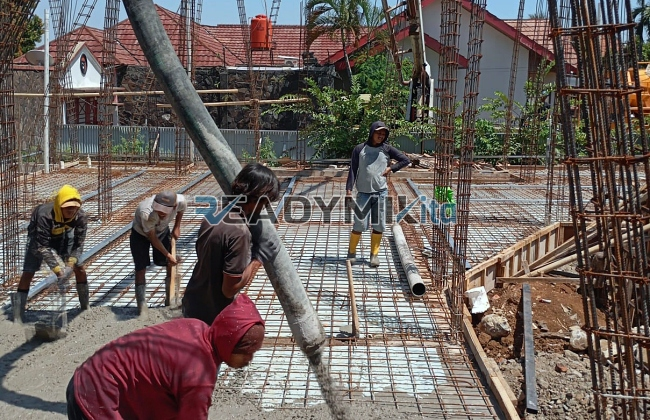

**Jasa Cor Readymix di Sawangan Depok Murah** - Hai Mitra Readymix Kita! Bingung mencari cara mempercepat proyek konstruksi Anda di Sawangan Depok? Atau khawatir dengan kualitas beton yang kurang konsisten? Kami punya solusinya! Readymix Kita hadir sebagai penyedia jasa pengecoran readymix yang andal, efisien, dan terpercaya. Dengan layanan kami, proses pembangunan jadi lebih lancar, hasil lebih kuat, dan pastinya hemat waktu serta biaya.



## Beton Readymix: Solusi Cerdas untuk Konstruksi Modern

Apa sebenarnya beton readymix itu? Singkatnya, ini adalah beton jadi yang diproduksi di pabrik dengan formula presisi dan bahan baku pilihan. Setelah jadi, beton ini diangkut langsung ke lokasi proyek menggunakan truk mixer khusus. Menggunakan beton readymix menawarkan banyak keuntungan dibandingkan metode konvensional. Simak selengkapnya:

1. **Hemat Waktu dan Biaya Tenaga**

   Proses pencampuran beton di lokasi proyek seringkali memakan waktu dan membutuhkan tenaga kerja yang signifikan. Dengan readymix, Anda langsung mendapatkan material siap pakai, mempersingkat jadwal pengerjaan.

2. **Kualitas Terjamin Konsisten**

   Di pabrik, beton readymix diproduksi dengan takaran yang akurat dan kontrol kualitas ketat. Ini meminimalkan risiko kesalahan pencampuran yang bisa mengganggu kekuatan dan durabilitas struktur.

3. **Fleksibilitas Kapasitas Produksi**

   Kebutuhan beton bisa bervariasi tergantung skala proyek. Beton readymix dapat dipesan dalam volume yang tepat, sesuai kebutuhan Anda, baik untuk proyek kecil maupun besar.

4. **Dukungan Ramah Lingkungan**

   Proses produksi readymix yang terpusat mengurangi limbah material di lokasi proyek, sehingga lebih ramah lingkungan.

## Kenapa Harus Memilih ReadymixKita di Sawangan Depok?

Di antara banyaknya penyedia jasa pengecoran di sekitar Sawangan Depok, **ReadymixKita** menawarkan keunggulan yang membedakan kami. Apa saja itu?

1. **Pengalaman dan Reputasi Terpercaya**

   Kami telah berpengalaman bertahun-tahun melayani berbagai proyek konstruksi, mulai dari bangunan perumahan, gedung komersial, hingga infrastruktur jalan. Kepercayaan pelanggan adalah prioritas kami.

2. **Pilihan Mutu Beton yang Lengkap**

   Kami menyediakan beragam pilihan mutu beton, mulai dari K-225 (untuk kebutuhan standar) hingga K-500 (untuk konstruksi yang memerlukan kekuatan ekstra). Pilih sesuai kebutuhan proyek Anda.

3. **Dilengkapi Peralatan Modern**

   Kami berinvestasi pada peralatan pengecoran modern, termasuk concrete pump, untuk memastikan pengecoran berlangsung cepat, merata, dan efisien.

4. **Didukung Tim Profesional Berdedikasi**

   Tim kami terdiri dari tenaga ahli yang siap membantu Anda mulai dari perencanaan hingga pelaksanaan proyek. Kami juga fleksibel menyesuaikan jadwal kerja dengan kebutuhan Anda.

## Layanan Kami yang Dirancang Khusus untuk Sawangan Depok

Kami memahami betul karakteristik wilayah Sawangan Depok. Untuk itu, layanan kami dirancang khusus untuk mengatasi tantangan konstruksi di area ini:

1. **Pengiriman Tepat Waktu**

   Lokasi strategis pabrik kami di sekitar Sawangan Depok memungkinkan kami mengirimkan beton readymix dengan cepat dan tepat waktu.

2. **Konsultasi Proyek Gratis**

   Bingung jenis beton apa yang cocok untuk proyek Anda? Tim kami siap memberikan konsultasi gratis untuk membantu Anda memilih beton dan metode pengecoran yang tepat.

3. **Penawaran Spesial untuk Proyek Lokal**

   Khusus untuk proyek-proyek di wilayah Sawangan Depok, kami menawarkan harga spesial dan diskon menarik. Yuk, manfaatkan kesempatan ini!

## Harga Bersaing dan Promo Menarik di Sawangan Depok

Anggaran proyek seringkali menjadi pertimbangan utama. **ReadymixKita** hadir untuk memberikan solusi dengan:

1. **Harga yang Kompetitif**

   Kami menawarkan harga yang bersaing tanpa mengorbankan kualitas beton readymix yang kami produksi. Transparansi adalah kunci kami.

2. **Promo Menarik Sepanjang Tahun**

   Dapatkan berbagai promo menarik, seperti diskon untuk pemesanan volume besar atau proyek jangka panjang.

3. **Jaminan Kepuasan Pelanggan**

   Kepuasan Anda adalah tujuan utama kami. Jika ada kendala selama proses pengecoran, tim kami akan segera membantu sampai proyek selesai dengan sempurna.

## Informasi Harga Jasa Cor Readymix di Sawangan Depok



Jangan tunda proyek Anda lagi! Segera hubungi kami untuk mendapatkan penawaran terbaik dan solusi pengecoran yang ideal untuk kebutuhan Anda di Sawangan Depok.

Kami juga menyediakan layanan survei lokasi untuk membantu Anda menentukan kebutuhan beton readymix yang paling tepat. Pesan sekarang dan rasakan kemudahan pengecoran dengan kualitas terjamin! [Jasa Cor Readymix di Abadijaya Depok Murah](/readymix/jasa-cor-readymix-di-abadijaya-depok-murah/) — untuk perbandingan, siapa tahu ada yang cocok dengan proyek Anda!

Dengan memilih jasa pengecoran dari ReadymixKita, Anda mendapatkan kombinasi sempurna antara kecepatan, kualitas, dan layanan profesional terpercaya di Sawangan Depok. Bersama ReadymixKita, wujudkan bangunan yang kokoh, awet, dan sesuai harapan! Segera hubungi kami untuk konsultasi dan pemesanan.