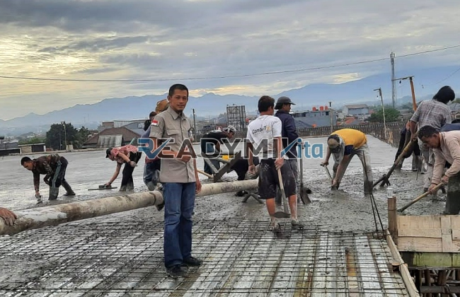

**Jasa Cor Readymix di Senayan Jakarta Murah** - Hai Mitra Readymix Kita! Punya proyek konstruksi di Senayan Jakarta dan butuh solusi pengecoran yang praktis, cepat, dan berkualitas? Tenang saja, Readymix Kita siap membantu Anda! Kami adalah penyedia jasa cor readymix terpercaya yang melayani area Senayan Jakarta Murah dan sekitarnya. Dengan pengalaman bertahun-tahun, kami berkomitmen memberikan layanan terbaik untuk setiap kebutuhan konstruksi Anda. Pengecoran dengan readymix dari kami menjamin efisiensi, kekuatan, dan hasil akhir yang optimal untuk bangunan Anda.



## Mengapa Memilih Beton Readymix untuk Proyek Anda?

Beton readymix, atau beton cor siap pakai, adalah solusi cerdas dalam dunia konstruksi modern. Diproduksi dengan presisi di pabrik menggunakan bahan baku berkualitas tinggi, beton ini kemudian diantar langsung ke lokasi proyek menggunakan truk mixer. Supaya Anda semakin yakin, inilah beberapa keunggulan utama beton Cor Readymix dibandingkan metode tradisional:

1. **Hemat Waktu & Biaya Tenaga**

   Proses pencampuran langsung di lokasi proyek memakan waktu dan tenaga yang tidak sedikit. Dengan readymix, Anda bisa menghemat keduanya secara signifikan karena beton sudah siap pakai saat tiba di lokasi.

2. **Kualitas Terjamin Konsisten**

   Formulasi yang akurat dan teknologi modern memastikan setiap batch beton Cor Readymix memiliki mutu yang seragam. Hal ini meminimalkan risiko kesalahan pencampuran yang dapat mengganggu kekuatan struktur.

3. **Kapasitas Fleksibel – Skala Besar Maupun Kecil**

   Baik untuk proyek kecil seperti pengecoran pondasi rumah atau proyek besar seperti pembangunan gedung bertingkat, beton readymix dapat disesuaikan dengan kebutuhan volume Anda.

4. **Berkontribusi pada Pembangunan Berkelanjutan**

   Proses produksi yang terkontrol pada pabrik membantu mengurangi limbah material dan dampak negatif terhadap lingkungan.

## Apa yang Membuat ReadymixKita Unggul di Senayan Jakarta?

Di antara banyak penyedia layanan pengecoran di Senayan Jakarta, ReadymixKita hadir dengan keunggulan kompetitif yang membedakan kami:

1. **Pengalaman dan Keahlian Teruji**

   Dengan rekam jejak yang solid di industri konstruksi, kami memahami betul tantangan dan kebutuhan proyek di berbagai skala.

2. **Pilihan Mutu Beton yang Lengkap**

   Kami menyediakan berbagai grade mutu beton, mulai dari K-225 untuk aplikasi standar hingga K-500 untuk bangunan yang memerlukan kekuatan ekstra. Pilih yang paling sesuai dengan desain dan kebutuhan proyek Anda.

3. **Didukung Peralatan Modern & Canggih**

   Kami berinvestasi pada peralatan pengecoran terkini, termasuk concrete pump yang efisien, untuk memastikan pengerjaan cepat, presisi, dan hasil akhir yang memuaskan.

4. **Tim Profesional yang Responsif**

   Tim kami terdiri dari ahli beton yang siap memberikan konsultasi, panduan, dan dukungan teknis dari tahap perencanaan hingga penyelesaian proyek. Kami juga fleksibel menyesuaikan jadwal kerja agar sinkron dengan kemajuan proyek Anda.

## Solusi Pengecoran yang Tepat Sasaran untuk Senayan Jakarta

Sebagai penyedia lokal, kami mengenal baik kondisi konstruksi di Senayan Jakarta. Area ini memiliki karakteristik unik, mulai dari kepadatan lalu lintas hingga variasi jenis tanah. **ReadymixKita** memberikan solusi yang dirancang khusus untuk mengatasi tantangan-tantangan tersebut:

1. **Pengiriman Tepat Waktu & Efisien**

   Kami memahami betapa pentingnya ketepatan waktu dalam proyek konstruksi. Dengan lokasi pabrik yang strategis di Senayan Jakarta dan armada pengiriman yang handal, kami menjamin beton Anda sampai tepat waktu.

2. **Konsultasi Gratis dari Ahli Beton**

   Bingung memilih mutu beton yang tepat? Atau butuh saran tentang metode pengecoran terbaik? Tim ahli kami siap memberikan konsultasi gratis untuk Anda.

3. **Penawaran Spesial Bagi Proyek di Senayan Jakarta Murah**

   Kami memberikan penawaran harga yang menarik dan diskon khusus bagi proyek-proyek yang berlokasi di wilayah Senayan Jakarta dan sekitarnya.

## Investasi Cerdas: Harga Terjangkau dengan Kualitas Terbaik

Kami percaya bahwa kualitas tidak harus mahal. **ReadymixKita** menawarkan:

1. **Harga Kompetitif dan Transparan**

   Kami berkomitmen untuk memberikan penawaran harga yang kompetitif tanpa mengorbankan kualitas produk dan layanan. Kami akan memberikan detail biaya, termasuk harga beton, biaya pengiriman, dan biaya tambahan lainnya.

2. **Program Promo dan Diskon Menarik**

   Dapatkan promo eksklusif untuk pemesanan dalam jumlah besar, proyek jangka panjang, atau melalui program-program promosi tertentu.

3. **Kepuasan Pelanggan adalah Prioritas Kami**

   Kami menjamin kualitas produk dan layanan kami. Jika Anda tidak puas dengan hasil pengecoran, tim kami akan segera menindaklanjuti dan mencari solusi terbaik.

## Informasi Harga Jasa Cor Readymix di Senayan Jakarta



Jangan biarkan proyek Anda tertunda karena kesulitan mendapatkan beton berkualitas! Segera hubungi **ReadymixKita** untuk mendapatkan penawaran harga terbaik dan layanan pengecoran yang profesional di Senayan Jakarta Murah.

Kami juga menawarkan layanan survei lokasi gratis dan konsultasi ahli untuk membantu Anda merencanakan proyek pengecoran yang sukses. Yuk, wujudkan bangunan impian Anda bersama ReadymixKita! [Nikmati penawaran spesial hari ini](URL)

Ingat! Kualitas bangunan Anda adalah investasi jangka panjang. Pilih jasa Pengecoran dg Cor Readymix dari ReadymixKita untuk mendapatkan kombinasi optimal antara kualitas, efisiensi, dan layanan terbaik di Senayan Jakarta. Bersama ReadymixKita, bangunan Anda kokoh dan terjamin keawetannya! [Hubungi tim kami sekarang juga!](URL)