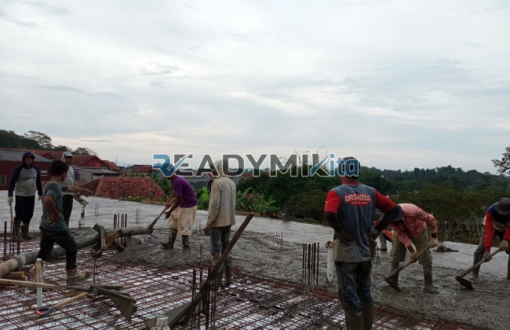

**Jasa Cor Readymix di Senen Jakarta Murah** - Hai Mitra Readymix Kita! Gimana kabarnya? Kalau Anda sedang merencanakan proyek konstruksi di Senen Jakarta, mencari beton readymix yang berkualitas dan terpercaya? Nah, Anda sudah berada di tempat yang tepat! Kami dari Readymix Kita hadir sebagai solusi pengecoran yang efisien dan handal untuk berbagai kebutuhan konstruksi Anda di Senen Jakarta Murah. Kami mengerti betul pentingnya fondasi yang kuat untuk bangunan yang tahan lama.



## Mengapa Memilih Cor Readymix untuk Proyek Anda?

Beton cor readymix, atau beton siap pakai, adalah pilihan cerdas untuk proyek konstruksi modern. Proses pembuatannya dilakukan di pabrik dengan kontrol kualitas yang ketat, menghasilkan campuran beton yang konsisten dan optimal. Pilihan ini menawarkan banyak keuntungan dibandingkan metode tradisional. Mari kita lihat lebih detail:

1. **Efisiensi Waktu dan Biaya**

   Tidak perlu lagi repot mencampur beton di lokasi proyek. Readymix datang siap pakai, mempercepat proses pengecoran dan menghemat biaya tenaga kerja.

2. **Kualitas Terjamin**

   Formulasi beton readymix dibuat dengan presisi, menggunakan bahan baku berkualitas tinggi, sehingga menghasilkan beton dengan kekuatan dan daya tahan yang optimal.

3. **Fleksibilitas dan Kemudahan**

   Readymix tersedia dalam berbagai mutu dan volume, sehingga bisa disesuaikan dengan kebutuhan spesifik proyek Anda – mulai dari skala kecil hingga besar.

4. **Pengurangan Limbah**

   Produksi terkontrol di pabrik meminimalkan limbah material di lokasi proyek, berkontribusi pada praktik konstruksi yang lebih berkelanjutan.

## Keunggulan Jasa ReadymixKita di Senen Jakarta

Di antara banyaknya penyedia jasa readymix, **ReadymixKita** hadir dengan keunggulan yang akan membuat proyek Anda berjalan lebih lancar. Kami bukan sekadar supplier beton, tapi mitra yang siap mendukung kesuksesan konstruksi Anda di Senen Jakarta:

1. **Pengalaman dan Keahlian Lokal**

   Kami telah melayani berbagai proyek konstruksi di Senen Jakarta dan sekitarnya. Pengalaman ini memungkinkan kami memahami tantangan dan kebutuhan unik di wilayah ini.

2. **Pilihan Mutu Beton Lengkap**

   Kami menyediakan berbagai kelas mutu beton, termasuk K-225 hingga K-500, serta opsi khusus sesuai permintaan. Pilihlah yang paling sesuai dengan spesifikasi proyek Anda.

3. **Peralatan Pengecoran Modern**

   Kami dilengkapi dengan truk mixer modern dan pompa beton (concrete pump) yang handal untuk memastikan pengecoran cepat, merata, dan efisien.

4. **Layanan Konsultasi Profesional**

   Tim ahli kami siap memberikan konsultasi gratis untuk membantu Anda memilih jenis beton yang tepat dan merencanakan strategi pengecoran yang optimal.

## Layanan Kami di Senen Jakarta: Adaptasi dengan Kebutuhan Lokal

**ReadymixKita** memahami betul karakteristik wilayah Senen Jakarta. Baik itu kepadatan penduduk, akses jalan yang terbatas, atau jenis tanah yang beragam, kami siap memberikan solusi yang tepat:

1. **Pengiriman Tepat Waktu**

   Kami menjamin pengiriman beton readymix yang tepat waktu ke lokasi proyek Anda di Senen Jakarta, menghindari keterlambatan yang dapat mengganggu jadwal.

2. **Solusi Pengecoran untuk Berbagai Kondisi**

   Tim kami berpengalaman dalam menangani pengecoran di berbagai kondisi lokasi, termasuk area yang sulit dijangkau atau memiliki topografi yang menantang.

3. **Dukungan Teknis Lokal**

   Kami menyediakan dukungan teknis yang responsif dan handal untuk memastikan proses pengecoran berjalan lancar dan sesuai dengan standar kualitas.

## Harga Kompetitif dan Promo Menarik di Senen Jakarta

Kami percaya bahwa kualitas tidak harus mahal. **ReadymixKita** menawarkan:

1. **Harga yang Bersaing**

   Kami berkomitmen untuk memberikan harga yang kompetitif tanpa mengorbankan kualitas beton readymix yang kami sediakan.

2. **Penawaran Spesial**

   Nikmati promo menarik dan diskon khusus untuk proyek-proyek di Senen Jakarta, terutama untuk pemesanan dalam skala besar.

3. **Keterbukaan Harga**

   Kami selalu transparan dalam memberikan informasi harga, termasuk biaya pengiriman dan biaya tambahan lainnya.

## Daftar Harga Jasa Cor Readymix di Senen Jakarta



Jangan tunda lagi! Pastikan proyek Anda dibangun dengan fondasi yang kuat dan awet. Segera hubungi kami untuk mendapatkan penawaran terbaik dan solusi pengecoran readymix yang terpercaya di Senen Jakarta Murah!

Kami siap membantu Anda dengan layanan survei gratis dan konsultasi mendalam untuk memastikan kebutuhan proyek Anda terpenuhi secara optimal. Pesan sekarang dan rasakan kemudahan serta keandalan ReadymixKita. [Jasa Cor Readymix di Bali Mester Jakarta Murah](/readymix/jasa-cor-readymix-di-bali-mester-jakarta-murah/) juga menawarkan layanan serupa. Bersama ReadymixKita, wujudkan impian konstruksi Anda!