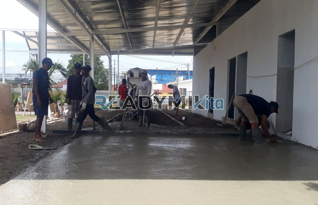

**Jasa Cor Readymix di Sepatan Tangerang Murah** - Hai Mitra Readymix Kita! Punya proyek konstruksi di Sepatan Tangerang dan butuh solusi pengecoran yang cepat dan berkualitas? Nah, Anda sudah berada di tempat yang tepat! Kami dari Readymix Kita siap mendukung kelancaran proyek Anda dengan layanan cor readymix yang terpercaya. Dengan mutu terjamin dan harga bersaing, kami menjadi pilihan utama bagi banyak kontraktor dan pemilik proyek di Sepatan Tangerang Murah.



## Mengapa Memilih Beton Readymix untuk Proyek Anda?

Mungkin Anda bertanya-tanya, apa sebenarnya beton readymix itu? Sederhananya, beton Cor Readymix adalah campuran beton yang diproduksi secara akurat di pabrik kami, menggunakan bahan baku pilihan. Kemudian, beton siap pakai ini diantarkan langsung ke lokasi proyek Anda dengan truk mixer khusus. Lantas, apa saja keunggulan yang ditawarkannya dibandingkan cara konvensional? Simak ulasannya:

1. **Efisiensi Waktu dan Tenaga Kerja**

   Proses pencampuran di lokasi proyek sering kali memakan waktu dan tenaga yang tidak sedikit. Dengan readymix, Anda menghemat waktu dan biaya karena beton sudah siap digunakan begitu tiba di lokasi.

2. **Konsistensi Kualitas yang Terjamin**

   Beton readymix diproduksi dengan takaran yang presisi dan pengawasan kualitas yang ketat, sehingga menghasilkan campuran yang konsisten dan meminimalkan risiko kegagalan struktur.

3. **Kemampuan Produksi Fleksibel**

   Baik untuk proyek kecil maupun besar, beton Cor Readymix dapat disesuaikan dengan kebutuhan volume yang Anda inginkan, menawarkan fleksibilitas yang tinggi.

4. **Solusi Ramah Lingkungan**

   Proses produksi yang terkontrol membantu mengurangi limbah material, menjadikan beton readymix sebagai pilihan yang lebih berkelanjutan.

## Apa yang Membuat ReadymixKita Spesial di Sepatan Tangerang?

Di antara banyaknya penyedia jasa pengecoran di Sepatan Tangerang Murah, ReadymixKita hadir dengan keunggulan yang tak tertandingi. Berikut adalah alasan mengapa Anda harus memilih kami:

1. **Pengalaman dan Kepercayaan Pelanggan**

   Dengan pengalaman bertahun-tahun di industri konstruksi, kami telah berhasil menyelesaikan berbagai proyek, mulai dari perumahan hingga infrastruktur besar.

2. **Pilihan Mutu Beton yang Lengkap**

   Kami menyediakan beragam pilihan mutu beton, termasuk K-225, K-300, K-350, hingga K-500, disesuaikan dengan spesifikasi proyek Anda.

3. **Didukung Peralatan Modern**

   Kami menggunakan pompa beton (concrete pump) dan peralatan pengecoran modern lainnya untuk memastikan proses pengecoran berlangsung cepat, efisien, dan menghasilkan kualitas terbaik.

4. **Tim Ahli yang Profesional**

   Tim kami terdiri dari para ahli yang siap memberikan bantuan teknis dan solusi terbaik untuk proyek Anda, mulai dari perencanaan hingga pelaksanaan.

## Layanan Kami yang Khusus untuk Wilayah Sepatan Tangerang

Kami sangat memahami karakteristik konstruksi di Sepatan Tangerang dan sekitarnya. Baik itu kondisi tanah yang beragam maupun tantangan logistik, **ReadymixKita** siap menghadapinya. Kami memberikan layanan khusus yang dirancang untuk menjawab kebutuhan Anda di Sepatan Tangerang:

1. **Pengiriman Tepat Waktu**

   Lokasi pabrik kami yang strategis memungkinkan kami menjamin pengiriman beton yang tepat waktu, bahkan di tengah kepadatan lalu lintas.

2. **Konsultasi Ahli Gratis**

   Kami menawarkan layanan konsultasi gratis untuk membantu Anda menentukan jenis beton yang paling sesuai dengan kebutuhan proyek Anda.

3. **Penawaran Spesial untuk Proyek Lokal**

   Sebagai bentuk dukungan kepada pembangunan di Sepatan Tangerang Murah, kami menawarkan harga dan diskon khusus untuk proyek-proyek di wilayah ini.

## Harga Terjangkau dan Promo Menarik di Sepatan Tangerang

Kami percaya bahwa kualitas tidak harus mahal. **ReadymixKita** menawarkan harga yang kompetitif dan transparan, tanpa mengorbankan mutu beton.

1. **Harga Bersaing**

   Kami menetapkan harga yang terjangkau dan sesuai dengan standar pasar, dengan rincian biaya yang jelas.

2. **Promo Eksklusif**

   Nikmati diskon menarik untuk pemesanan dalam jumlah besar atau proyek dengan durasi panjang.

3. **Jaminan Kepuasan**

   Kami berkomitmen untuk memberikan layanan terbaik dan memastikan kepuasan Anda sebagai pelanggan. 

## Daftar Harga Jasa Cor Readymix di Sepatan Tangerang



Jangan tunda lagi! Dapatkan solusi pengecoran terbaik di Sepatan Tangerang Murah dengan menghubungi kami sekarang juga. Kami siap memberikan penawaran terbaik dan membantu mewujudkan proyek impian Anda.

Kami juga menyediakan layanan survei lokasi dan konsultasi gratis untuk memastikan kebutuhan Anda terpenuhi secara optimal. Pesan beton readymix dari ReadymixKita sekarang juga dan rasakan kemudahan serta kualitas yang tak tertandingi! Dengan pilihan readymix yang tepat, proyek Anda akan kokoh dan tahan uji waktu. Hubungi kami untuk informasi lebih lanjut dan dapatkan solusi pengecoran unggulan di Sepatan Tangerang! [Jasa Cor Readymix di Balaraja Tangerang Murah](/readymix/jasa-cor-readymix-di-balaraja-tangerang-murah/) — perbandingan dengan layanan serupa di Balaraja, untuk Anda yang mempertimbangkan pilihan.