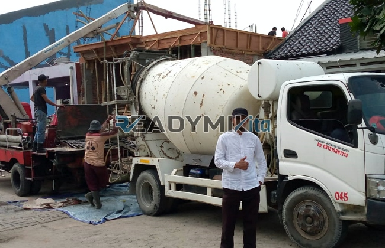

**Jasa Cor Readymix di Sindangsari Bogor Murah** - Hai Mitra Readymix Kita! Proyek konstruksi sedang berjalan di Sindangsari Bogor? Mencari solusi cepat, berkualitas, dan terjangkau? Nah, Anda sudah berada di tempat yang tepat! Kami dari Readymix Kita hadir sebagai penyedia beton cor readymix terpercaya yang siap mendukung kesuksesan proyek Anda, mulai dari bangunan rumah hingga infrastruktur skala besar.



## Mengapa Memilih Concrete Readymix untuk Proyek Anda?

Beton Cor Readymix, atau sering disebut *ready mix concrete*, adalah campuran beton yang diproduksi secara kontrol kualitas di pabrik kami. Bahan-bahan berkualitas tinggi dicampur dengan presisi dan dibawa langsung ke lokasi proyek Anda menggunakan truk mixer. Keunggulan utamanya? Efisiensi, konsistensi, dan kekuatan! Mari kita lihat lebih detail:

1. **Hemat Waktu & Biaya**

   Bayangkan: tidak perlu lagi repot mencampur semen, pasir, dan air di lokasi proyek. Beton readymix menghemat waktu dan tenaga kerja, sehingga proyek Anda bisa selesai lebih cepat dan efisien.

2. **Kualitas Terjamin Konsisten**

   Dengan teknologi modern dan pengawasan ketat, setiap batch beton readymix yang kami produksi memiliki kualitas yang homogen dan terjamin. Ini meminimalkan risiko kegagalan konstruksi akibat campuran yang tidak tepat.

3. **Skalabilitas Tak Terbatas**

   Apakah proyek Anda kecil atau besar? Kami siap memenuhi kebutuhan beton Anda, kapan saja dan dalam jumlah berapapun. Kapasitas produksi kami sangat fleksibel.

4. **Kontribusi untuk Lingkungan yang Lebih Baik**

   Proses produksi beton readymix yang terkontrol membantu mengurangi limbah material dan dampak lingkungan dibandingkan metode konvensional.

## Apa yang Membuat ReadymixKita Unggul di Sindangsari Bogor?

Di Sindangsari Bogor Murah, Anda akan menemukan banyak penyedia beton. Tapi, kenapa harus memilih **ReadymixKita**? Ini dia alasannya:

1. **Pengalaman Luas & Reputasi Terpercaya**

   Bertahun-tahun melayani proyek konstruksi di Jabodetabek menjadikan kami ahli dalam memahami kebutuhan spesifik Anda. Kami berkomitmen memberikan kualitas terbaik setiap saat.

2. **Pilihan Mutu Beton yang Lengkap**

   Kami menyediakan berbagai kelas mutu beton, termasuk K-225, K-300, K-350, K-400, dan K-500. Pilihan yang luas ini memungkinkan Anda menyesuaikan material dengan kebutuhan kekuatan konstruksi yang tepat.

3. **Didukung Peralatan Canggih**

   Kami dilengkapi dengan truk mixer modern dan *concrete pump* (pompa beton) yang handal untuk memastikan pengiriman dan pengecoran beton yang cepat dan merata. Ini mengerjakan proyek di lokasi yang sulit sekalipun menjadi lebih mudah.

4. **Tim Ahli yang Siap Membantu**

   Tim kami terdiri dari tenaga profesional yang berpengalaman dan siap memberikan konsultasi teknis, mulai dari pemilihan jenis beton hingga metode pengecoran yang optimal.

## Layanan Kami yang Disesuaikan untuk Sindangsari Bogor

Sebagai warga lokal Sindangsari Bogor, kami memahami betul tantangan konstruksi di area ini. Kondisi medan yang beragam, akses jalan yang terkadang terbatas, bukan masalah bagi kami!

1. **Pengiriman Tepat Waktu & Andal**

   Lokasi pabrik kami yang strategis memungkinkan kami memberikan pengiriman beton yang cepat dan tepat waktu ke seluruh wilayah Sindangsari Bogor dan sekitarnya.

2. **Konsultasi Gratis & Solusi Tepat**

   Kami menawarkan layanan konsultasi gratis untuk membantu Anda menentukan jenis beton, volume yang dibutuhkan, dan metode pengecoran yang paling efisien.

3. **Penawaran Spesial untuk Proyek Lokal**

   Klien di Sindangsari Bogor Murah berhak mendapatkan harga khusus dan penawaran menarik untuk proyek-proyek membangun mereka.

## Investasi Cerdas: Harga Terjangkau dengan Kualitas Terbaik

Kami percaya bahwa kualitas tidak harus mahal. **ReadymixKita** berkomitmen memberikan harga yang kompetitif tanpa mengorbankan mutu beton yang kami hasilkan.

1. **Harga Transparan & Bersaing**

   Kami menyediakan informasi harga yang jelas dan terperinci, termasuk biaya pengiriman dan penggunaan pompa beton. Tidak ada biaya tersembunyi!

2. **Promo Menarik & Diskon Spesial**

    Nikmati berbagai promo menarik dan diskon khusus untuk pemesanan dalam jumlah besar atau proyek jangka panjang.

3. **Kepuasan Pelanggan adalah Prioritas Utama**

   Kami menjamin kepuasan Anda dengan kualitas beton dan layanan kami. Jika ada masalah, tim kami akan segera memberikan solusi terbaik untuk memastikan proyek Anda berjalan lancar.

## Tabel Harga Readymix di Sindangsari Bogor



Jangan tunda lagi! Pastikan proyek konstruksi Anda dibangun dengan fondasi yang kuat dan tahan lama. Hubungi kami sekarang juga untuk mendapatkan penawaran terbaik dan layanan pengecoran readymix yang profesional di Sindangsari Bogor!

Kami juga menyediakan layanan survei lokasi gratis untuk menganalisis kebutuhan proyek Anda dengan akurat. Yuk, wujudkan proyek impian Anda bersama **ReadymixKita**! Dengan kualitas terjamin dan layanan prima, kami siap menjadi mitra terpercaya Anda. Segera hubungi kami dan buktikan sendiri keunggulannya. Bersama, kita bangun masa depan! [Jasa Cor Readymix di Babakan Bogor Murah](/readymix/jasa-cor-readymix-di-babakan-bogor-murah/) bisa menjadi referensi lebih lanjut untuk melihat area layanan kami.