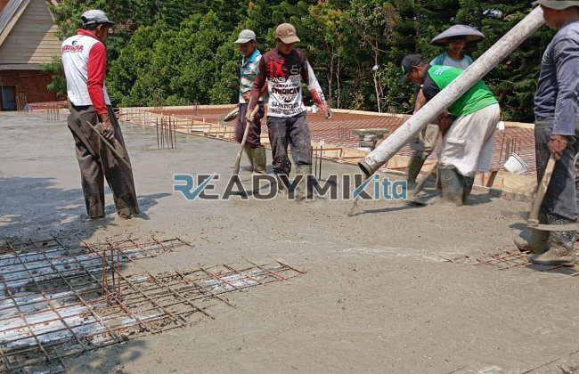

**Jasa Cor Readymix di Sunter Jaya Jakarta Murah** - Hai Mitra Readymix Kita! Merencanakan pembangunan di Sunter Jaya Jakarta? Kualitas beton adalah fondasi utama kesuksesan proyek Anda. Nah, kami dari Readymix Kita hadir sebagai solusi pengecoran yang handal dan efisien, siap mendukung setiap langkah konstruksi Anda. Dengan layanan jasa cor readymix di Sunter Jaya Jakarta, Anda mendapatkan kemudahan, kecepatan, dan hasil yang optimal.



## Mengapa Memilih Beton Readymix untuk Proyek Anda?

Beton readymix adalah campuran beton yang diproduksi secara presisi di pabrik, menggunakan material terbaik dan teknologi terkini. Setelah dibuat, beton ini langsung dikirim ke lokasi proyek menggunakan truk mixer khusus. Mengapa memilih readymix? Berikut keunggulannya:

1. **Efisiensi Waktu & Biaya Operasional**

   Proses pencampuran beton di lokasi seringkali memakan waktu dan tenaga. Readymix hadir sebagai solusi instan, mempercepat pengerjaan dan mengurangi biaya operasional.

2. **Kualitas Terjamin dan Konsisten**

   Dengan takaran yang akurat dan pengawasan kualitas ketat, beton readymix menjamin mutu yang stabil dan dapat diandalkan. Ini meminimalkan risiko kegagalan struktur akibat kualitas yang buruk.

3. **Kapasitas Produksi Fleksibel**

   Baik untuk proyek kecil maupun skala besar, beton readymix mampu memenuhi kebutuhan volume beton yang berbeda-beda dalam waktu singkat.

4. **Dukungan Ramah Lingkungan**

   Proses produksi yang terkontrol menghasilkan lebih sedikit limbah material, menjadikan beton readymix pilihan yang lebih bertanggung jawab terhadap lingkungan.

## Apa yang Membuat ReadymixKita Unggul di Sunter Jaya Jakarta?

Di antara banyaknya penyedia jasa, **ReadymixKita** menonjol dengan komitmen kami terhadap kualitas dan kepuasan pelanggan di Sunter Jaya Jakarta. Inilah yang membedakan kami:

1. **Pengalaman dan Keahlian Teruji**

   Dengan pengalaman bertahun-tahun di industri konstruksi, kami memahami seluk-beluk proyek, mulai dari bangunan residensial hingga infrastruktur kompleks.

2. **Beragam Pilihan Mutu Beton Sesuai Kebutuhan**

   Kami menawarkan berbagai kelas mutu beton – dari K-225 untuk konstruksi standar hingga K-500 untuk aplikasi berat – memastikan Anda mendapatkan material yang tepat. Setiap pilihan mutu disesuaikan dengan kebutuhan spesifik proyek Anda.

3. **Teknologi Modern dan Peralatan Canggih**

   Kami memanfaatkan teknologi terkini, termasuk pompa beton (concrete pump), untuk memastikan pengecoran cepat, merata, dan efisien.

4. **Tim Profesional yang Siap Mendukung**

   Tim ahli kami siap memberikan bimbingan dari tahap perencanaan hingga pelaksanaan di lapangan, memastikan proyek Anda berjalan lancar.

## Cakupan Layanan Kami di Sunter Jaya Jakarta dan Sekitarnya

Sebagai penyedia lokal, kami paham betul karakteristik konstruksi di Sunter Jaya Jakarta. Kami siap mengatasi berbagai kondisi medan, dari area padat penduduk hingga kawasan dengan kontur tanah yang beragam. Layanan khusus kami meliputi:

1. **Pengiriman Tepat Waktu dan Andal**

   Kami menjamin pengiriman beton readymix tepat waktu ke lokasi proyek Anda di Sunter Jaya Jakarta dan sekitarnya, berkat jaringan transportasi yang efisien.

2. **Konsultasi Gratis untuk Proyek Anda**

   Dapatkan konsultasi gratis dari ahli kami untuk memilih jenis beton yang paling sesuai dengan kebutuhan dan anggaran proyek Anda.

3. **Penawaran Istimewa untuk Pelanggan Lokal**

   Klien di wilayah Sunter Jaya Jakarta berhak mendapatkan harga spesial dan diskon menarik untuk proyek-proyek konstruksi.

## Harga Kompetitif dan Penawaran Khusus di Sunter Jaya Jakarta

Kami memahami pentingnya anggaran dalam setiap proyek. Oleh karena itu, **ReadymixKita** berkomitmen untuk memberikan:

1. **Harga yang Bersaing dan Transparan**

   Kami menawarkan harga yang kompetitif tanpa mengorbankan kualitas. Kami selalu terbuka mengenai biaya pengiriman dan biaya tambahan, seperti penggunaan concrete pump.

2. **Promosi Menarik dan Diskon Spesial**

   Dapatkan diskon eksklusif untuk pemesanan dalam jumlah besar atau proyek jangka panjang.

3. **Jaminan Kepuasan Pelanggan**

   Kami berkomitmen untuk memberikan layanan terbaik. Jika ada kendala, tim kami akan bekerja sama dengan Anda hingga proyek selesai memuaskan.

## Informasi Harga Jasa Cor Readymix di Sunter Jaya Jakarta



Jangan tunda lagi! Percayakan proyek Anda pada ahlinya. Hubungi kami sekarang juga untuk mendapatkan solusi pengecoran terbaik di Sunter Jaya Jakarta!

Kami siap membantu dengan survei lokasi dan konsultasi gratis untuk memastikan Anda mendapatkan rekomendasi yang paling tepat. Pesan sekarang dan rasakan sendiri kekuatan beton readymix berkualitas dari ReadymixKita. Bangun dengan kokoh, bangun dengan percaya diri! Segera hubungi kami untuk penawaran terbaik.

ReadymixKita – Mitra terpercaya Anda dalam membangun masa depan. Dapatkan penawaran jasa Pengecoran dg Cor Readymix di Sunter Jaya Jakarta dari ReadymixKita!