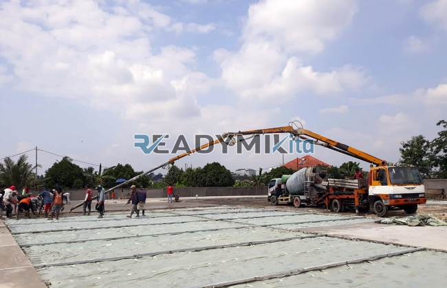

**Jasa Cor Readymix di Tanah Sareal Jakarta Murah** - Hai Mitra Readymix Kita! Mau membangun di Tanah Sareal Jakarta? Pastikan fondasi bangunan Anda kokoh dan tahan lama dengan beton cor readymix berkualitas! Kami hadir sebagai solusi praktis untuk kebutuhan pengecoran proyek Anda. Kualitas terjamin, harga bersaing, dan layanan yang memuaskan — itulah komitmen kami.



## Mengapa Memilih Beton Readymix untuk Proyek Anda?

Beton readymix, atau beton cor siap pakai, merupakan solusi modern dalam konstruksi. Diproduksi di pabrik dengan formulasi akurat dan bahan baku unggulan, beton ini kemudian diantarkan langsung ke lokasi proyek menggunakan truk mixer. Lantas, apa saja kelebihannya dibandingkan metode konvensional? Mari kita simak:

1. **Hemat Waktu dan Biaya Tenaga**

   Proses pencampuran di lokasi proyek memakan waktu dan memerlukan tenaga kerja lebih banyak. Dengan readymix, Anda menghemat keduanya karena beton sudah siap cor saat tiba di lokasi.

2. **Mutu Konsisten dan Terukur**

   Proses produksi yang terkontrol memastikan komposisi beton selalu konsisten, meminimalkan risiko kesalahan takaran yang bisa melemahkan struktur bangunan.

3. **Kapasitas Fleksibel**

   Mau proyek kecil atau skala besar? Beton readymix dapat disesuaikan dengan kebutuhan Anda, mulai dari volume sedikit hingga ratusan meter kubik.

4. **Dukungan Keberlanjutan**

   Pabrik readymix umumnya menerapkan proses yang lebih efisien dan menghasilkan limbah lebih sedikit dibandingkan campuran manual di lapangan.

## Kenapa Harus Memilih Readymix Kita di Tanah Sareal Jakarta?

Di antara banyaknya penyedia jasa, **ReadymixKita** menonjol sebagai solusi terbaik untuk kebutuhan pengecoran di Tanah Sareal Jakarta. Inilah yang membedakan kami:

1. **Pengalaman dan Keahlian Teruji**

   Dengan pengalaman bertahun-tahun di industri konstruksi, kami memahami betul seluk-beluk pengecoran dan kebutuhan spesifik setiap proyek.

2. **Pilihan Mutu Beton yang Lengkap**

   Kami menyediakan beragam kelas mutu beton — mulai dari K-225 untuk pekerjaan ringan hingga K-500 untuk bangunan bertingkat tinggi — sesuai dengan spesifikasi proyek Anda.

3. **Didukung Peralatan Canggih**

   Kami memanfaatkan teknologi terkini dalam pengecoran, termasuk pompa beton (concrete pump) untuk mempercepat proses dan memastikan hasil yang rata sempurna.

4. **Tim Solid dan Profesional**

   Tim kami terdiri dari para ahli yang siap memberikan dukungan, mulai dari perencanaan hingga pelaksanaan, serta menyesuaikan layanan dengan jadwal proyek Anda.

## Layanan Kami yang Disesuaikan untuk Tanah Sareal Jakarta

Sebagai penyedia lokal, **ReadymixKita** sangat memahami karakteristik wilayah Tanah Sareal Jakarta. Baik itu kepadatan penduduk, akses jalan, atau jenis tanah, kami siap memberikan solusi terbaik:

1. **Pengiriman Tepat Waktu**

   Lokasi pabrik kami yang strategis memungkinkan pengiriman beton readymix secara cepat dan efisien ke seluruh wilayah Tanah Sareal Jakarta dan sekitarnya.

2. **Konsultasi Ahli**

   Butuh saran tentang jenis beton yang tepat atau metode pengecoran terbaik? Tim konsultan berpengalaman kami siap membantu tanpa biaya.

3. **Penawaran Eksklusif untuk Proyek Lokal**

   Sebagai bentuk apresiasi, kami menawarkan harga spesial dan diskon menarik untuk proyek-proyek konstruksi di kawasan Tanah Sareal Jakarta.

## Harga Kompetitif dan Promo Menarik di Tanah Sareal Jakarta

Kami percaya bahwa kualitas tidak harus mahal. **ReadymixKita** berkomitmen untuk memberikan harga yang bersahabat tanpa mengorbankan mutu:

1. **Harga Transparan dan Bersaing**

   Kami menjamin harga yang kompetitif dan tidak ada biaya tersembunyi. Rincian harga, termasuk biaya pengiriman dan penggunaan concrete pump, akan kami informasikan secara jelas.

2. **Promo dan Diskon Spesial**

   Nikmati berbagai promo menarik untuk pemesanan volume besar, proyek jangka panjang, atau pelanggan setia.

3. **Jaminan Kepuasan Pelanggan**

   Kepuasan Anda adalah prioritas kami. Jika ada kendala dalam proses pengecoran, tim kami akan segera memberikan solusi terbaik.

## Detail Harga Jasa Cor Readymix di Tanah Sareal Jakarta



Jangan biarkan proyek Anda terhambat karena material yang berkualitas rendah! Percayakan pengecoran Anda pada **ReadymixKita** dan nikmati kemudahan, efisiensi, serta hasil yang memuaskan.

Kami juga menyediakan layanan survei lokasi gratis untuk memastikan solusi pengecoran yang paling tepat untuk kebutuhan Anda. Segera hubungi kami untuk mendapatkan penawaran menarik dan wujudkan konstruksi impian Anda di Tanah Sareal Jakarta! Kami adalah mitra terpercaya Anda untuk fondasi yang kokoh dan bangunan yang tahan lama. [Jasa Cor Readymix di Bali Mester Jakarta Murah](/readymix/jasa-cor-readymix-di-bali-mester-jakarta-murah/) adalah salah satu layanan unggulan kami.