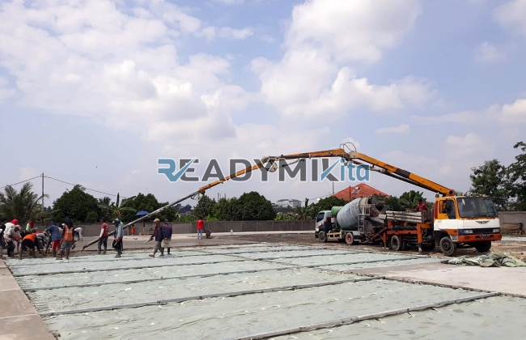

**Jasa Cor Readymix di Tugu Depok Murah** - Hai Mitra Readymix Kita! Sedang merencanakan pembangunan di Tugu Depok? Kualitas beton yang prima adalah fondasi utama keberhasilan proyek Anda. Nah, kami dari Readymix Kita hadir sebagai solusi pengecoran readymix terpercaya, siap mendukung setiap tahapan konstruksi Anda. Kami memahami betul kebutuhan proyek di Tugu Depok Murah, dan berkomitmen memberikan hasil terbaik.



## Mengapa Memilih Beton Readymix untuk Proyek Anda?

Beton readymix, atau beton cor siap pakai, adalah solusi modern yang semakin digemari dalam industri konstruksi. Pembuatan beton ini dilakukan di pabrik dengan kontrol kualitas ketat, kemudian dikirim langsung ke lokasi proyek menggunakan truk mixer. Apa saja sih kelebihannya dibandingkan metode tradisional? Yuk, simak manfaatnya:

1. **Hemat Waktu dan Tenaga**

   Lupakan repotnya mencampur beton di lokasi proyek! Beton readymix datang sudah siap pakai, menghemat waktu dan tenaga kerja Anda secara signifikan.

2. **Kualitas Terjamin Konsisten**

   Dengan formula yang presisi dan pengawasan mutu yang ketat, beton readymix menjamin kualitas yang konsisten di setiap batch. Minim risiko kesalahan takaran yang bisa membahayakan struktur bangunan Anda.

3. **Fleksibilitas Kapasitas**

   Mau proyek kecil atau skala besar? Beton readymix bisa disesuaikan dengan kebutuhan Anda. Kami siap menyediakan volume yang tepat sesuai spesifikasi proyek.

4. **Berkontribusi Pada Lingkungan**

   Proses produksi beton readymix yang terkelola dengan baik membantu meminimalkan limbah dan dampak negatif terhadap lingkungan.

## Keunggulan Jasa Readymix Kita di Tugu Depok Murah

Di antara banyaknya pilihan penyedia jasa, kenapa harus memilih **ReadymixKita** untuk proyek Anda di Tugu Depok Murah? Ini dia alasannya:

1. **Pengalaman dan Kepercayaan Pelanggan**

   Kami telah lama berkecimpung dalam industri ini dan telah berhasil menyelesaikan berbagai proyek konstruksi di Tugu Depok Murah. Pelanggan puas adalah prioritas utama kami.

2. **Pilihan Mutu Beton Lengkap**

   Kebutuhan proyek berbeda-beda. Kami menyediakan berbagai kelas mutu beton, mulai dari K-225 yang umum digunakan hingga K-500 untuk proyek dengan beban berat. Konsultasikan kebutuhan Anda dengan tim kami!

3. **Didukung Peralatan Modern**

   Kami menggunakan concrete pump (pompa beton) dan teknologi terkini lainnya untuk memastikan pengecoran cepat, merata, dan efisien.

4. **Tim Ahli Siap Membantu**

   Tim kami terdiri dari para profesional yang siap memberikan solusi terbaik untuk proyek Anda, mulai dari perencanaan hingga pelaksanaan di lapangan.

## Layanan Kami yang Dipersonalisasi untuk Tugu Depok Murah

Kami memahami betul karakteristik wilayah Tugu Depok Murah. Medan yang beragam dan kondisi proyek yang unik memerlukan penanganan khusus. Inilah layanan yang kami tawarkan:

1. **Pengiriman Tepat Waktu**

   Kami menjamin pengiriman beton readymix tepat waktu ke lokasi proyek Anda di Tugu Depok Murah, memastikan kelancaran proses pengerjaan.

2. **Konsultasi Teknis Gratis**

   Bingung memilih jenis beton yang tepat? Tim ahli kami siap memberikan konsultasi gratis untuk membantu Anda menentukan solusi terbaik.

3. **Penawaran Khusus untuk Proyek Lokal**

   Sebagai penyedia jasa lokal, kami memberikan penawaran khusus dan diskon menarik untuk proyek-proyek di Tugu Depok Murah.

## Harga Terjangkau dan Promo Menarik di Tugu Depok Murah

Kami percaya bahwa kualitas tidak harus mahal. **ReadymixKita** menawarkan:

1. **Harga Bersaing**

   Kami memberikan harga yang kompetitif tanpa mengorbankan kualitas beton readymix yang kami sediakan.

2. **Promo dan Diskon Spesial**

   Nikmati berbagai promo menarik, terutama untuk pemesanan dalam jumlah besar atau proyek jangka panjang. Jangan lewatkan kesempatan ini!

3. **Garansi Kepuasan**

   Kami menjamin kepuasan Anda. Jika ada masalah dengan beton readymix yang kami sediakan, kami akan segera mencari solusinya.

## Daftar Harga Jasa Cor Readymix di Tugu Depok



Jangan tunda lagi! Percayakan proyek Anda pada ahlinya. Hubungi kami sekarang dan dapatkan penawaran terbaik untuk jasa cor readymix di Tugu Depok Murah.

Kami juga menyediakan layanan survei lokasi gratis untuk membantu Anda menentukan kebutuhan beton yang tepat. Pesan sekarang dan rasakan kemudahan serta kualitas terbaik dari **ReadymixKita**! [Jasa Cor Readymix di Abadijaya Depok Murah](/readymix/jasa-cor-readymix-di-abadijaya-depok-murah/) bisa menjadi referensi tambahan untuk perbandingan layanan. Dengan Readymix Kita, proyek Anda akan berdiri kokoh dan tahan lama!