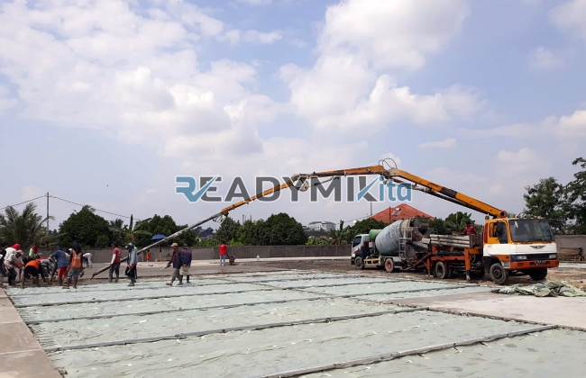

**Jasa Cor Readymix di Wijaya Kusuma Jakarta Murah** - Hai Mitra Readymix Kita! Membangun di Wijaya Kusuma Jakarta? Atau sedang merencanakan proyek konstruksi di area ini? Jangan kompromi soal kualitas! Kami dari Readymix Kita hadir sebagai solusi pengecoran readymix yang andal dan efisien. Yuk, simak bagaimana kami bisa membantu Anda mewujudkan bangunan impian yang kokoh dan tahan lama!



## Mengapa Memilih Beton Readymix untuk Proyek Anda?

Beton Cor Readymix adalah solusi cerdas untuk kebutuhan konstruksi modern. Diproduksi secara presisi di pabrik kami, beton ini dicampur dengan bahan-bahan berkualitas tinggi dan diangkut langsung ke lokasi proyek Anda menggunakan truk mixer khusus. Apa saja yang membuat readymix unggul? Simak keunggulannya:

1. **Hemat Waktu dan Tenaga**

   Lupakan repotnya mencampur beton secara manual di lokasi proyek. Dengan readymix, waktu pengerjaan berkurang drastis karena pencampuran sudah dilakukan di pabrik.

2. **Kualitas Terjamin Konsisten**

   Proses pencampuran yang terkontrol dan menggunakan teknologi modern memastikan mutu beton readymix selalu konsisten, meminimalkan risiko kegagalan struktur.

3. **Skalabilitas Produksi**

   Baik untuk proyek kecil maupun besar, kami mampu menyediakan volume beton readymix yang sesuai dengan kebutuhan Anda, kapanpun Anda membutuhkannya.

4. **Dukungan Ramah Lingkungan**

   Metode produksi terpusat kami mengurangi limbah material di lokasi konstruksi, mendukung praktik pembangunan yang lebih berkelanjutan.

## Keunggulan ReadymixKita di Wijaya Kusuma Jakarta

Di tengah banyaknya pilihan penyedia jasa pengecoran, **ReadymixKita** menawarkan keunggulan yang akan membuat Anda semakin yakin memilih kami untuk proyek di Wijaya Kusuma Jakarta:

1. **Pengalaman Teruji**

   Dengan pengalaman bertahun-tahun di industri konstruksi, kami memahami seluk-beluk proyek di Wijaya Kusuma Jakarta dan memberikan solusi terbaik sesuai kebutuhan Anda.

2. **Pilihan Mutu Beton Lengkap**

   Kami menyediakan berbagai kelas mutu beton, mulai dari K-225 untuk aplikasi umum hingga K-500 untuk konstruksi yang membutuhkan kekuatan tinggi. Pilih yang paling sesuai untuk proyek Anda!

3. **Peralatan Pengecoran Modern**

   Kami dilengkapi dengan peralatan pengecoran mutakhir, termasuk *concrete pump*, untuk memastikan pengecoran berjalan cepat, merata, dan efisien.

4. **Tim Ahli yang Siap Membantu**

   Tim profesional kami siap memberikan pendampingan dari tahap perencanaan hingga eksekusi di lapangan. Kami juga fleksibel dan siap menyesuaikan jadwal dengan kebutuhan proyek Anda.

## Layanan Kami yang Disesuaikan untuk Wijaya Kusuma Jakarta

**ReadymixKita** memahami karakteristik unik wilayah Wijaya Kusuma Jakarta. Kondisi medan yang bervariasi menjadi tantangan tersendiri, namun kami siap menghadapinya! Berikut layanan khusus yang kami tawarkan:

1. **Pengiriman Tepat Waktu**

   Lokasi pabrik kami yang strategis di sekitar Wijaya Kusuma Jakarta memungkinkan kami mengirimkan beton readymix tepat waktu, meminimalkan keterlambatan proyek.

2. **Konsultasi Gratiss oleh Ahli**

   Butuh saran mengenai jenis beton yang tepat atau metode pengecoran terbaik? Manfaatkan layanan konsultasi gratis dari tim ahli kami.

3. **Penawaran Spesial untuk Proyek Lokal**

   Dapatkan harga spesial dan diskon menarik khusus untuk proyek konstruksi di wilayah Wijaya Kusuma Jakarta.

## Harga Beton Readymix Terjangkau di Wijaya Kusuma Jakarta

Kami percaya bahwa kualitas tidak harus mahal. **ReadymixKita** berkomitmen untuk memberikan harga yang kompetitif tanpa mengorbankan mutu. Berikut beberapa poin yang perlu Anda ketahui:

1. **Harga yang Bersaing**

   Kami menawarkan harga beton readymix yang terjangkau di Wijaya Kusuma Jakarta, tanpa biaya tersembunyi.

2. **Promo Menarik**

   Nikmati diskon khusus untuk pemesanan dalam jumlah besar atau proyek jangka panjang.

3. **Jaminan Kepuasan Pelanggan**

   Kami menjamin kualitas beton readymix yang kami kirim. Jika ada kendala, tim kami siap memberikan solusi hingga proyek Anda selesai sempurna.

## Daftar Harga Jasa Cor Readymix di Wijaya Kusuma Jakarta



Jangan tunda lagi! Dapatkan penawaran terbaik untuk proyek konstruksi Anda di Wijaya Kusuma Jakarta. Hubungi kami sekarang dan rasakan kemudahan serta keunggulan menggunakan beton readymix dari ReadymixKita.

Kami juga menyediakan layanan survei lokasi gratis dan konsultasi mendalam untuk memastikan Anda mendapatkan solusi pengecoran yang paling tepat. Dengan ReadymixKita, Anda mendapatkan lebih dari sekadar beton – Anda mendapatkan mitra yang siap mendukung kesuksesan proyek Anda. Percayakan pengecoran Anda kepada ahlinya dan wujudkan bangunan impian Anda bersama kami! Hubungi tim kami untuk informasi lebih lanjut!

Selain itu, bagi Anda yang berencana membangun di area yang berdekatan, jangan ragu untuk menjelajahi artikel kami tentang [Jasa Cor Readymix di Baktijaya Depok Murah](/readymix/jasa-cor-readymix-di-baktijaya-depok-murah/) untuk opsi terbaik di sekitar Anda. [Jasa Cor Readymix di Bale Kambang Jakarta Murah](/readymix/jasa-cor-readymix-di-bale-kambang-jakarta-murah/) juga bisa menjadi referensi bagi proyek konstruksi Anda.