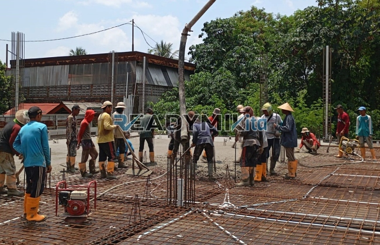

**Layanan Beton Readymix di Bangka Jakarta Murah** - Hai Mitra Readymix Kita! Punya proyek konstruksi di Bangka Jakarta? Kualitas fondasi adalah kunci keberhasilan, dan kami paham betul pentingnya mendapatkan material yang tepat. Nah, di sinilah ReadymixKita hadir untuk Anda. Kami adalah penyedia jasa Pengecoran dg Beton Readymix di Bangka Jakarta yang siap memberikan solusi efisien, andal, dan berkualitas tinggi untuk setiap kebutuhan konstruksi Anda. Yuk, simak lebih lanjut!



## Mengapa Memilih Pengecoran dg Readymix?

Apa sih kelebihan beton readymix dibandingkan cara konvensional? Singkatnya, beton readymix adalah campuran beton yang diproduksi di pabrik dengan kontrol kualitas ketat, menggunakan bahan baku pilihan. Kemudian, beton ini diantar langsung ke lokasi proyek menggunakan truk mixer khusus.  Berikut beberapa keuntungan utama yang bisa Anda dapatkan:

1. **Hemat Waktu dan Tenaga**

   Pengerjaan beton di lokasi memakan banyak waktu dan tenaga kerja. Dengan readymix, proses ini dipersingkat drastis karena pencampuran sudah dilakukan secara profesional di pabrik!

2. **Kualitas Terjamin Konsisten**

   Proses produksi yang presisi dan terkontrol memastikan kualitas beton yang konsisten, mengurangi risiko kegagalan struktur akibat kesalahan campuran.

3. **Kapasitas Fleksibel untuk Semua Skala**

   Dari proyek kecil hingga konstruksi berskala besar, beton readymix siap memenuhi kebutuhan Anda dengan volume yang tepat.

4. **Komitmen pada Lingkungan**

   Proses produksi yang terkendali juga berarti pengurangan limbah material di lokasi proyek, mendukung praktik konstruksi yang lebih berkelanjutan.

## Apa yang Membedakan ReadymixKita di Bangka Jakarta?

Di tengah banyaknya penyedia jasa, **ReadymixKita** hadir sebagai solusi pengecoran terbaik di Bangka Jakarta. Apa saja keunggulan kami?

1. **Pengalaman dan Keandalan**

   Kami berpengalaman dalam menangani berbagai proyek konstruksi di Bangka Jakarta—dari pembangunan rumah hingga infrastruktur komersial—membuat kami paham betul dengan kebutuhan unik di wilayah ini.

2. **Pilihan Mutu Beton Lengkap**

   Kami menawarkan beragam kelas mutu beton, mulai dari K-225 untuk proyek standar hingga K-500 untuk konstruksi berat. Pilihan ini memungkinkan Anda memilih yang paling sesuai dengan spesifikasi proyek Anda.

3. **Didukung Peralatan Modern**

   Kami memanfaatkan teknologi pengecoran terkini, termasuk *concrete pump*, untuk memastikan proses pengecoran berlangsung cepat, merata, dan efisien.

4. **Tim Ahli yang Siap Membantu**

   Tim profesional kami siap memberikan konsultasi dan panduan sepanjang proyek, memastikan semua berjalan lancar sesuai rencana.

## Layanan Kami yang Disesuaikan untuk Bangka Jakarta

Sebagai penyedia lokal, kami mengerti betul tantangan konstruksi di Bangka Jakarta. Baik di area perkotaan padat atau daerah perbukitan, **ReadymixKita** siap melayani:

1. **Pengiriman Tepat Waktu**

   Lokasi pabrik strategis di Bangka Jakarta dan sekitarnya memungkinkan kami menjamin pengiriman beton yang tepat waktu, meminimalkan keterlambatan proyek.

2. **Konsultasi Gratis**

   Tim kami siap memberikan konsultasi gratis untuk membantu Anda memilih jenis beton dan metode pengecoran terbaik untuk proyek Anda.

3. **Penawaran Eksklusif untuk Pelanggan Lokal**

   Dapatkan penawaran khusus dan diskon menarik untuk proyek-proyek di wilayah Bangka Jakarta.

## Harga Terjangkau dan Promo Menarik di Bangka Jakarta

Kami percaya bahwa kualitas tidak harus mahal. **ReadymixKita** berkomitmen untuk menyediakan:

1. **Harga Kompetitif**

   Kami menawarkan harga yang bersaing tanpa mengorbankan kualitas beton dan layanan kami.  Informasi harga, termasuk biaya pengiriman, tersedia secara transparan.

2. **Promo dan Diskon**

   Manfaatkan promo menarik untuk pemesanan volume besar atau proyek jangka panjang.

3. **Kepuasan Pelanggan Terjamin**

   Kami selalu berusaha memberikan layanan terbaik dan siap membantu jika ada kendala dalam proses pengecoran.

## Daftar Harga Jasa Beton Readymix di Bangka Jakarta



Jangan biarkan kualitas beton menjadi batu sandungan dalam proyek impian Anda. Hubungi kami sekarang untuk mendapatkan solusi pengecoran terbaik di Bangka Jakarta!

Kami siap membantu Anda dengan survei lokasi gratis dan konsultasi mendalam untuk memastikan semua kebutuhan konstruksi Anda terpenuhi. [Alih-alih menunggu lebih lama](URL_FORM_KONTAK), segera pesan beton readymix berkualitas dari ReadymixKita dan rasakan perbedaan konstruksi yang solid, tahan lama, dan memuaskan.

ReadymixKita berkomitmen menjadi mitra terpercaya Anda dalam membangun masa depan yang kokoh. Dengan pengalaman, kualitas, dan pelayanan profesional, kami siap mewujudkan proyek Anda di Bangka Jakarta. Segera hubungi kami untuk konsultasi dan penawaran terbaik! Bangun impian dengan pondasi yang kuat bersama ReadymixKita. [Baca juga artikel kami tentang persiapan lahan sebelum pengecoran](URL_ARTIKEL_PERSAPAN_LAHAN) untuk tips tambahan.