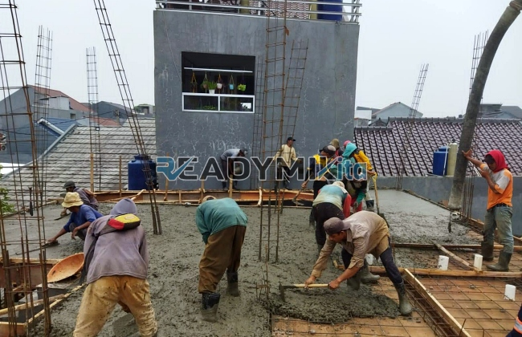

**Layanan Beton Readymix di Baranangsiang Bogor Murah** - Hai Mitra Readymix Kita! Proyek konstruksi sedang berjalan? Kualitas material adalah kunci keberhasilan, lho. Kami dari ReadymixKita, penyedia beton cor readymix terpercaya di Baranangsiang Bogor, hadir untuk mendukung kelancaran proyek Anda. Dengan layanan pengecoran beton readymix yang efisien dan berkualitas, kami siap menjadi solusi terbaik untuk setiap kebutuhan konstruksi Anda di Baranangsiang Bogor dan sekitarnya. Gimana, yuk kita bahas lebih lanjut?



## Mengapa Beton Readymix Penting untuk Proyek Anda?

Beton readymix, atau beton siap pakai, adalah hasil campuran beton yang diproduksi secara presisi di pabrik kami. Bahan baku berkualitas tinggi dipadukan dengan teknologi modern, kemudian diantarkan langsung ke lokasi proyek Anda menggunakan truk mixer. Apa saja keunggulan menggunakan beton readymix dibandingkan cara tradisional? Simak daftarnya berikut ini:

1. **Hemat Waktu dan Tenaga**

   Proses pencampuran beton di lokasi proyek seringkali memakan waktu dan melibatkan banyak tenaga kerja. Dengan readymix, waktu pengerjaan dipangkas drastis karena pencampuran sudah dilakukan di pabrik.

2. **Kualitas yang Konsisten dan Terjamin**

   Pencampuran beton readymix menggunakan takaran yang akurat dan peralatan canggih. Alhasil, beton yang dihasilkan memiliki kualitas yang konsisten, meminimalkan risiko kegagalan struktur akibat kesalahan takaran.

3. **Kapasitas Produksi Fleksibel**

   Kami siap melayani kebutuhan volume beton mulai dari proyek kecil hingga skala besar. Dengan kemampuan produksi yang besar, kami dapat memenuhi permintaan Anda dengan cepat dan efisien.

4. **Pilihan yang Lebih Ramah Lingkungan**

   Proses produksi beton readymix yang terkontrol membantu mengurangi limbah material konstruksi, berkontribusi pada praktik pembangunan yang lebih berkelanjutan.

## Apa yang Membuat ReadymixKita Unggul di Baranangsiang Bogor?

Di antara banyaknya pilihan penyedia beton readymix di Baranangsiang Bogor, **ReadymixKita** menawarkan keunggulan yang membedakan kami:

1. **Pengalaman dan Kepercayaan Pelanggan**

   Bertahun-tahun berkecimpung di industri konstruksi menjadikan kami ahli dalam memahami kebutuhan beragam proyek. Baik perumahan, gedung komersial, atau infrastruktur, kami siap memberikan solusi terbaik.

2. **Pilihan Mutu Beton Lengkap**

   Kami menyediakan berbagai kelas mutu beton, mulai dari K-225 untuk aplikasi standar hingga K-500 untuk proyek konstruksi berat. Pilihan ini memungkinkan Anda menyesuaikan jenis beton dengan kebutuhan spesifik proyek Anda.

3. **Didukung Peralatan Canggih**

   Kami menggunakan peralatan modern, termasuk pompa beton (concrete pump) yang memastikan proses pengecoran berlangsung cepat, merata, dan efisien.

4. **Tim Profesional yang Siap Membantu**

   Tim kami terdiri dari tenaga ahli yang siap memberikan panduan mulai dari tahap perencanaan hingga pelaksanaan di lapangan. Kami menyesuaikan layanan dengan jadwal proyek Anda.

## Layanan Kami yang Disesuaikan untuk Kondisi Baranangsiang Bogor

Sebagai penyedia lokal, kami memahami betul karakteristik konstruksi di Baranangsiang Bogor. Area ini memiliki beragam kondisi geografis, dari dataran hingga perbukitan. **ReadymixKita** menyediakan layanan yang dirancang khusus untuk menghadapi tantangan tersebut:

1. **Pengiriman Tepat Waktu**

   Lokasi pabrik kami relatif dekat dengan Baranangsiang Bogor dan sekitarnya, memungkinkan kami memastikan pengiriman beton tepat waktu.

2. **Konsultasi Ahli untuk Proyek Anda**

   Kami menawarkan konsultasi gratis untuk membantu Anda memilih jenis beton dan metode pengecoran yang paling sesuai dengan kebutuhan proyek Anda.

3. **Penawaran Spesial untuk Proyek Lokal**

   Klien di Baranangsiang Bogor berhak mendapatkan penawaran menarik dan diskon khusus untuk proyek-proyek besar.

## Harga Beton Readymix di Baranangsiang Bogor yang Bersaing

Kami memahami bahwa anggaran adalah salah satu pertimbangan penting dalam proyek konstruksi. Karena itu, **ReadymixKita** berkomitmen untuk memberikan:

1. **Harga yang Kompetitif**

   Kami menawarkan harga yang terjangkau tanpa mengorbankan kualitas, dengan rincian biaya pengiriman dan penggunaan pompa beton yang transparan.

2. **Promo dan Diskon Menarik**

   Nikmati diskon khusus untuk pemesanan dalam jumlah besar atau proyek konstruksi jangka panjang.

3. **Jaminan Kepuasan Pelanggan**

   Kepuasan Anda adalah prioritas kami. Jika ada kendala selama proses pengecoran, tim kami siap membantu Anda hingga proyek selesai dengan sempurna.

## Informasi Harga Jasa Beton Readymix di Baranangsiang Bogor



Jangan biarkan kualitas bangunan Anda terancam karena material yang tidak tepat. Hubungi kami sekarang untuk mendapatkan solusi pengecoran terbaik di Baranangsiang Bogor!

Kami juga menyediakan layanan survei lokasi gratis dan konsultasi untuk memastikan kebutuhan Anda terpenuhi secara optimal. Segera pesan dan rasakan manfaat konstruksi yang kuat, tahan lama, dan memuaskan.

Pilihlah jasa Pengecoran dengan Beton Readymix dari ReadymixKita, dan dapatkan kombinasi efisien, kualitas terjamin, serta pelayanan profesional di Baranangsiang Bogor. Bersama ReadymixKita, raih hasil konstruksi yang kokoh dan awet! [Layanan Beton Readymix di Babakan Pasar Bogor Murah](/readymix/layanan-beton-readymix-di-babakan-pasar-bogor-murah/) — perbandingan solusi beton readymix di sekitar Baranangsiang Bogor bisa jadi pertimbangan penting untuk Anda.