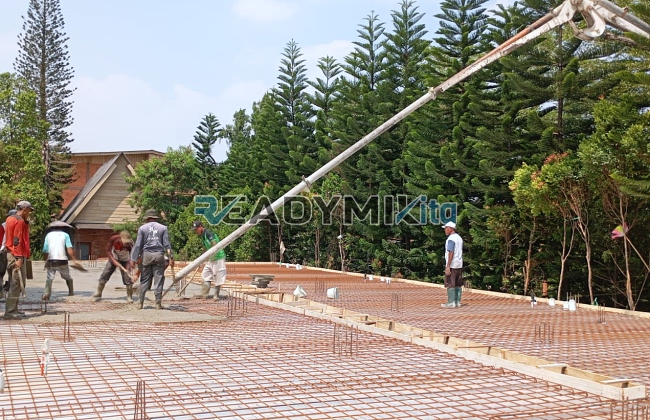

**Layanan Beton Readymix di Bintaro Jakarta Murah** - Hai Mitra Readymix Kita! Tahukah Anda, konstruksi yang sukses dimulai dari material yang tepat? Di Bintaro Jakarta yang dinamis ini, efisiensi dan kualitas adalah kunci. Nah, dengan layanan Pengecoran dg Beton Readymix dari kami, Anda mendapatkan keduanya – efisiensi pengerjaan dan mutu beton yang terjamin. Proyek Anda, lebih cepat selesai, lebih kokoh hasilnya.



## Mengapa Memilih Beton Readymix untuk Proyek Anda?

Beton readymix, atau beton siap pakai, adalah solusi cerdas dalam konstruksi modern. Dibuat secara presisi di pabrik, menggunakan bahan baku pilihan, lalu diangkut langsung ke lokasi proyek menggunakan truk mixer. Mengapa memilihnya? Yuk, simak keunggulannya:

1. **Hemat Waktu dan Biaya Tenaga Kerja**

   Proses pencampuran di lokasi proyek kerap memakan waktu dan memerlukan tenaga kerja yang signifikan. Dengan beton readymix, Anda langsung mendapatkan material siap pakai, sehingga lebih fokus pada tahap konstruksi inti.

2. **Kualitas Terjamin dan Konsisten**

   Beton readymix diproduksi dengan takaran yang akurat dan melalui kontrol kualitas yang ketat. Ini menjamin konsistensi kekuatan dan daya tahan beton, meminimalkan risiko kesalahan konstruksi.

3. **Fleksibilitas Volume Produksi**

   Kebutuhan beton bervariasi tergantung skala proyek. Beton readymix dapat dipesan dalam volume yang sesuai kebutuhan, mulai dari proyek kecil hingga konstruksi berskala besar.

4. **Dukungan Keberlanjutan Lingkungan**

   Proses produksi beton readymix yang lebih terkontrol membantu mengurangi limbah material dan penggunaan sumber daya, berkontribusi pada praktik pembangunan berkelanjutan.

## Apa yang Membuat ReadymixKita Unggul di Bintaro Jakarta?

Di antara banyaknya penyedia jasa pengecoran di Bintaro Jakarta, **ReadymixKita** hadir dengan keunggulan yang membedakan kami:

1. **Pengalaman dan Kepercayaan Pelanggan**

   Dengan pengalaman bertahun-tahun di industri konstruksi, kami telah menjadi mitra terpercaya bagi berbagai proyek, mulai dari perumahan hingga infrastruktur skala besar.

2. **Pilihan Mutu Beton yang Lengkap**

   Kami menyediakan beragam mutu beton, termasuk K-225, K-300, K-350, hingga K-500. Ini memungkinkan Anda memilih beton yang sesuai dengan kebutuhan kekuatan dan daya tahan proyek Anda.

3. **Didukung Peralatan Pengecoran Modern**

   Kami menggunakan peralatan pengecoran mutakhir, termasuk concrete pump yang memastikan pengecoran cepat, merata, dan efisien, bahkan di area yang sulit dijangkau.

4. **Tim Ahli yang Siap Membantu**

   Tim profesional kami siap memberikan panduan teknis, membantu perencanaan, dan memastikan proses pengecoran berjalan lancar sesuai jadwal proyek Anda.

## Layanan Kami di Bintaro Jakarta: Menyesuaikan dengan Kebutuhan Lokal

Sebagai penyedia jasa lokal di Bintaro Jakarta, kami memahami betul tantangan konstruksi di wilayah ini. Mulai dari kepadatan lalu lintas hingga variasi kondisi tanah, kami siap memberikan solusi yang tepat:

1. **Pengiriman Tepat Waktu**

   Kami menjamin pengiriman beton tepat waktu, berkat jaringan logistik yang efisien dan lokasi pabrik yang strategis di Bintaro Jakarta dan area sekitarnya.

2. **Konsultasi Bebas Biaya**

   Kami menawarkan layanan konsultasi gratis untuk membantu Anda memilih jenis beton dan metode pengecoran yang paling sesuai dengan karakteristik proyek Anda.

3. **Penawaran Khusus untuk Pelanggan Setia**

   Pelanggan di Bintaro Jakarta berhak mendapatkan penawaran khusus dan diskon menarik, terutama untuk proyek-proyek berulang atau volume besar.

## Harga Bersaing dan Penawaran Spesial di Bintaro Jakarta

Kami memahami bahwa efisiensi anggaran adalah prioritas utama dalam setiap proyek konstruksi. Karena itu, **ReadymixKita** berkomitmen menghadirkan:

1. **Harga yang Kompetitif**

   Kami menawarkan harga yang bersaing tanpa mengorbankan kualitas beton dan layanan. Informasi detail mengenai biaya pengiriman dan penggunaan concrete pump dapat Anda dapatkan secara transparan.

2. **Promosi Menarik**

   Dapatkan diskon khusus untuk pemesanan dalam jumlah besar atau proyek dengan jangka waktu yang panjang.

3. **Jaminan Kepuasan Pelanggan**

   Kami memberikan jaminan kepuasan penuh. Jika ada masalah selama proses pengecoran, tim kami akan segera turun tangan untuk memastikan proyek Anda selesai dengan sempurna.

## Informasi Harga Jasa Beton Readymix di Bintaro Jakarta



Jangan biarkan proyek Anda terhambat karena material yang tidak berkualitas! Hubungi kami sekarang untuk mendapatkan solusi pengecoran terbaik di Bintaro Jakarta. Kami akan bantu Anda mewujudkan bangunan impian dengan pondasi yang kuat dan tahan lama.

Kami juga menyediakan layanan survei lokasi untuk membantu Anda menentukan kebutuhan material yang tepat. Pesan beton readymix sekarang dan rasakan sendiri keunggulan jasa Pengecoran dg Beton Readymix di Bintaro Jakarta dari ReadymixKita. Bangun masa depan yang kokoh bersama kami! [Layanan Beton Readymix di Bali Mester Jakarta Murah](/readymix/layanan-beton-readymix-di-bali-mester-jakarta-murah/) bisa menjadi pertimbangan jika Anda juga punya proyek di sana.