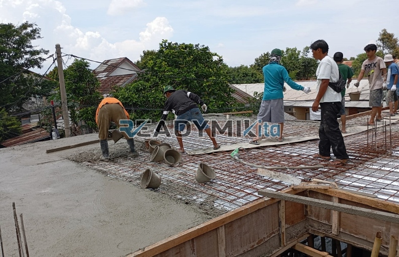

**Layanan Beton Readymix di Bojongkerta Bogor Murah** - Hai Mitra Readymix Kita! Ada rencana membangun di Bojongkerta Bogor? Proyek makin ramai, kebutuhan beton berkualitas juga meningkat. Memastikan fondasi kuat sejak awal itu krusial, lho. Yuk, simak bagaimana Readymix Kita bisa jadi solusi terbaik untuk proyek Anda!



## Mengapa Memilih Beton Readymix untuk Proyek Anda?

Beton readymix itu apa sih? Sederhananya, beton readymix adalah campuran beton yang sudah siap pakai. Dibuat dengan presisi di pabrik, menggunakan bahan baku pilihan yang terjamin kualitasnya. Kemudian, diangkut langsung ke lokasi proyek Anda menggunakan truk molen khusus. Apa saja kelebihannya dibandingkan cara tradisional?

1. **Hemat Waktu & Biaya**

   Pencampuran beton di lokasi proyek memakan waktu dan tenaga. Dengan readymix, prosesnya jauh lebih cepat karena beton sudah siap cor saat tiba di lokasi. Ini berarti efisiensi biaya operasional juga meningkat!

2. **Kualitas Terjamin Konsisten**

   Di pabrik, takaran bahan baku diawasi ketat menggunakan teknologi modern. Ini memastikan kualitas beton readymix selalu konsisten, meminimalkan risiko kesalahan dan kegagalan struktur. 

3. **Kapasitas Sesuai Kebutuhan**

   Mau proyek kecil atau besar? Beton readymix bisa mengakomodasi volume kebutuhan apa pun, karena produksi bisa disesuaikan dengan pesanan.

4. **Lebih Ramah Lingkungan**

   Proses produksi yang lebih terkontrol di pabrik mengurangi potensi limbah material di lokasi proyek, mendukung konstruksi berkelanjutan.

## Apa yang ReadymixKita Tawarkan di Bojongkerta Bogor?

Di antara banyaknya penyedia beton cor, **ReadymixKita** punya sejumlah keunggulan yang menjadikannya pilihan tepat di Bojongkerta Bogor:

1. **Pengalaman dan Kepercayaan Pelanggan**

   Kami punya pengalaman bertahun-tahun di industri konstruksi, memahami betul tantangan dan kebutuhan proyek-proyek di Bojongkerta Bogor. Kepercayaan pelanggan adalah prioritas utama kami.

2. **Pilihan Mutu Beton Lengkap**

   Kami menyediakan beragam kelas mutu beton, mulai dari K-225 (untuk aplikasi standar) hingga K-500 (untuk konstruksi yang membutuhkan kekuatan ekstra). Semua sesuai standar SNI, dan bisa dipilih sesuai kebutuhan spesifik proyek Anda.

3. **Didukung Peralatan Canggih**

   Kami dilengkapi dengan pompa beton (concrete pump) modern yang mempercepat dan meratakan proses pengecoran. Alat ini sangat membantu, terutama untuk proyek di lokasi yang sulit dijangkau.

4. **Tim Ahli Siap Membantu**

   Tim kami terdiri dari tenaga profesional yang siap memberikan konsultasi dan bantuan di setiap tahap proyek, mulai dari perencanaan hingga pelaksanaan. Kami fleksibel dan bisa menyesuaikan layanan dengan jadwal Anda.

## Layanan Lokal Khusus untuk Bojongkerta Bogor

Sebagai penyedia jasa lokal, **ReadymixKita** memahami betul karakteristik Bojongkerta Bogor. Medan yang beragam, mulai dari dataran hingga perbukitan, membutuhkan penanganan khusus. Kami menawarkan:

1. **Pengiriman Tepat Waktu**

   Lokasi pabrik kami yang strategis di Bojongkerta Bogor memungkinkan kami menjamin pengiriman beton tepat waktu, sesuai jadwal proyek Anda.

2. **Konsultasi Gratis**

   Bingung memilih jenis beton yang tepat? Tim ahli kami siap memberikan konsultasi gratis untuk membantu Anda menentukan pilihan terbaik untuk proyek Anda.

3. **Penawaran Spesial Lokal**

   Khusus untuk pelanggan di wilayah Bojongkerta Bogor, kami memberikan penawaran harga yang menarik dan diskon untuk proyek-proyek skala besar.

## Harga Terjangkau dan Promo Menarik di Bojongkerta Bogor

Kami memahami bahwa anggaran adalah pertimbangan penting dalam setiap proyek. **ReadymixKita** berkomitmen untuk memberikan:

1. **Harga Kompetitif**

   Kami menawarkan harga yang bersaing tanpa mengorbankan kualitas beton readymix yang kami produksi. Kami juga transparan dalam memberikan informasi harga, termasuk biaya pengiriman dan penggunaan pompa beton.

2. **Promo dan Diskon**

   Nikmati diskon menarik untuk pemesanan dalam jumlah besar atau proyek yang berjalan dalam jangka waktu lama. Cek promo terbaru kami!

3. **Kepuasan Pelanggan Terjamin**

   Kami memberikan garansi kepuasan pelanggan. Jika ada kendala selama proses pengecoran, tim kami akan segera memberikan solusi terbaik.

## Daftar Harga Jasa Beton Readymix di Bojongkerta Bogor



Jangan biarkan kualitas beton menjadi kendala dalam proyek Anda. Segera hubungi kami untuk solusi pengecoran terbaik di Bojongkerta Bogor! 

Kami juga menyediakan layanan survei lokasi dan konsultasi gratis untuk memastikan semua kebutuhan Anda terpenuhi. Pesan beton readymix sekarang dan rasakan sendiri kualitas konstruksi yang kokoh dan tahan lama. 

ReadymixKita hadir untuk memberikan layanan unggulan bagi semua mitra. Dengan keahlian, kualitas terjamin, dan layanan profesional, kami yakin bisa menjadi partner yang tepat dalam mewujudkan proyek impian Anda. Hubungi kami sekarang juga dan buktikan sendiri kualitas beton readymix terbaik di Bojongkerta Bogor! Bersama ReadymixKita, bangun masa depan dengan fondasi yang kuat! [Layanan Beton Readymix di Babakan Pasar Bogor Murah](/readymix/layanan-beton-readymix-di-babakan-pasar-bogor-murah/) bisa jadi referensi tambahan untuk Anda.