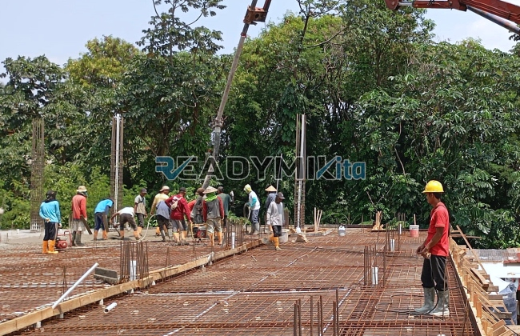

**Layanan Beton Readymix di Cibadak Bogor Murah** - Hai Mitra Readymix Kita! Membangun di Cibadak Bogor? Pondasi yang kokoh adalah kunci utama. Kami dari Readymix Kita hadir sebagai solusi tepat untuk kebutuhan beton cor readymix Anda. Jangan berkompromi soal kualitas – pilih beton yang terjamin kuat dan tahan lama untuk proyek impian Anda.



## Mengapa Memilih Pengecoran dengan Readymix?

Apa sih keunggulan beton readymix dibandingkan cara tradisional? Sederhana saja: Beton readymix adalah campuran beton yang diproduksi secara presisi di pabrik modern dengan bahan baku pilihan. Lalu, langsung diantar ke lokasi proyek Anda menggunakan truk mixer khusus. Ini beberapa alasan mengapa Anda harus mempertimbangkan beton readymix:

1. **Hemat Waktu & Tenaga**

   Proses pencampuran di lokasi proyek seringkali memakan waktu dan tenaga ekstra. Dengan readymix, Anda bisa langsung fokus pada tahap konstruksi lainnya karena beton sudah siap pakai saat tiba di lokasi.

2. **Jaminan Kualitas Konsisten**

   Pencampuran yang terkontrol di pabrik memastikan setiap batch beton memiliki kualitas yang seragam. Ini meminimalkan risiko kesalahan takaran yang bisa mengancam kekuatan struktur bangunan Anda.

3. **Skalabilitas Produksi**

   Butuh beton dalam jumlah besar untuk proyek besar? Atau hanya sedikit untuk renovasi kecil? Beton readymix sangat fleksibel dan bisa menyesuaikan dengan volume yang Anda butuhkan.

4. **Dukung Pembangunan Berkelanjutan**

   Proses produksi beton readymix yang terkelola dengan baik cenderung menghasilkan lebih sedikit limbah dibandingkan metode konvensional, berkontribusi pada praktik konstruksi yang lebih ramah lingkungan.

## Mengapa ReadymixKita Pilihan Tepat di Cibadak Bogor?

Di antara banyaknya penyedia jasa, kenapa harus memilih **ReadymixKita** untuk kebutuhan beton Anda di Cibadak Bogor? Ini dia alasannya:

1. **Pengalaman & Kepercayaan**

   Kami sudah lama berkecimpung di dunia konstruksi, memahami betul seluk-beluk dan tantangan proyek di berbagai skala. Pengalaman ini menjadikan kami mitra yang andal.

2. **Pilihan Mutu Beton Lengkap**

   Kami menyediakan berbagai kelas mutu beton, mulai dari K-225 untuk proyek ringan hingga K-500 untuk bangunan yang memerlukan kekuatan ekstra. Pasti ada yang sesuai dengan spesifikasi proyek Anda.

3. **Teknologi Mutakhir**

   Kami menggunakan peralatan modern, termasuk *concrete pump*, untuk memastikan pengecoran berjalan cepat, efisien, dan merata.

4. **Tim Ahli yang Siap Membantu**

   Tim kami terdiri dari para profesional yang siap memberikan dukungan penuh, mulai dari perencanaan hingga pelaksanaan di lapangan. Kami juga fleksibel dalam menyesuaikan jadwal dengan proyek Anda.

## Solusi Pengecoran Tepat Sasaran untuk Cibadak Bogor

Sebagai bagian dari masyarakat Cibadak Bogor, kami memahami betul karakteristik wilayah ini. Mulai dari kepadatan penduduk hingga kondisi geografis yang beragam, kami siap memberikan solusi yang tepat:

1. **Pengiriman Tepat Waktu**

   Lokasi pabrik kami yang strategis di Cibadak Bogor memungkinkan kami memastikan pengiriman beton tepat waktu, meminimalkan potensi keterlambatan proyek Anda.

2. **Konsultasi Gratis**

   Bingung memilih jenis beton yang tepat? Tim kami siap memberikan konsultasi gratis untuk membantu Anda menentukan solusi terbaik sesuai kebutuhan proyek.

3. **Penawaran Spesial untuk Proyek Lokal**

   Khusus untuk pelanggan di wilayah Cibadak Bogor, kami menawarkan tarif khusus dan diskon menarik untuk proyek-proyek lokal.

## Harga Terjangkau & Promo Menarik di Cibadak Bogor

Kami percaya bahwa kualitas tidak harus mahal. **ReadymixKita** berkomitmen untuk memberikan:

1. **Harga Bersaing**

   Kami menawarkan harga yang kompetitif tanpa mengorbankan kualitas. Kami juga transparan dalam memberikan rincian biaya, termasuk biaya pengiriman dan penggunaan pompa beton.

2. **Promo Eksklusif**

   Dapatkan diskon menarik untuk pemesanan dalam jumlah besar atau untuk proyek yang berjalan dalam jangka waktu tertentu.

3. **Kepuasan Anda Prioritas Kami**

   Kami memberikan garansi kepuasan. Jika ada kendala selama proses pengecoran, tim kami akan segera memberikan solusi hingga proyek Anda selesai dengan sempurna.

## Informasi Harga Jasa Beton Readymix di Cibadak Bogor



Jangan biarkan proyek Anda tertunda karena kualitas material yang kurang memadai. Segera hubungi kami untuk mendapatkan penawaran terbaik dan solusi pengecoran yang sempurna di Cibadak Bogor!

Kami siap membantu Anda dengan survei lokasi dan konsultasi gratis untuk memastikan semua kebutuhan Anda tercukupi. Pesan beton readymix sekarang dan nikmati kualitas bangunan yang solid, awet, dan memuaskan.

Di ReadymixKita, kepuasan pelanggan adalah prioritas utama kami. Dengan pengalaman, kualitas, dan layanan profesional, kami adalah mitra yang tepat untuk mewujudkan proyek Anda di Cibadak Bogor. Hubungi kami sekarang dan rasakan sendiri keunggulan layanan beton readymix dari ReadymixKita. Bersama, kita bangun masa depan yang lebih kokoh! [Layanan Beton Readymix di Babakan Pasar Bogor Murah](/readymix/layanan-beton-readymix-di-babakan-pasar-bogor-murah/) untuk informasi lebih lanjut mengenai layanan kami di area Bogor.