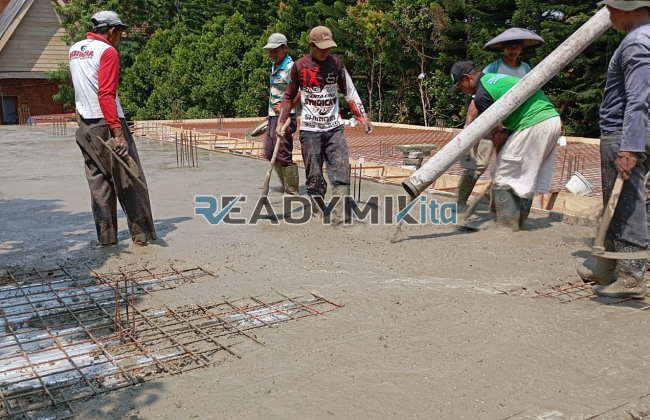

**Layanan Beton Readymix di Cinere Depok Murah** - Hai Mitra Readymix Kita! Proyek konstruksi di Cinere Depok sedang berkembang pesat? Nah, kami dari Readymix Kita siap menjadi solusi andalan Anda. Kami menyediakan layanan pengecoran beton readymix berkualitas tinggi, dirancang khusus untuk mendukung setiap tahapan pembangunan di wilayah Cinere Depok dan sekitarnya. Dengan pengalaman bertahun-tahun, kami memahami betul seluk-beluk konstruksi lokal dan siap menghadirkan hasil yang optimal untuk proyek Anda.



## Mengapa Beton Readymix adalah Pilihan Tepat?

Mungkin Anda bertanya-tanya, apa sih keunggulan menggunakan beton readymix dibandingkan cara tradisional? Secara sederhana, beton readymix adalah campuran beton siap pakai yang diproduksi di pabrik modern dengan kontrol kualitas ketat. Kemudian, beton ini diangkut langsung ke lokasi proyek Anda dengan truk mixer khusus. Berikut beberapa manfaat utama yang bisa Anda rasakan:

1. **Hemat Waktu dan Tenaga:** Proses pencampuran di lokasi proyek seringkali memakan waktu dan membutuhkan banyak tenaga kerja. Dengan readymix, waktu pengerjaan proyek Anda akan jauh lebih efisien.
2. **Kualitas Terjamin:** Formulasi yang presisi dan pengujian kualitas yang ketat memastikan beton readymix yang Anda terima selalu konsisten dan memenuhi standar tertinggi. Ini meminimalkan risiko kegagalan konstruksi.
3. **Skalabilitas Produksi:** Apakah Anda membutuhkan volume beton kecil untuk renovasi rumah atau volume besar untuk proyek komersial? Kami mampu mengakomodasi semua kebutuhan Anda dengan fleksibel.
4. **Lebih Ramah Lingkungan:** Proses produksi yang terkontrol di pabrik mengurangi limbah material di lokasi proyek, berkontribusi pada praktik konstruksi yang lebih berkelanjutan.

## Keunggulan ReadymixKita di Cinere Depok

Di antara banyaknya penyedia layanan pengecoran, **ReadymixKita** menawarkan nilai tambah yang signifikan bagi mitra kami di Cinere Depok:

1. **Pengalaman dan Keahlian:** Kami memiliki pengalaman yang luas dalam menangani berbagai jenis proyek konstruksi, mulai dari perumahan hingga bangunan komersial dan infrastruktur.
2. **Pilihan Mutu Beton yang Lengkap:** Kami menyediakan berbagai kelas mutu beton, termasuk K-225, K-300, K-350 dan K-500, disesuaikan dengan kebutuhan dan spesifikasi proyek Anda. Kami bantu Anda memilih yang paling tepat!
3. **Peralatan Modern dan Terawat:** Kami berinvestasi dalam peralatan pengecoran modern, termasuk concrete pump, untuk memastikan hasil pengecoran yang cepat, merata, dan berkualitas tinggi.
4. **Tim Profesional yang Siap Membantu:** Tim kami terdiri dari ahli beton berpengalaman yang siap memberikan konsultasi, panduan, dan dukungan teknis selama proyek Anda berlangsung.

## Layanan Kami yang Dirancang Khusus untuk Cinere Depok

Sebagai penyedia lokal, kami memahami betul tantangan konstruksi di Cinere Depok. Kondisi geografis yang bervariasi, mulai dari area perkotaan padat hingga kawasan perbukitan, membutuhkan solusi yang disesuaikan. Kami siap membantu:

1. **Pengiriman Tepat Waktu:** Kami punya jaringan logistik yang kuat untuk memastikan beton readymix Anda tiba di lokasi proyek tepat waktu, sesuai jadwal yang disepakati.
2. **Konsultasi Bebas Biaya:** Kami menawarkan layanan konsultasi gratis untuk membantu Anda menentukan jenis beton dan metode pengecoran yang paling sesuai dengan kebutuhan proyek Anda.
3. **Penawaran Spesial untuk Proyek Lokal:** Mitra di Cinere Depok berhak menikmati penawaran khusus dan diskon menarik untuk proyek-proyek dengan volume besar. Yuk, manfaatkan kesempatan ini!

## Harga Terjangkau dan Penawaran Istimewa di Cinere Depok

Kami percaya bahwa kualitas tidak harus mahal. **ReadymixKita** berkomitmen untuk memberikan solusi pengecoran beton readymix dengan harga yang kompetitif dan terjangkau di Cinere Depok:

1. **Harga Transparan dan Bersaing:** Kami memberikan rincian harga yang jelas dan terbuka, termasuk biaya pengiriman dan biaya tambahan lainnya.
2. **Diskon dan Promo Menarik:** Manfaatkan promo khusus untuk pemesanan volume besar atau proyek jangka panjang!
3. **Kepuasan Pelanggan Terjamin:** Kami selalu berusaha memberikan layanan terbaik dan memastikan Anda puas dengan hasil pengecoran beton readymix kami.

## Daftar Harga Jasa Beton Readymix di Cinere Depok



Jangan tunda lagi! Dapatkan solusi pengecoran terbaik untuk proyek Anda di Cinere Depok sekarang juga. Kami menawarkan layanan survei lokasi gratis dan konsultasi tanpa biaya. Pesan beton readymix Anda hari ini dan nikmati hasil konstruksi yang solid, tahan lama, dan memuaskan. 

Di ReadymixKita, kami berkomitmen untuk menjadi mitra terpercaya Anda dalam mewujudkan proyek impian. Dengan pengalaman, mutu, dan pelayanan yang terbaik, kami yakin bisa memberikan solusi yang tepat untuk kebutuhan Anda. Hubungi kami segera dan rasakan sendiri keunggulan layanan Pengecoran dg Beton Readymix di Cinere Depok dari ReadymixKita. Bangun masa depan bersama kami! [Layanan Beton Readymix di Babakan Pasar Bogor Murah](/readymix/layanan-beton-readymix-di-babakan-pasar-bogor-murah/) — Pelajari juga layanan kami di Bogor!